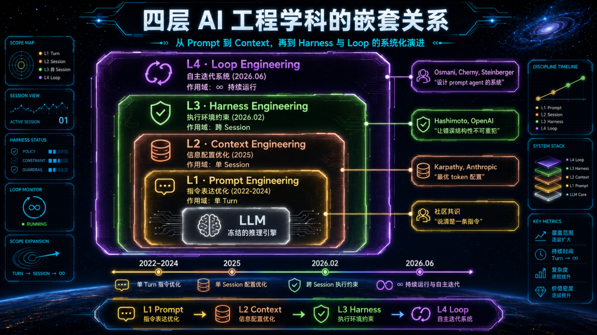
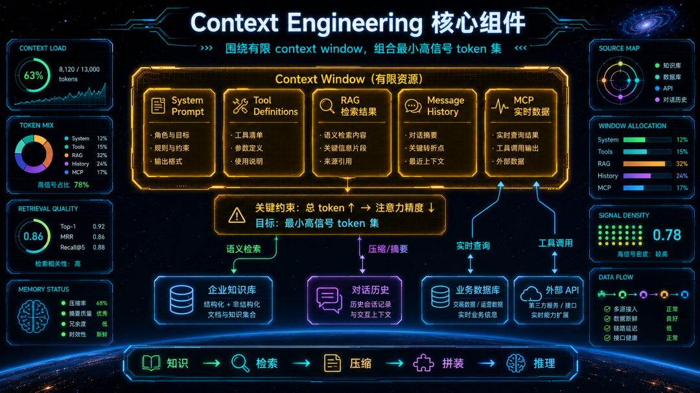
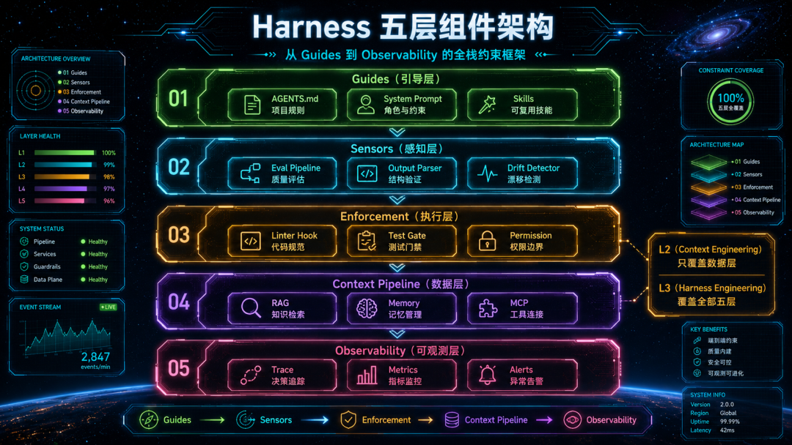
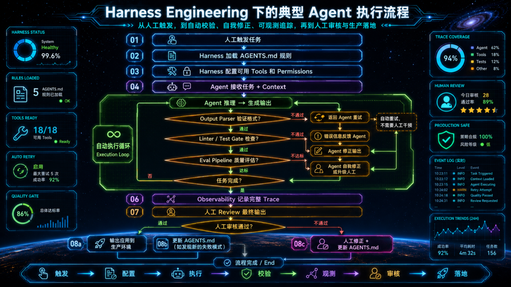
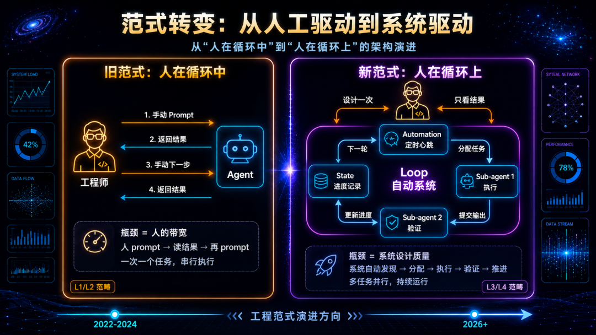
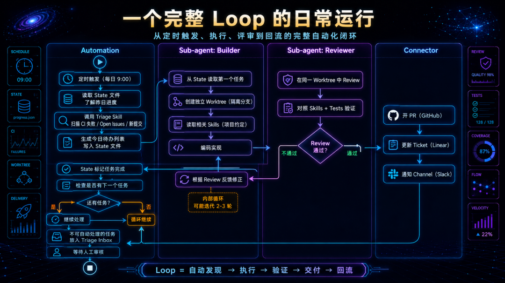
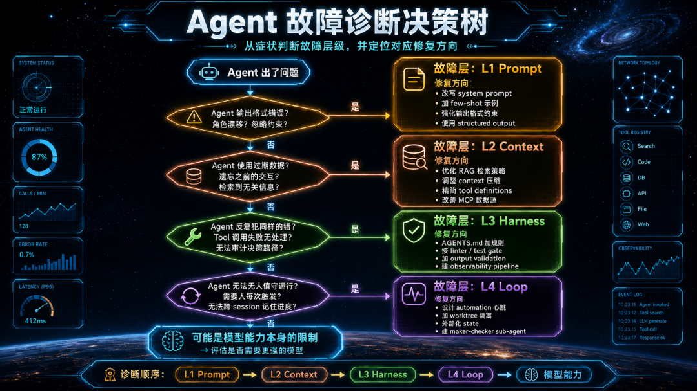
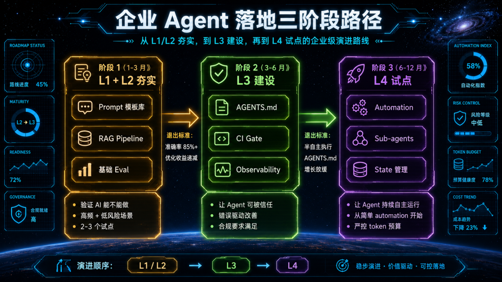
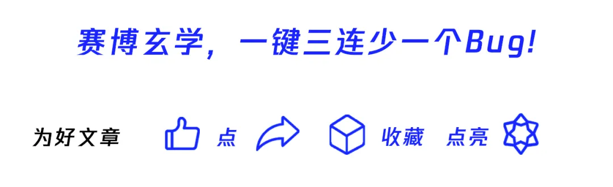

# Loop Engineering又是啥？一文讲清企业Agent落地的四层工程进化论

> 腾讯云开发者 · 李伟山 · 2026-07-02 08:45

> 原文：<https://mp.weixin.qq.com/s/3Zbx4RHB4fOdomI5aA_wIQ>

---

\

\

关注腾讯云开发者，一手技术干货提前解锁👇

\

\

\

引言：为什么你的 Agent 在 Demo 里惊艳，在生产中拉胯？

\

2026 年，几乎每家企业都在谈 AI Agent。

\

团队花了三周搭了一个 Agent 原型，接入了内部知识库，看 Demo 效果像那么回事儿。然后呢？上线两周后，Agent 把客户的订单信息张冠李戴，把合同条款搞混，在凌晨三点自动发了一封莫名其妙的邮件。你手忙脚乱地关掉自动化，Agent 又变回了一个需要人盯着的聊天机器人。纯赛博嘉豪！

\

这个故事正在无数企业里反复上演。时至今日，模型智能早已不是问题，开源模型们的能力已经足够完成大多数企业任务。问题在于：技术团队**在用 Demo 阶段的工程方法论，去解决生产阶段的系统问题。**

**\**

过去四年，AI 工程领域范式迁移轮替了四遍。从 2022 年的 Prompt Engineering，到 2025 年的 Context Engineering，到 2026 年初的 Harness Engineering，再到 2026 年中的 Loop Engineering。

\

每一次演进到底是"新瓶装旧酒"的造词游戏，还是工程关注点的实质性跃迁？这个问题每个人都有自己的观点，但不可否认的，从 Prompt 到 Loop，改变早已在不经意间悄然发生。

\

Andrej Karpathy 在 2025 年说"prompt engineering 应该让位给 context engineering"。Mitchell Hashimoto（HashiCorp 联合创始人）在 2026 年 2 月提出"engineer the harness"。Boris Cherny（Anthropic Claude Code 负责人）在 2026 年 6 月说"我不再 prompt Claude 了，我设计循环来 prompt Claude"。

\

他们都遇到了同样的瓶颈：**单靠改善 prompt 无法让 Agent 在生产环境中可靠运行；单靠优化 context 无法防止 Agent 犯同样的错；单靠搭好 harness 无法让 Agent 持续自主地完成复杂目标。每一层都解决了上一层留下的核心瓶颈，但也引入了新的工程挑战。**

**\**

这篇文章将系统地拆解这四个工程层级，分析每一层对企业 Agent 落地的具体影响，并给出可操作的采纳路径。无论你是刚开始探索 AI Agent 的技术负责人，还是已经在生产环境中踩过坑的工程团队，这篇文章都会帮你建立一个清晰的该在哪个层级投入的判断框架。

\

\

\

# 01

\

\

四层演进的时间线：嵌套！

\

在深入每一层之前，先建立一个关键认知：**这四层是嵌套关系，不是替代关系。**

**\**

很多团队的误区是把它们当作时间线上的换代：

\

现在都 2026 年了，还搞 Prompt Engineering？应该搞 Harness Engineering 了！

\

这种理解是错的。正确的关系是：

- Context Engineering **包含** Prompt Engineering
- Harness Engineering **包含** Context Engineering
- Loop Engineering **包含** 以上所有

\

外层不取消内层，而是在内层的基础上增加新的工程维度。如果你的 prompt 写得模糊、context 配置混乱，再好的 harness 也救不了你，因为模型每次推理时收到的指令和信息本身就是低质量的。

\

下面这张图展示了四层的嵌套关系和各自的作用域：

\

理解了嵌套关系，我们就可以逐层拆解每一层对企业 Agent 落地的影响了。

\

\

\

# 02

\

\

L1 · Prompt Engineering：说清楚任务——Agent 的"语言能力"

\

### 定义与核心问题

\

Prompt Engineering 是一切的起点。它关注的是：**在模型已经拿到所有信息的前提下，如何用最有效的措辞引导模型产出期望行为。**

**\**

核心问题只有一个：**同样的信息，换一种说法，模型表现会不会更好？**

**\**

具体技术手段包括：角色设定（"你是一位资深财务分析师"）、输出格式约束（"以 JSON 格式返回"）、Few-shot 示例（给 2-3 个输入输出样本）、Chain-of-Thought 引导（"让我们一步步思考"）、结构化 prompt 模板（使用 XML/Markdown 分区）。

\

### 对企业 Agent 的正面影响

### \

Prompt Engineering 解决的是模型的"听话问题"。在企业场景中，这意味着：

1. **输出格式可控。** 企业系统需要结构化数据，比如 JSON、表格、特定模板的文本。好的 prompt 能让模型稳定输出可被下游系统解析的格式，而不是随意组织的自然语言。
2. **角色边界清晰。** 通过角色设定和行为约束，Agent 可以被限定在特定的业务领域内。你是客服助手，只回答产品相关问题，不确定的说我需要转接人工：这种边界设定在 L1 层就可以实现。
3. **推理质量提升。** Chain-of-Thought 和 structured reasoning 让模型在复杂业务逻辑中保持条理。对于需要多步骤推理的场景（如合同条款分析、财务异常检测），CoT 能显著提升准确率。

\

### 企业落地的天花板

\

但 Prompt Engineering 有三个无法突破的天花板：

\

**信息孤岛。** Prompt 只能优化"怎么问"，无法解决"模型不知道你的业务数据"的问题。比如电商场景，你在 prompt 里写"根据我们的退款政策"，但模型根本不知道你的退款政策是什么。每次人工粘贴上下文，不可规模化。

\

**无记忆。** 每个 turn 是独立的。上一轮的洞察、决策、中间状态全部丢失，除非人手动搬运。Agent 无法维持跨 turn 的连贯性。

\

**人是瓶颈。** 触发、判断、下一步决策全在人身上。Agent 的吞吐量等于人的带宽。一个人盯一个 Agent 手动交互，这是套了一层皮的人肉自动化。

\

### 企业成熟度定位

**\**

**个人生产力工具，不是组织基础设施。** L1 适合验证"AI 能不能做这件事"，不适合回答"AI 能不能替我们持续做这件事"。

\

大多数企业在这一层停留太久了。他们花大量时间优化 prompt 模板、建 prompt 库、做 prompt 版本管理——这些都有价值，但如果止步于此，Agent 永远无法从"一个更好用的聊天窗口"进化为"一个可信赖的业务流程节点"。

\

**你的瓶颈不再是"怎么问"的问题时，就该迈向 L2 了。**

**\**

\

\

# 03

\

\

L2 · Context Engineering：提供正确背景——Agent 的"知识能力"

\

### 定义与核心问题

### \

2025 年 6 月，Andrej Karpathy 在 X 上发了一条简短的帖子，大意是"比起 prompt engineering，我更支持 context engineering 这个说法"。这条帖子引发了整个行业的范式转移讨论。

\

三个月后，Anthropic 发布了《Effective Context Engineering for AI Agents》这篇工程博客，给出了正式定义：**Context engineering 是策划和维护最优 token 集（信息）的策略集，包括 prompt 之外落入 context 的所有其他信息。**

**\**

核心问题从"怎么说"变成了：**什么样的 token 配置，最可能触发模型的期望行为？**

**\**

"Token 配置"这个词很关键。它意味着 context engineering 不只是"多给模型一些信息"，而是系统性地设计一个**信息策略**：什么放进去、什么不放、放多少、以什么顺序放、什么时候放。因为 context window 是有限资源，Anthropic 的研究表明，即便模型声称支持 200K token 的上下文，随着 token 数量增加，模型对信息的召回准确率会下降，这被称为"Context Rot"（上下文腐烂）。

\

### 技术手段

### \

Context Engineering 在企业场景中的具体实现手段包括：

\

**RAG（检索增强生成）。** 不把整个知识库塞给模型，而是根据用户查询，语义检索最相关的文档片段，只把这些片段放入 context。企业场景中，这意味着 Agent 可以回答关于内部流程、产品手册、合同条款的问题，而不需要对模型做微调。

\

**MCP（Model Context Protocol）。** Anthropic 主导的协议标准，让 Agent 通过统一接口连接外部数据源和工具。企业的 CRM、ERP、项目管理工具都可以通过 MCP 接入，Agent 在推理时实时拉取最新数据。

\

**Message History 管理。** 长对话中，早期消息的价值递减。Context engineering 通过滑窗（只保留最近 N 轮）、摘要压缩（把 20 轮对话压缩成 3 段摘要）、优先级排序（关键决策记录保留，闲聊丢弃）来维持 context 质量。

\

**Tool Schema 精简。** 每个 tool definition 都占 context 空间。如果你给 Agent 接了 50 个工具，光是工具定义就吃掉了几千 token。Context engineering 要求只暴露当前任务需要的工具子集。

\

### 对企业 Agent 的正面影响

### \

1. **Agent 从"通用对话"变成"业务助手"。** 接入了企业知识库和业务系统后，Agent 的回答不再是通用常识，而是基于你的具体业务数据的有依据回答。这是企业 Agent 真正创造价值的起点。
2. **Token 效率直接影响成本。** 企业按 token 付费。Context engineering 的"最小高信号 token 集"原则直接对应 cost reduction。一个优化过的 RAG pipeline 可能把每次查询的 context 从 8K token 降到 3K token——在月均 10 万次查询的规模下，这是数千美元的差异。
3. **单 session 内的连贯性得到保障。** 通过有效的 message history 管理，Agent 在一个长对话中可以"记住"之前讨论的内容，而不会在第 15 轮突然忘了第 3 轮的决策。

### \

### 企业落地的天花板

**\**

**模型的"手"不受控。** Context engineering 管的是模型的 input side——模型看到什么。但模型看到正确信息后，可能仍然做出错误的行动：调用了错误的 API 端点、生成了不合规的代码、做了违反业务规则的决策。你把编码规范放进了 context，模型读了，但它选择性忽略了某条规则——L2 对此无能为力。

\

**错误不会自愈。** Agent 在第 3 轮犯了一个错误（比如 RAG 检索到了过期文档），L2 没有机制发现和纠正它。没有 linter 拦截、没有 test gate 验证、没有 feedback loop 把错误转化为系统改进。同样的错误会在下次遇到相似查询时再次出现。

\

**仍然依赖人触发和人判断。** Context 让 agent 在单次任务中更准确，但"做什么任务"和"结果是否可接受"仍然由人来决定和触发。Agent 是一个更聪明的工具，但仍然需要人来握着它。

\

### 企业成熟度定位

### \

**业务助手阶段。** Agent 能基于企业数据做出有依据的回答和建议，但每次任务仍需人工启动和验收。典型场景：客服知识库问答、代码补全 with 项目上下文、文档生成 with 数据检索、内部政策查询。

\

**当你的 Agent 反复犯同样的错，而你只能通过改 prompt 或调 RAG 来"希望"它不再犯时——你需要 L3 了。**

**\**

\

\

# 04

\

\

L3 · Harness Engineering：让模型能真实执行——Agent 的"可靠性"

\

### 定义与核心问题

### \

2026 年 2 月 5 日，Mitchell Hashimoto 发布了一篇博客，描述了一个他在使用 AI agent 时养成的习惯：**每次 agent 犯错，他都会工程化一个解决方案，让 agent 再也不会犯同样的错。** 他把这个实践叫做 "engineer the harness"。

\

六天后，OpenAI 发布了《Harness Engineering: Leveraging Codex in an Agent-First World》，描述了一个 3-7 人小团队如何在五个月内，用 Codex agent 构建了约一百万行代码——零行手写代码。核心发现是：**"Early progress was slower than we expected, not because Codex was incapable, but because the environment was underspecified."** 不是模型不行，是环境没配好。

\

LangChain 用一个公式做了最简洁的凝练：**Agent = Model + Harness。**

**\**

核心问题从"模型看到什么"变成了：**如何构建一个让错误结构性不可重犯的执行环境？**

**\**

### Harness 包含什么

### \

Harness 是模型之外的一切基础设施。它有五个核心组件：

\

1. **Guides（引导）：** AGENTS.md 或 CLAUDE.md 文件，编码了项目的规则、约定、禁忌。不同于 prompt 里的"请遵守编码规范"（概率性遵守），AGENTS.md 的每一行都对应一个曾经的失败模式——它是错误经验的结构化沉淀。
2. **Sensors（感知）：** Output parser 验证输出格式、eval pipeline 评估输出质量、drift detector 检测 Agent 行为是否偏离预期。这些不是 Agent 自己的能力，而是 harness 提供的外部检查机制。
3. **Enforcement（执行约束）：** Linter 在 Agent 生成不合规代码时阻止提交，test gate 在测试不通过时阻止合并，permission 系统限制 Agent 能访问的资源和能执行的操作。**确定性约束替代概率性遵守**——这是 L3 与 L2 的本质区别。
4. **Context Pipeline（数据管线）：** 这就是 L2 的 context engineering，但在 L3 中它被 harness 的其他组件治理——什么时候加载什么 context，由 harness 的编排逻辑控制，而不是静态配置。
5. **Observability（可观测性）：** 记录每个 turn 的完整 trace——input、output、tool calls、token count、latency、决策原因。对合规要求高的行业（金融、医疗、法律），这不是可选项而是硬性前提。

\

### L2 与 L3 的本质区别

### \

这一点非常重要，值得单独展开。

\

L2（Context Engineering）的思路是：**给模型看正确的信息，期望它做出正确的行为。** 这是一种基于信任的策略——你信任模型在看到正确信息后会做正确的事。

\

L3（Harness Engineering）的思路是：**不管模型看到了什么，在它的输出被应用到真实环境之前，必须通过外部检查。** 这是一种基于验证的策略——你不信任模型的任何单次输出，你信任的是验证流程。

\

用一个类比：L2 是给考生发了正确的教材（期望他考好），L3 是设置了阅卷系统和作弊检测（不管他用什么教材，答案必须过审）。

\

Hashimoto 的原始描述最生动：在 prompt 里写"请遵守编码规范"是 L1/L2 的做法；在 CI pipeline 里接一个 linter，Agent 违反规范时 PR 直接无法合并——这是 L3 的做法。前者是"请你遵守"，后者是"你不遵守就过不了"。

\

### 对企业 Agent 的正面影响

### \

1. **从"希望正确"到"验证正确"。** 这是企业 Agent 从 PoC 到 production 的关键跨越。Demo 阶段你可以容忍 Agent 偶尔犯错，生产环境不行。Harness 把 Agent 的输出从"概率性正确"变成"可验证的正确"（至少在可形式化验证的维度上）。
2. **错误驱动的持续改善。** AGENTS.md 的增长模式是：Agent 犯了一个新类型的错误 → 你分析根因 → 你在 AGENTS.md 里加一条规则或在 CI 里加一个 check → 这个错误不再出现。系统的可靠性随时间单调递增。这是一个工程学的正循环，而不是依赖运气。
3. **半自主执行释放人力。** 有了约束和验证，Agent 可以在一定范围内自主执行，人从"每步都参与"退到"任务完成后 review"。这释放了巨大的人力带宽。一个工程师可以同时监督 3-5 个 Agent 处理不同任务，而不是盯着一个 Agent 的每次输出。
4. **可审计的决策链满足合规要求。** 对于金融风控、医疗辅助、法律文书等场景，"AI 为什么做出这个决策"不是好奇心而是法律要求。Observability pipeline 提供的完整 trace 是满足这类合规要求的基础。

### \

### 企业落地的天花板

**\**

**仍然是人触发、人收尾。** Harness 保障的是"给 Agent 一个任务，它可靠地完成"。但谁来决定"做什么任务"、"任务的优先级"、"任务之间的依赖关系"——仍然是人。每天早上，你得人工检查 issue 列表，手动把任务分配给 Agent，等它完成后手动 review。

\

**无跨 session 记忆。** Harness 在一个 task session 内有效。但 session 结束后，Agent 忘记一切。明天它不知道昨天做了什么、什么还没完成、下一步应该是什么。

**不能并行规模化。** 你想同时运行 5 个 Agent 处理 5 个不同的 issue——harness 本身不提供并行隔离和编排能力。

\

### 企业成熟度定位

### \

**可靠执行阶段。** Agent 可以被信任独立完成明确定义的任务。这是 2026 年大多数企业应该全力投入的层级——L3 做扎实比急于跳到 L4 更有价值，因为没有可靠的单任务执行，多任务自动化只会把不可靠放大到系统级。

\

下面这张流程图展示了一个典型的 L3 Agent 执行流程：

\

**当你希望 Agent 不再等你每天早上来分配任务，而是自己发现工作、自己推进——你需要 L4 了。**

\

\

\

# 05

\

\

L4 · Loop Engineering：让 Agent 持续迭代——Agent 的"自主性"

\

### 定义与核心问题

### \

2026 年 6 月 8 日，Google Chrome 团队的 Addy Osmani 发表了一篇文章，文章开头引用了两段话：

- **Peter Steinberger 说："你不应该再 prompt coding agent 了。你应该设计循环来 prompt 你的 agent。"**
- **Boris Cherny（Anthropic Claude Code 负责人）说："我不再 prompt Claude 了。我有循环在运行，这些循环 prompt Claude 并决定要做什么。我的工作是写循环。"**

**\**

这就是 Loop Engineering 的核心命题：**你不再是那个 prompt Agent 的人，你成为了设计那个 prompt Agent 的系统的人。**

\

\

### Loop 的六个构成要素

\

Osmani 的分析揭示了一个重要观察：Codex（OpenAI）和 Claude Code（Anthropic）这两个竞品已经独立收敛到了几乎相同的 Loop 架构。这不是巧合，而是 coding agent 用例下的自然均衡态。

\

Loop 需要五个原语加一个状态存储：

1. **Automations（自动化心跳）。** 这是让 Loop 成为 Loop 而不是"你执行了一次"的关键。定时触发（每天早上）或事件触发（CI 失败时）自动运行 Agent 进行发现和分类。Codex 有 Automations tab，Claude Code 有 `/loop`、`/goal`、hooks、GitHub Actions。
2. **Worktrees（工作树隔离）。** 多个 Agent 同时在同一个 repo 上工作时，如果不做隔离，文件冲突会让一切崩溃。Git worktree 为每个 Agent 创建独立的工作目录和分支，共享仓库历史但互不干扰编辑。
3. **Skills（技能编码）。** 把项目的约定、构建步骤、"我们不这么做因为那次事故"写成可复用的 SKILL.md 文件。Agent 每次运行时读取 skill，而不是从零猜测你的项目习惯。这消除了"意图负债"（Intent Debt）——Agent 冷启动时会用自信的猜测填补你没说的部分，skill 把这些猜测替换为确定的规则。
4. **Plugins / Connectors（插件/连接器）。** 基于 MCP 协议，让 Agent 能读 issue tracker、查数据库、调 staging API、发 Slack 消息。没有 connector 的 Loop 只能看文件系统——有了 connector 的 Loop 能在你的真实工作环境中行动。
5. **Sub-agents（子 Agent）。** 最关键的结构模式：**写的人和查的人分开**。生成代码的 Agent 不给自己打分——另一个 Agent（不同指令，可能不同模型）做 review。这种 maker-checker 分离是 Loop 能在你不在场时运行的信任基础。
6. **State（外部状态）。** Markdown 文件、Linear board、或任何存活在 context window 之外的持久化存储。记录什么做完了、什么在进行、什么是下一步。Agent 在 session 间会忘记一切，但 repo 不会——state 文件是 Loop 跨 run 连续性的唯一保障。

\

\

### 对企业 Agent 的正面影响

**\**

1. **从"一次一任务"到"持续运转"。** Automation + State 让 Agent 能跨 session 工作。你周五下班前设计好 Loop，周一回来看结果——期间 Agent 一直在发现、执行、验证、推进。
2. **从"串行"到"并行"。** Worktree 隔离让多个 Agent 同时工作。Boris Cherny 描述的"一天合并 20-30 个 PR"不是一个 Agent 做了 30 次，而是多个 Agent 并行处理不同任务的结果。
3. **知识复利。** Skill 把项目知识编码化后，每次 Loop run 都从相同的知识基线出发，而不是每次冷启动都重新猜测。这产生复利效应——skill 越完善，Agent 的首次正确率越高，需要的迭代轮数越少，token 成本越低。
4. **内部制衡。** Maker-checker 分离不只是质量保障，它改变了 Loop 的信任模型。你不需要信任任何单个 Agent 的输出——你信任的是验证流程。这让"无人值守运行"从冒险变成了可管理的风险。

\

### L4 引入的新风险

### \

这是需要诚实面对的部分。**Loop Engineering 在提升自主性的同时，引入了三个在 L3 不存在的新风险：**

**\**

**风险 1：成本可预测性大幅下降。**

- **L3** 的成本模型简单：一个任务 × 一次执行 × 大约 N 个 turn ≈ 可预算的 token 消耗。
- **L4** 的成本是组合爆炸：Automation 每天跑 × 每次可能 spawn M 个 sub-agent × 每个 sub-agent 各自有迭代循环 × 每个 skill 调用和 tool call 都消耗额外 token。如果不做预算控制，一个设计不当的 Loop 可能一晚上烧掉你一个月的 token 预算。

\

对于"token 丰富"（大预算）的团队和"token 贫困"（有限预算）的团队，Loop 的策略完全不同。前者可以让 Loop 自由探索，后者必须严格限制 automation 频率、sub-agent 数量、每次迭代的 token 上限。

\

**风险 2：可靠性的新风险面。**

- **L3** 的可靠性目标是"单任务内 Agent 不犯错"。L4 的可靠性要求变成了"一个无人值守系统在多任务、多 Agent、多 session 的组合空间内不出问题"——这是一个数量级更难的问题。

\

具体包括：

- Triage 逻辑错误可能把高优先级 issue 分类为低优先级，导致重要问题被忽略
- Sub-agent 之间的依赖可能产生死锁或循环依赖
- State 文件损坏或不一致可能导致任务重复执行或遗漏
- Maker-checker 都使用同一个模型时，系统性偏差不会被捕获

**\**

**风险 3：Comprehension Debt（理解力负债）和 Cognitive Surrender（认知投降）。**\
\

这是 Osmani 在文章中专门警告的：Loop 越快产出你没写的代码，你对 codebase 的理解缺口越大。这个缺口不会在任何指标上报警，直到你需要 debug 一个跨越多个 Loop 生成模块的问题。

\

更危险的是 Cognitive Surrender——当 Loop 运行顺畅时，人倾向于停止审查、停止质疑、停止思考。Osmani 的原话："同样的操作，相反的结果"——用判断力设计 Loop 是加速器，用 Loop 来逃避思考是灾难。

\

### 企业成熟度定位

### \

**自主运营阶段。** 只有在 L3 扎实的基础上才应该尝试 L4。如果你的 Harness 还不能保证单任务可靠执行，加上 Loop 只会把不可靠放大到系统级。

\

\

\

# 06

\

\

四层诊断框架：Agent 出了问题，先判断在哪一层

\

理解了四层的职责后，最大的实操价值是建立一个**故障诊断框架**。当企业 Agent 在生产中出问题时，不要急着改 prompt 或换模型——先判断故障在哪一层，再施加对应层的修复。

\

大量实践表明：**2025-2026 年大多数生产级 Agent 的故障是 harness 层故障，被误诊为 prompt 或 context 层故障。修复施加在错误的层面，症状反复出现，团队对 Agent 失去信心。**

\

\

来看几个真实企业场景的诊断示例：

\

**场景 1：客服 Agent 总是把退款政策搞错。**

\

初始诊断："prompt 写得不够清楚"→ 花了两周优化 prompt 模板 → 问题依然出现。

\

正确诊断：L2 层故障。RAG pipeline 检索到了过期的退款政策文档（去年修订的旧版本仍在知识库中）。修复不是改 prompt，而是加一个文档版本管理机制，确保 RAG 只检索最新版本。

\

**场景 2：代码生成 Agent 总是用已废弃的 API。**

\

初始诊断："context 里没有给足够的 API 文档"→ 塞入了更多文档 → 问题偶尔减少但没消失。

\

正确诊断：L3 层故障。即使 context 里有正确的 API 文档，模型的训练数据中旧 API 的出现频率更高，导致它"习惯性"使用旧 API。修复不是加更多 context，而是在 CI pipeline 里加一个 deprecated API detector——Agent 如果使用了废弃 API，PR 直接被阻止。确定性约束 > 概率性引导。

\

**场景 3：Agent 一天只能处理 5 个 issue，而积压有 50 个。**

**\**

初始诊断："模型太慢"→ 换了更快的模型 → 吞吐量从 5 提升到 7，但 50 个积压还是处理不完。

\

正确诊断：L4 层瓶颈。不是模型慢，是人在串行驱动——每个 issue 都要人工触发、人工检查、人工推进到下一个。修复不是换模型，而是设计一个 Loop：automation 每天早上自动 triage 50 个 issue，把可自动处理的分给并行的 sub-agent（worktree 隔离），只把不能自动处理的放入人工 triage inbox。

\

\

\

# 07

\

\

企业采纳路径：先打地基再盖楼

\

理解了四层模型后，最后一个关键问题是：**企业应该以什么顺序、什么节奏来采纳这四层？**

**\**

答案不是"四层同时推进"，也不是"直接跳到最新的 Loop Engineering"。正确的策略是**由内而外、逐层验证**。

\

### 阶段 1：夯实 L1 + L2

### \

**目标：验证 "AI 能不能做这件事"。**

**\**

选择 2-3 个高频、低风险的业务场景（客服问答、文档生成、代码补全），做好 prompt 模板 + RAG pipeline + context 管理。

\

具体动作：

- 为每个场景建立结构化的 prompt 模板，包含角色设定、输出格式、边界约束
- 搭建 RAG pipeline 接入内部知识库，验证检索准确率
- 接入 MCP 连接 1-2 个业务系统（如 CRM、工单系统）
- 建立基础的 eval 流程——对比 Agent 输出与人工标准答案，计算准确率

**\**

**退出标准：** Agent 在选定场景上的准确率达到 85%+，且团队对 prompt + context 的优化已经进入收益递减阶段（改来改去提升不大了）。这时候你的瓶颈已经不在 L1/L2 了。

\

### 阶段 2：建设 L3

### \

**目标：让 Agent 能被信任独立完成任务。**

**\**

在验证过的场景上加 harness——从最简单的开始：

\

具体动作：

- 创建 AGENTS.md，把阶段 1 中发现的所有 Agent 失败模式编码为规则
- 在 CI pipeline 中接入 output validation（格式检查、业务规则检查）
- 对关键场景加 test gate——Agent 的输出必须通过自动化测试才能应用
- 搭建 observability pipeline——至少做到每次 Agent 执行的完整 trace 可查
- 建立 AGENTS.md 的持续更新机制：每次新的失败模式 → 分析根因 → 加规则

**\**

**退出标准：** Agent 在选定场景上可以半自主执行——人只需要做最终 review 而不是逐步监控。AGENTS.md 的增长速度放缓（说明常见失败模式已被覆盖）。

\

\

### 阶段 3：试点 L4

**\**

**目标：验证无人值守运行的可行性和 ROI。**

**\**

在 L3 最成熟的场景上试点 Loop——从最简单的 automation 开始。

\

具体动作：

- 选一个低风险、高频次的重复性任务（如每日 CI failure triage、代码风格修正、测试补全）
- 设计一个最小 Loop：automation（定时触发）+ 一个 builder sub-agent + 一个 reviewer sub-agent + state 文件
- 设置严格的 token budget 上限——每次 Loop run 不超过 X token
- 前两周保持高频人工 review（每次 Loop 输出都看），确认 Loop 行为符合预期
- 逐步降低 review 频率：每天 → 每两天 → 每周抽查
- 监控 comprehension debt：定期做 code walkthrough，确保团队仍然理解 Loop 生成的代码

**\**

**退出标准：** Loop 在试点场景上稳定运行 4 周+，人工 review 的否决率低于 10%，token 成本在预算范围内。此时可以考虑扩展 Loop 到更多场景。

\

### 关键 Anti-Pattern：跳过 L3 直接搞 L4

### \

这是最常见也最危险的错误。一些团队看到"Boris Cherny 一天合并 30 个 PR"的故事，就想直接跳到 Loop Engineering。但他们忽略了一个关键前提：Cherny 是在 Anthropic 内部、使用自家模型、有完善的 harness 基础设施的情况下做到这一点的。

\

没有 L3 的 L4 意味着：你搭了一个自动运行的系统，但这个系统里的每个 Agent 都是不可靠的。它不会停下来等你修复——它会持续产出需要人工善后的结果。你以为自动化节省了时间，实际上人工善后的成本可能超过了手动执行的成本。净效率不是正的，是负的。

\

\

\

# 08

\

\

四层模型的行业适配差异

\

不同行业因为风险容忍度和合规要求的差异，在四层模型上的重心有所不同。

\

### 金融行业

\

金融行业的核心约束是**合规可审计**和**零容错**（一个错误的交易指令可能导致巨额损失）。

- **L1/L2 重心：** 确保 Agent 只基于合规数据源做推理，context 中不混入未授权的信息
- **L3 是核心投入层：** 需要最强的 harness——每个 Agent 输出必须通过合规检查器、风控模型、格式验证器的三重 gate。Observability 不是可选项而是监管要求。AGENTS.md 需要编码所有监管规则
- **L4 极度谨慎：** 全自动化在高风险金融决策中可能不被监管允许。Loop 更适合用在辅助性任务（研报生成、数据清洗、异常预警）而非决策性任务

### \

### 软件工程

### \

软件工程是 Loop Engineering 的原生场景——上文提到的所有案例（Codex、Claude Code）都来自这个领域。

- **L1/L2 快速通过：** 模型对代码的理解已经足够强，context engineering 的主要工作是接入项目的 codebase、文档、测试
- **L3 是基础：** Linter、test suite、CI pipeline 本身就是 harness 的天然组件。软件工程团队的优势是他们已经有丰富的自动化验证基础设施
- **L4 是当前热点：** 这是最适合 Loop Engineering 的行业，因为代码有明确的验证手段（编译通过、测试通过、lint 通过），maker-checker 分离有坚实的自动化基础

### \

### 客户服务

### \

客服场景的特殊性在于**与真实用户直接交互**，错误的代价是客户体验和品牌信誉。

- **L1/L2 是核心：** 客服 Agent 的质量高度依赖 prompt 的边界设定（什么问题回答、什么问题转人工）和 context 的准确性（RAG 检索到正确的产品信息和政策）
- **L3 重要但侧重不同：** 客服场景的 harness 更关注 content safety（不能说不该说的话）、tone consistency（语气一致）、escalation logic（何时转人工）
- **L4 适用有限：** 客服的本质是响应式的（客户提问才回答），不太适合 Loop 的主动发现模式。但可以用于辅助场景：每日自动分析客诉趋势、生成 FAQ 更新建议

\

\

\

# 09

\

\

展望：四层之后是什么？

\

回顾这条演进脉络——Prompt → Context → Harness → Loop——有一个清晰的趋势：**每一层都把人往"更高层抽象"推。**

**\**

L1 时代，人管的是"每一句话怎么说"。L2 时代，人管的是"模型看到什么信息"。L3 时代，人管的是"执行环境怎么设计"。L4 时代，人管的是"自动化系统怎么编排"。

\

那 L5 会是什么？

\

一个可能的方向是 **Meta-Loop Engineering**——不是你设计 Loop，而是 Agent 自己根据项目需求和历史表现动态调整 Loop 的配置（automation 频率、sub-agent 数量、skill 更新、budget 分配）。斯坦福和 MIT 的研究者在 2026 年发布了 Meta-Harness 的概念验证，展示了通过 agentic search 自动优化 harness 配置的可能性。

\

但这还很远。对于 2026 年的企业而言，最务实的行动是：

1. **停止在 L1 上过度投入。** 如果你的团队还在花大量时间"调 prompt"，你可能在错误的层面上用力。
2. **在 L2 上建立扎实基础。** RAG pipeline、MCP 连接、context 管理——这些是一切后续层级的地基。
3. **把主要精力放在 L3。** Harness engineering 是 2026 年企业 Agent 落地的决胜层。一个可靠的单任务 Agent 比一个不可靠的全自动系统有价值得多。
4. **用 L4 的思维设计，但从最小 Loop 开始。** 不要一上来就搞全自动化。从一个场景、一个 automation、一对 maker-checker 开始。

\

\

\

# 10

\

\

结论：Build the Loop, Stay the Engineer

\

这篇文章梳理了从 Prompt Engineering 到 Loop Engineering 的四层演进，以及每一层对企业 Agent 落地的具体影响。核心洞察可以浓缩为一句话：

\

**企业 Agent 落地的瓶颈正在从"模型能力"迁移到"系统工程能力"。**

**\**

模型已经足够聪明了。GPT-5.5 能理解你的业务逻辑，Claude 能写出合格的代码，Gemini 能分析你的数据。差异不在模型，在于你在模型之外构建了什么——Context pipeline 是否精准？Harness 是否完善？Loop 是否可控？

\

这意味着企业 AI 团队需要的核心能力正在发生转变：从"会调模型的人"到"会做系统设计的人"。这更像 DevOps/SRE 的思维方式，而非传统 ML 的思维方式。

\

但请记住 Addy Osmani 的那句警告：**"Build the loop. Stay the engineer."**

**\**

两个人可以搭建完全相同的 Loop，得到完全相反的结果。一个人用它加速自己深刻理解的工作，另一个人用它逃避理解工作本身。Loop 不知道区别，你知道。

\

设计 Loop。但像一个打算持续当工程师的人那样设计它，而不是像一个只想按下启动键的人。

\

参考来源：

- *Mitchell Hashimoto, "My AI Adoption Journey", mitchellh.com, 2026.02.05*
- *OpenAI, "Harness Engineering: Leveraging Codex in an Agent-First World", 2026.02.11*
- *Anthropic, "Effective Context Engineering for AI Agents", anthropic.com, 2025.09.29*
- *Addy Osmani, "Loop Engineering", addyo.substack.com, 2026.06.08*
- *Andrej Karpathy, X Post on Context Engineering, 2025.06.25*
- *Andrej Karpathy, X Post on Agentic Engineering, 2026.02*
- *LangChain, "Agent = Model + Harness", blog.langchain.com, 2026.02*
- *Agent Harness Engineering: A Survey, CMU/Yale/JHU et al., 2026*

\

-End-

原创作者｜李伟山

\

\

感谢你读到这里，不如关注一下？👇

\  你对本文内容有哪些看法？同意、反对、困惑的地方是？欢迎留言，我们将邀请作者针对性回复你的评论，欢迎评论留言补充。我们将选取1则优质的评论，送出腾讯云定制文件袋套装1个（见下图）。7月9日中午12点开奖。\\扫码领取腾讯云开发者专属服务器代金券！\     
