# 契约化多端架构：基于领域模型的Harness实践

> 腾讯云开发者 · 刘勇刚 · 2026-07-07 08:45

> 原文：<https://mp.weixin.qq.com/s/EG8YdPbBUnnyQJzcfGoIGg>

---

\

\

关注腾讯云开发者，一手技术干货提前解锁👇

\

\

\

作为一名老登前端开发，这两年深刻感受到大模型时代 AI 对软件工程带来的冲击——也被近年来 AI 各种范式大潮冲击了一遍又一遍。一路从提示词工程，再到上下文工程、Vibe Coding，再到本篇要介绍的 Harness 工程化，一路在思考：什么样的 AI 工程化方案，才是符合 WeTV（腾讯视频海外平台）当下 Web 项目的？这里抛砖引玉，和大家一起来探讨。 【为了将每个细节讲到味，篇幅较长，文章有问题的地方欢迎指出，大佬们不吝点赞+收藏！】

\

\

\

# 01

\

\

我们是怎么开始"吃 AI"的

\

说实话，2025 年初那会儿，AI 热潮铺天盖地——朋友圈、技术社区、各种大会，全是"不用 AI 就被淘汰"的论调。作为老登，说实话有点焦虑。

\

正好那段时间，我们接连有两个从 0 到 1 的项目：Linux TV 改版、Roku TV 立项。按以往经验，这种新项目意味着大量重复劳动——搭建项目框架、写基础组件、对接 API、写测试用例... 总得有个起点吧？

\

当时就想：要不拿 AI 试试？

\

1.1 AI 辅助编程的那点历史

\

回过头看，这事儿其实折腾了很久。图灵 1950 年的那篇论文，其实不是在讨论"AI 写代码"，而是提了个判据：如果机器能通过对话骗过人类，就算有智能——这个设想埋下了后来"用自然语言编程"的种子。70 年代有人研究自动编程（Automatic Programming），试图从形式化规约推导程序，当然没成。80 年代专家系统火过一阵，用 IF-THEN 规则做代码审查，但规则维护成本太高，最后也没落地。

\

2000 年代统计机器学习入场，但还是没改变开发者的日常。真正的转折是 2017 年的 Transformer（就是那篇 Attention is All You Need），然后 2021 年 Copilot 上线，AI 辅助编程才算真正进入主流。

\

但"进入主流"和"真正好用"之间，还有很大的距离——这就是为什么我们从提示词工程，一路走到 Harness 工程化。

\

1.2 没有 AI 之前：我们其实已经做了很多"工程化"

\

面对 Web 侧这种多平台产品矩阵——Linux TV、V 站、M 站、Roku TV——我们为了提升研效，早就开始"工程化"了：

- @tencent/wetv-kernel：核心逻辑包，平台无关
- 上报/账号/播放器 SDK：基础能力收敛
- 规范检测集、目录范式、单测范式：多年踩坑沉淀

\

没有 AI 之前，我们靠"人肉传承"——有了 AI 之后，第一反应是：怎么让 AI 也"懂这些范式"？

\

1.2.1 上下文腐化：memory 不是万能的

\

刚开始用 AI，每次写提示词都想：能不能把这些范式和复用场景直接给到 AI？

\

但很快发现——上下文工程虽然有 memory，但体量一大就会"腐化"：

1. 规范冲突：AI 生成的代码，经常忘记我们的特殊规则
2. 开发范式丢失：聊着聊着，AI 就忘了"Page / Module / API"这些开发范式
3. 复用场景不识别：明明有现成 SDK，AI 还是给你重新写冗余逻辑

\

这时候我们才意识到：memory 不是万能的。

\

1.2.2 从"人肉传承"到"契约化规范"

\

意识到 memory 不行之后，我们开始想：既然 AI 的上下文会腐化，那就把规范"外置"——不让 AI 靠记忆，而是靠"查契约"。

\

具体来说，就是把我们之前沉淀的那些东西——规范检测集、目录范式、单测范式、开发范式模型——从"人读的文档"变成"机器可读的契约"。

\

这一步，其实就是从上下文工程走向Harness 工程化的关键转折点。

\

\

\

# 02

\

\

我们需要什么样的Harness

\

2.1 用"契约"代替"猜"

\

以前让 AI 写代码，它得先把项目扒一遍，然后靠"猜"来理解你的意图。项目一大，该读的没读到，不该读的干扰一堆——这就是"上下文腐化"。

\

Harness 的做法是提前定义好领域模型——用 JSON 把业务概念写清楚：页面有哪些、组件有哪些、接口有哪些、数据结构是什么。AI 直接读这个就行，不用去扒源码。

\

关键是这份领域模型跟平台没关系，各端共用同一份。

\

运行 /project:init 的时候，AI 会根据 _DETECTION_HINTS 自动扫描当前项目，生成 domain-mapping.json 映射文件，把"通用契约"映射到"各端具体实现"：

\

```
{  "HomePage": {    "linux-tv": { "path": "src/pages/Home.tsx" },    "web": { "path": "pages/index.tsx" }  }}
```

\

通用契约定义"是什么"，映射文件定义"在哪、怎么实现"。

\

2.2 多端差异用映射解决

\

业务逻辑是通的，但各端实现方式不一样——TV 用焦点驱动，Web 用鼠标，移动端用触摸。

\

Harness 用 _PLATFORM_SPECIFIC 标注各端差异。AI 生成代码时先读通用契约，再读映射文件，最后结合项目依赖库生成符合该端技术栈的代码。

\

2.3 把整个流程串起来

\

完整工作流：

```
/project:init → 需求分析 → 红队验证 → 验收标准 → 方案设计 → 需求开发 → 测试验证 → 观测回收
```

\

- 初始化：AI 探测项目结构，生成映射文件和配置
- 需求分析：AI 读需求，拆成任务清单让你确认——避免理解偏差
- 红队验证：AI 自己当"对手"，找漏洞——没网络怎么办？数据为空怎么展示？
- 验收标准：生成 TDD 契约文件，开发完了对着验收
- 需求开发：AI 创建 Team 分工——reader 读代码、planner 做方案、executor 写代码、reviewer 做 Review
- L0-L4 验证：五层质量门禁，自动拦截不合格代码
- 观测回收：记录 Token 消耗、首次通过率、返工次数

\

2.4 用建房子理论类比图

\

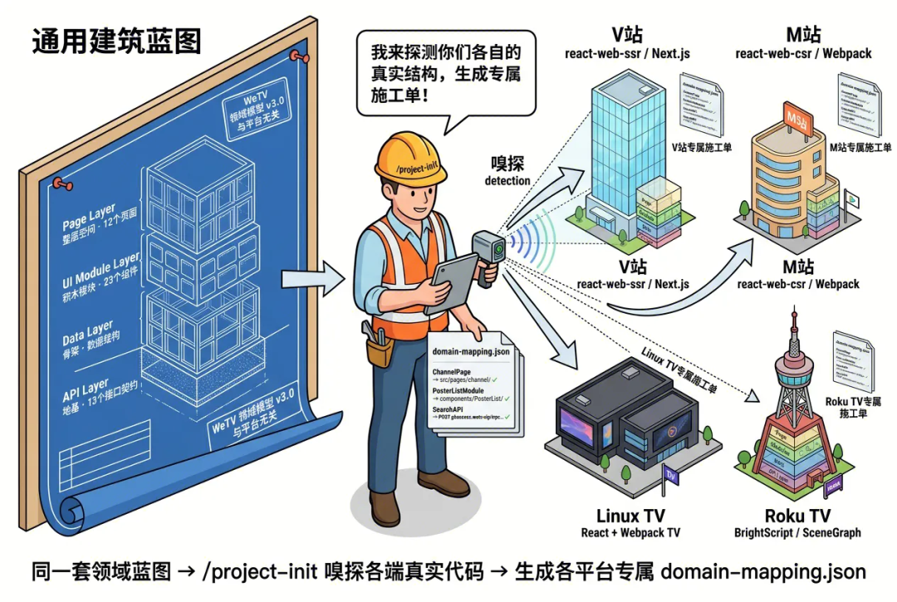

\

\

\

# 03

\

\

我们的 harness 如何编排设计

\

早期我们让 AI 一口气干完"读需求 → 拆任务 → 写代码 → 跑测试"，结果是上下文一多就乱，改一处漏一片。

\

后来想通了：把开发流程拆成角色，每个人干自己的活，上下文隔离，互不干扰。

\

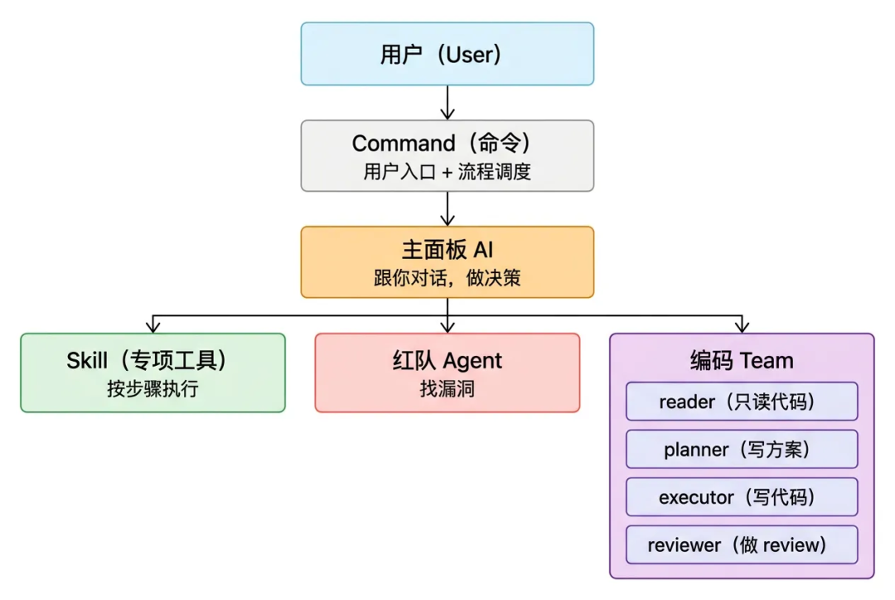

\

**Command、Skill、Agent 到底啥区别？**

\

刚接触的人容易搞混，其实很简单：

- Command 是"你跑的那个命令"。比如 /web-agent-new，它就是个入口，负责解析参数、拉 TAPD、串步骤。它不干活，它是"调度员"，类似我们以前开发脚手架 Cli的命令入口。
- Skill 是"专项工具"。比如 requirement-breakdown 专门拆需求，d2c 专门把 Figma 转代码。它被 command 调用，只做一件事，做完就返回。好处是复用方便，换个项目不用改。
- Agent 是"带角色的执行者"。比如 code-analyzer 是代码阅读者，code-planner 是方案设计者。它有角色设定，会在独立上下文里自主决策。

\

**一句话区分**：Command 是"入口"，Skill 是"工具"，Agent 是"角色"。

\

**跟业界比，我们做了哪些优化？**

| **工具** | **怎么干活的** | **多角色？** | **懂业务？** |
| --- | --- | --- | --- |
| Copilot / Cursor | 一个模型聊到底 | ❌ | ❌ |
| Devin | 一个 agent 自己干 | ❌ | ❌ |
| OpenHands | 多 agent 协作 | ✅（得自己配） | ❌ |
| **我们的Harness** | Command + Skill + Agent Team | ✅（流程里固化了） | ✅（领域模型注入） |

\

**最大的区别**：Copilot / Cursor 你得把需求说清楚，它自己去扒代码猜意图。Harness 提前把业务概念结构化（领域模型），AI 直接读，不用猜。

\

**一个真实踩的坑**

\

最早设计的时候，我们让主面板把"需求管理"也当子 agent 启动——结果**卡死了**。

\

原因是：子 agent 弹的确认框出现在"子 agent 面板"，主面板看不到，就一直等，死锁。

\

后来定了一条铁律：**所有用户交互必须在主面板，子 agent 只执行不交互**。

\

这个坑修了两轮才彻底闭合。现在的流程里，每个检查点都是主面板直接弹 ask_followup_question，子 agent 返回结果后主面板再决定下一步。

\

---

\

有了上面的 harness顶层设定，接下来我将核心内容拆开讲，把这套东西的设计细节摊开说。主要分三块：

- **先是领域模型。** 这是整套 Harness 的核心——把业务概念结构化，让 AI 能读懂。四个模型文件（pages、ui-modules、api-layer、data-layer）分别管什么、怎么配合，_DETECTION_HINTS 和 _PLATFORM_SPECIFIC 这两个关键设计是怎么工作的，都会说清楚。
- **然后是完整工作流。** 从你跑 /project:init command命令开始，到需求分析、需求开发、L0-L4 验证，再到最后的观测回收，每一步具体做什么、产出什么、怎么保证质量，都会拆开讲。
- **最后是管理机制。** 这套东西做好了，得让团队真正用起来。各端项目怎么接入、怎么升级、文件怎么管理、版本怎么迭代，这些是落地时要解决的。

\

\

\

# 04

\

\

领域模型设计

\

前面说了，领域模型是一份"业务说明书"——用 JSON 写清楚业务里有哪些页面、哪些组件、哪些接口、哪些数据。AI 读这份说明书就能理解业务，不用去扒源码。

\

4.1 四层架构

\

四层从上到下是依赖关系：

```
页面层（pages.json）  ↓ composed ofUI 模块层（ui-modules.json）  ↓ depends on数据层（data-layer.json）  ↓ fetched from接口层（api-layer.json）
```

\

实际跑起来是这样：用户访问首页 → AI 识别 HomePage（pages.json）→ 分解出需要 HeaderModule + PosterListModule（ui-modules.json）→ 识别数据依赖 ChannelListData（data-layer.json）→ 生成调用 ChannelListAPI（api-layer.json）的代码 → 输出各端实现。

\

4.2 _DETECTION_HINTS：让 AI 自己找文件

\

领域模型是通用业务概念，但各端具体实现文件路径不一样。首页在 Web 端是 pages/index.tsx，Linux TV 端是 pages/home.tsx，Roku 端是 components/HomeScene.brs。

\

以前的做法是在领域模型里硬编码各端路径，但项目重构后路径变了，模型就错了。

\

现在的做法是用 _DETECTION_HINTS 给 AI 提供探测提示，让 AI 在 /project-init 时自动扫描项目，生成 domain-mapping.json 映射文件。

\

看实际例子：

```
{  "HomePage": {    "_DETECTION_HINTS": {      "purposeKeywords": ["home", "index", "main", "首页"],      "commonRoutes": ["/", "/home"],      "commonFilePatterns": ["**/pages/Home.{tsx,jsx}", "**/pages/index.{tsx,jsx}"]    },    "platforms": {      "_PENDING_DETECTION": "由 /project-init 时 AI 探测生成"    }  }}
```

\

跑 /project-init 时 AI 会扫描项目目录，生成：

```
{  "HomePage": {    "web": { "path": "pages/index.tsx", "route": "/", "renderMode": "SSR" },    "linux-tv": { "path": "src/pages/Home.tsx", "renderMode": "CSR" }  }}
```

\

4.3 _PLATFORM_SPECIFIC：处理各端差异

\

文件在哪解决了，还有个问题：各端的 props 不一样。

\

PosterCard 组件，通用定义里只说"这是一个可点击的海报卡片"，但 TV 端需要 focusKey、onFocus（焦点驱动），Web 端需要 onMouseEnter（鼠标悬停）。

\

做法是在通用定义里用 _PLATFORM_PROP_VARIATIONS 标注各端差异：

```
{  "PosterCard": {    "props": {      "src": { "type": "string", "required": true },      "onClick": { "type": "() => void", "required": true }    },    "_PLATFORM_PROP_VARIATIONS": {      "tv": "可能需要 focusKey, onFocus, onBlur, onEnterPress",      "web": "可能需要 onMouseEnter, onMouseLeave"    }  }}
```

\

AI 生成代码时，先读通用契约，再读 domain-mapping.json 里的平台映射，最后结合项目依赖库生成符合该端技术栈的代码。

\

4.4 glossary.json：统一业务语言

\

业务里有很多专有名词，不同人叫法不一样。比如"视频 ID"，有人叫 vid，有人叫 videoId，有人叫 contentId。AI 读代码的时候就会混乱。

\

用 glossary.json 统一业务语言：

```
{  "vid": {    "name": "视频ID",    "definition": "腾讯视频全局唯一标识符",    "format": "mzc00200xxx（剧集）, n00xxxx（综艺）"  }}
```

\

AI 读领域模型之前先读 glossary.json，建立统一的业务语言理解。

\

\

\

# 05

\

\

完整工作流

\

说完领域模型，接下来讲完整工作流。

\

第一次接入项目时，先跑 /project-init：

```
/project-init .
```

\

它会做下面几件事情：

1. 探测项目类型（Roku / Next.js / Linux TV / ...）
2. 根据 _DETECTION_HINTS 扫描项目，生成 domain-mapping.json
3. 从 infrastructure-templates/ 读取对应类型的模板，生成项目专属规范

\

跑完这一步，Harness 才算真正"接入"了你的项目。

\

**后续开发新需求**时，直接从"需求输入"开始：

```
需求输入 → 需求拆分 → 红队验证 → 验收标准 → 初始化存档 → 方案设计 → 编码开发 →  → 观测回收
```

\

5.1 项目初始化：/project-init 流程

\

5.1.1 接入步骤

\

第一次接入项目时跑这个命令，让 AI 把通用领域模型映射到你的项目。

\

整个流程 5 步：

| **步骤** | **干什么** | **产出啥** |
| --- | --- | --- |
| 环境准备 | 解析路径、判断单仓/Monorepo、读项目配置 | 项目上下文变量 |
| MCP 配置 | 问你要不要配 MCP（连 TAPD、企微这些外部工具） | mcp.json（可选） |
| 项目探测 | 扫描项目目录，识别项目类型，问你确认 | 项目类型 + 特定配置 |
| 领域映射 | 逐层确认 Page / API / UI Module 的映射关系 | 完整映射表（内存中） |
| 生成文件 | 把前面收集的信息写成项目专属配置文件 | .codebuddy/ 目录下的所有文件 |

\

领域映射这一步最关键，分三层确认：

| **层** | **AI****干啥** | **你要确认啥** |
| --- | --- | --- |
| Page 层 | 根据 _DETECTION_HINTS 找到每个页面对应的实际文件 | 识别对了没？漏了没？ |
| API 层 | 找到项目中实际的 API 调用代码，跟通用定义做匹配 | 接口路径对不对？ |
| UI Module 层 | 找到项目中实际的 UI 组件，跟通用定义做匹配 | 组件路径对不对？ |

\

三层都确认完，AI 展示完整映射表，你点头后才进入"生成文件"这一步。

生成的文件清单：

| **文件** | **内容** |
| --- | --- |
| config/domain-mapping.json | 领域模型映射表 |
| rules/domain-mapping.md | 映射文件的可读版 |
| rules/coding-standards.md | 编码规范（从项目真实配置生成） |
| rules/test-standards.md | 测试规范 |
| patterns/idioms.md | 代码模式库 |

\

如果项目没有 E2E 测试基础设施，还会生成测试骨架。

\

关键设计：每一步都要你确认才继续。因为领域模型映射一旦错了，后面所有 AI 生成的代码都会跟着错。

\

5.1.2 流程图

\

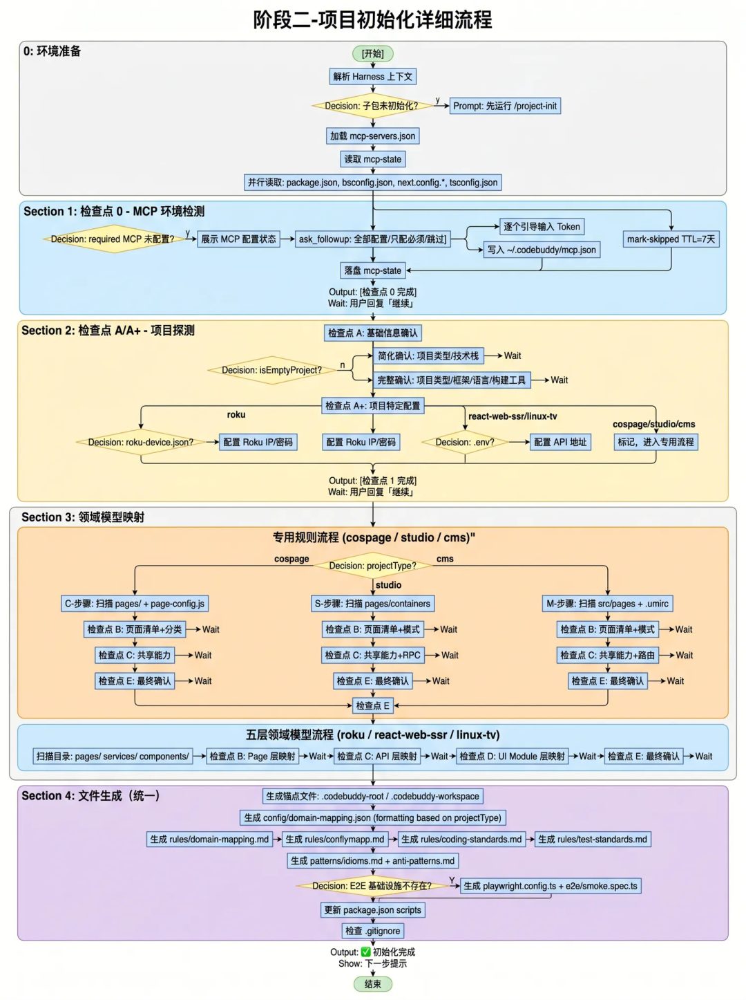

\

5.2 需求分析阶段

\

需求分析分 5 步：TAPD 拉取 → 需求拆分 → Figma 设计稿处理 → 红队验证 → 验收标准。

\

5.2.1 第一步：TAPD 拉取 + 父需求回溯 + Figma 链接扫描

\

AI 从 TAPD 拉取需求详情，如果 description 为空，会自动回溯父需求（tapd有可能是需求下story）

| **步骤** | **AI****干啥** | **你要确认啥** |
| --- | --- | --- |
| 解析输入 | 识别是 TAPD 短 ID / 完整链接 / 自然语言 | - |
| 拉取需求 | 调用 TAPD MCP，获取 name / description / parent_id 等字段 | - |
| 父需求回溯 | 如果 description 为空，且 parent_id 存在，自动拉取父需求 | - |
| Figma 链接扫描 | 从 description 中提取 Figma / 蓝湖 / Axure 链接 | Figma 链接对不对？ |
| 人员信息确认 | 展示需求详情（名称、描述、处理人、开发人员、测试人员） | 人员信息对不对？ |

\

如果需求信息不足，AI 会问你 3 个问题：

```
❓ 需求信息不完整，需要补充几个关键点：[1] 本次开发针对哪个端？（V 站 / M站 / Linux TV / Roku TV）[2] 核心功能变化是什么？（一句话描述用户能看到的变化）[3] 是否有设计稿或交互稿链接？（Figma / 蓝湖 / Axure）
```

\

5.2.2 第二步：需求拆分

\

AI 把需求拆成一级任务、二级子任务，输出 working/breakdown.md。

\

| **步骤** | **AI****干啥** | **你要确认啥** |
| --- | --- | --- |
| 两级拆分 | 拆成一级任务（功能模块）+ 二级子任务（技术动作） | 拆分结果对不对？ |
| 工时预估 | 每个一级任务预估工时（0.5h ~ 1 天） | 工时合理不？ |
| 写入文件 | 按标准 Schema 写入 breakdown.md | 确认无误？ |

\

拆分原则：

- 一级任务：用户可感知的完整功能单元（半天 ~ 1 天可完成）
- 二级任务：实现一级任务需要的具体代码动作（1 ~ 3 小时可完成）

\

5.2.3 第三步：Figma 设计稿处理（D2C 精简模式）

\

如果有 Figma 链接，AI 会调用 D2C Skill（精简模式），生成设计约束文档。

| **步骤** | **AI****干啥** | **产出啥** |
| --- | --- | --- |
| 结构梳理 | get_design_context + get_metadata 获取组件层级 | Figma 节点映射表 |
| 素材整理 | get_variable_defs 提取 Token 映射表 | Token 映射表 |
| 存量排查 | codebase_search 查已有组件、图标、样式变量 | 存量复用清单 |

\

产出格式（追加到 breakdown.md 末尾）

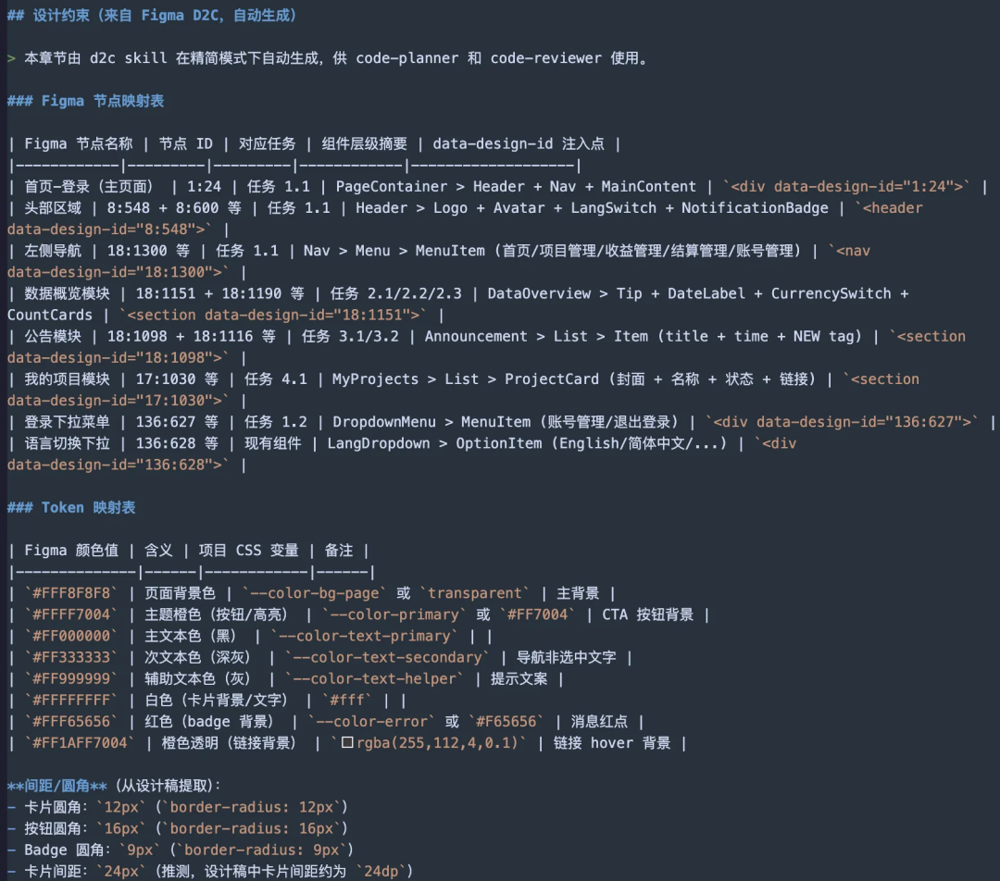

\

5.2.4 第四步：红队验证

\

拆分完成后，AI 会自己当"对手"，找遗漏场景。

| **维度** | **检验目标** | **示例** |
| --- | --- | --- |
| **数据边界** | API 返回的所有可能数据状态 | 空数据、null、超大数据、网络超时 |
| **交互边界** | 用户可能的所有操作序列 | 快速连点、加载中操作、离线操作 |
| **环境边界** | 不同运行环境下的兼容性 | SSR 兼容性、弱网环境、权限缺失 |

\

找完展示给你：【这里是我们linux-tv实际项目的演示图】

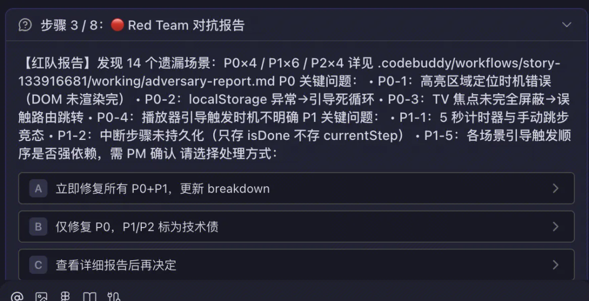

\

请选择下一步操作：

[1] 立即修复所有 P0/P1 问题

[2] 仅修复 P0 问题，P1/P2 标记为技术债

[3] 查看详细报告后再决定

\

选完后会更新 breakdown.md，把遗漏的场景补进去。

\

5.2.5 第五步：验收标准生成

\

拆分确认后，AI 基于 breakdown.md 生成 working/acceptance-criteria.md。

\

从三个维度推导用例：

| **维度** | **来源** | **产出** |
| --- | --- | --- |
| 功能边界 | breakdown.md 一级任务 | 每个功能 1 个 Happy Path 用例（P0） |
| 数据边界 | api-layer.json 的 errorHandling | 每个错误码 1 个异常用例（P1） |
| 交互边界 | ui-modules.json 的 interactions | 每个关键交互 1 个交互用例（P0/P1） |

\

生成示例：

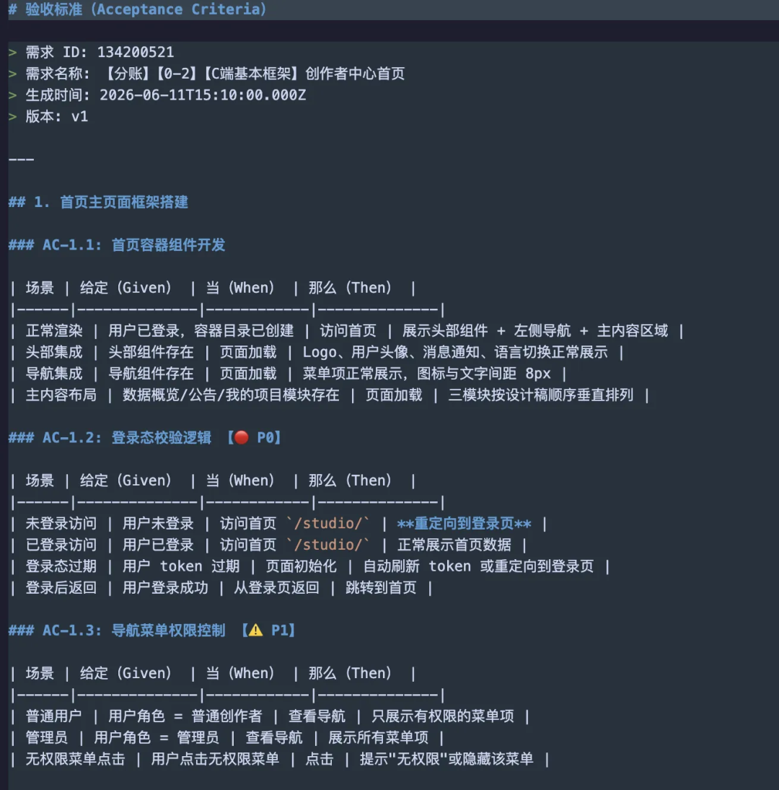

\

生成后展示给你确认，确认后才继续。

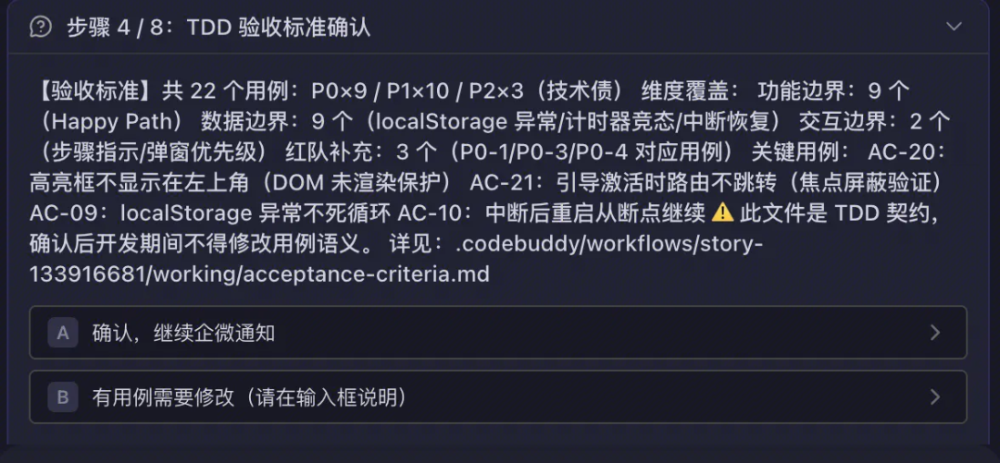

\

**关键设计**：每一步都要你确认才继续。因为需求拆分一旦错了，后面所有 AI 生成的代码都会跟着错。

\

5.2.6 流程图

\

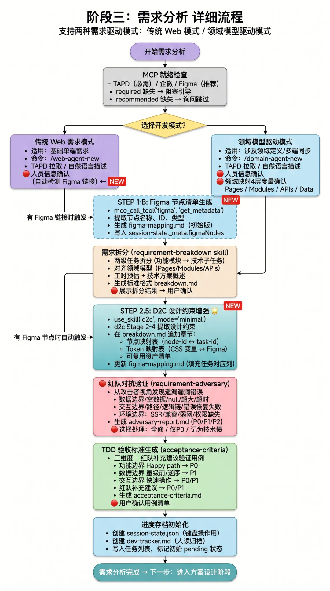

\

5.3 方案设计流程

\

方案设计分 2 步：代码分析 → 方案规划。

\

5.3.1 第一步：代码分析（Reader）

\

编码前，AI 先让 code-analyzer（reader）上场，做情报收集。

\

reader 只干一件事：编码前只读情报收集。

\

| **步骤** | **AI****干啥** | **产出啥** |
| --- | --- | --- |
| 领域模型分析 | 读 domain-mapping.json、pages.json、api-layer.json | 涉及哪些页面/API/组件 |
| 代码扫描 | 用 codebase_search 找可复用组件、hooks、工具函数 | 可复用资产清单 |
| 惯用法识别 | 读 patterns/idioms.md，标注相关条目 | 相关惯用法列表 |
| 技术风险识别 | 扫描相关文件，找 SSR 兼容性陷阱、跨包依赖等 | 技术风险清单 |

\

产出格式（通过 send_message 发给 planner）：

```
[READER_DONE] task_id=2.1## 可复用资产- `PosterListModule` @ `src/components/poster/PosterList.tsx`：渲染海报列表  - 签名：`PosterListProps { dataSource: Video[]; onItemClick: (id: string) => void; }`## 关键文件现状- `src/pages/ChannelPage.tsx`（120 行）：频道页主入口，已引入 `PosterListModule`## 技术风险- ⚠️ `ChannelPage` 是 SSR 模式，`useEffect` 里发请求会白屏，需用 `getServerSideProps`
```

\

关键设计：reader 不修改任何源码，只收集情报。情报报告会传给 planner，用来做方案。

\

5.3.2 第二步：方案规划（Planner）

\

reader 收集完情报后，AI 让 code-planner（planner）上场，出方案。

\

planner 只干一件事：**基于情报产出 impl-plan-{taskId}.md，不修改源码**。

| **步骤** | **AI****干啥** | **产出啥** |
| --- | --- | --- |
| 读取基础资料 | 读 breakdown.md、session-state.json、acceptance-criteria.md、adversary-report.md | 任务上下文 |
| 加载记忆层 | 读 patterns/anti-patterns.md 和 patterns/idioms.md | 禁止事项清单 + 惯用法参考 |
| 代码库探查 | 用 codebase_search 找可复用组件、hooks、工具函数 | 可复用资产清单 |
| Figma 设计约束解析（如有） | 读 breakdown.md 末尾的"设计约束"章节，调用 D2C 精简模式获取详细结构 | 附录 A：Figma 设计约束 |
| 起草方案 | 按标准 Schema 逐节填写 impl-plan-{taskId}.md | 完整实现方案 |
| 写入文件 | 把方案写成 working/impl-plan-{taskId}.md | 方案文件 |
| 展示审批 | 展示方案摘要，等你审批 | 你的审批结论 |

\

**方案文件标准****Schema**：这里不详细贴了，说白了就是详细描述代码开发的技术方案

```
## 元信息- 需求 ID：133916681- 任务 ID：2.1- 渲染模式：SSR## 1. 任务目标改完之后，频道页会展示推荐视频列表，用户能看到至少 6 个视频海报。## 2. 上下文摘要- 相关现有文件：`src/pages/ChannelPage.tsx`（频道页主入口）- 可复用组件：`PosterListModule`（已有，直接引入）- 需要避免踩的坑：见 AP-001（useEffect 依赖数组缺失）## 3. 文件变更清单xxxxxxx## 4. 每个文件详细方案xxxxxx## 5. CSR|SSR模式处理xxxxx## 6. 测试要点xxxxx## 7. 风险与开放问题xxxxx## 8. Executor执行清单检查xxxxxx**Figma 设计约束（如有）**： 如果 `breakdown.md` 末尾有"设计约束"章节，planner 会调用 D2C 精简模式，获取详细结构，追加"附录 A：Figma 设计约束"到方案文件末尾
```

\

planner 出完方案后，会展示给你审批。这是**第一道卡点**——方案审批通过后，executor 才能开始编码。

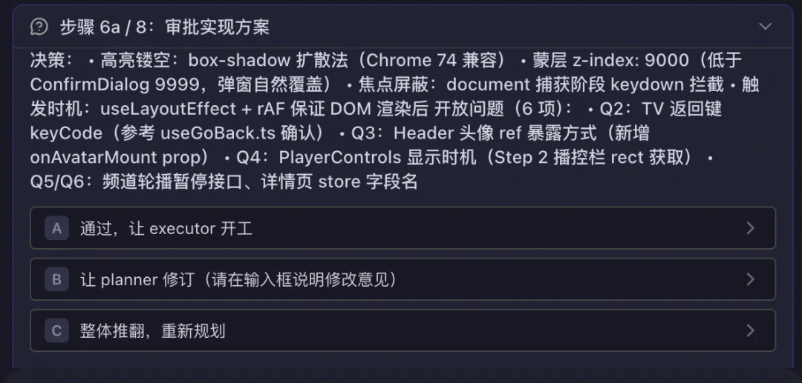

\

[linux-tv项目实际截图]

\

5.3.3 流程图

\

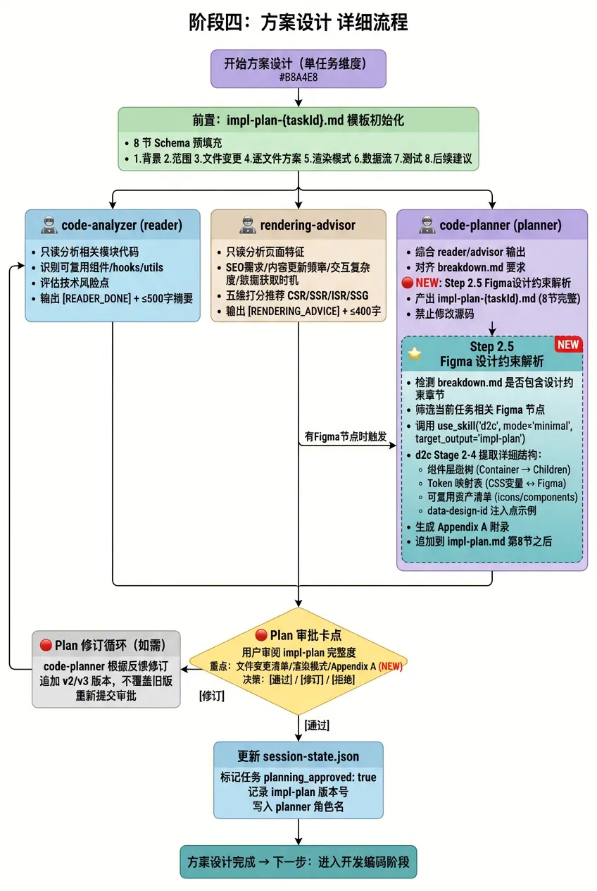

\

5.4 开发编码阶段

\

开发编码分 3 步：编码执行 → 代码审查。

\

5.4.1 第一步：编码执行（Executor）

\

Planner 方案审批通过后，AI 让 code-developer（executor）上场，严格按方案落盘。

\

executor 只干一件事：严格按 impl-plan-{taskId}.md 落盘，不自己发挥。

| **步骤** | **AI****干啥** | **你要确认啥** |
| --- | --- | --- |
| 读取方案 | 读 impl-plan-{taskId}.md，确认方案完整 | - |
| 按清单执行 | 按第 3 节"文件变更清单"顺序，逐个文件落盘 | 落盘前弹窗确认 |
| 质量门禁 | 跑 web-local-quality-gate skill，检查 lint/类型/测试 | - |
| 回报完成 | 列出实际修改的文件清单，发 [TASK_DONE] | - |

\

5.4.2 第二步：代码审查（Reviewer）

\

Executor 落盘后，AI 让 code-reviewer（reviewer）上场，做新鲜视角审查。

\

reviewer 只干一件事：**executor 落盘后做新鲜视角审查，产出报告，不修改代码**。

| **审查维度** | **检查目标** | **示例** |
| --- | --- | --- |
| **Plan****忠诚度** | 代码是否真的按方案执行了？有没有超纲、偷工、顺手加料？ | 方案里没让加 <Wrapper>，实际加了 |
| **Idioms****合规** | 是否踩了项目惯用法？有没有重复造轮子？ | 直接 fetch()，没走项目统一的 axios 封装 |
| **React/TS****反模式** | useEffect 依赖遗漏、不必要的 memo、直接改 props、any 泛滥、组件过大等 | useEffect 的依赖数组缺 userId，会导致 stale closure |
| **CSR/SSR****兼容性** | SSR 模式下是否误用了浏览器 API、Hydration 是否一致、数据获取时机是否正确 | 在初始化时用了 window.localStorage，SSR 会崩 |

**\**

**产出格式**（review-report-{taskId}.md）：[由于篇幅问题，不详细展开]

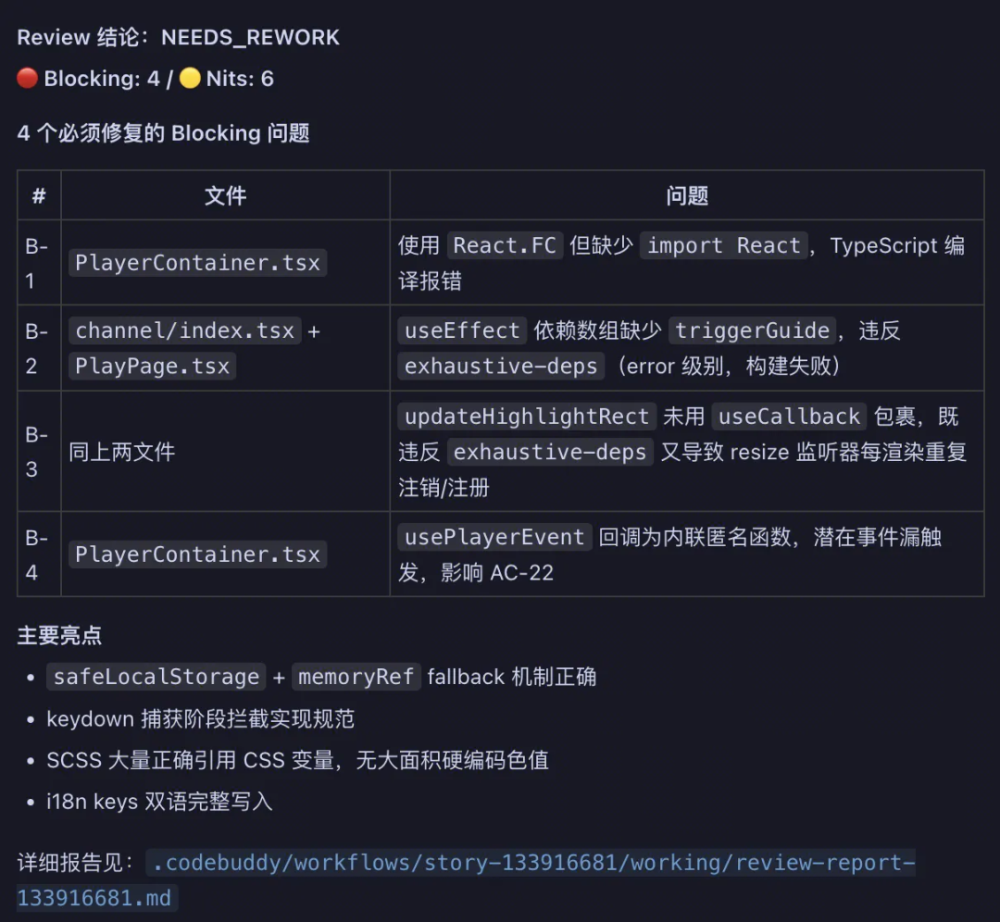

\

**审查结论**：

| **结论** | **含义** | **下一步** |
| --- | --- | --- |
| PASS | 通过，无问题 | 进入 L0-L4 验证 |
| PASS_WITH_NITS | 通过，但有 NIT 建议修 | 你可选择修或不修 |
| NEEDS_REWORK | 不通过，有 Blocking 问题 | 打回 executor 重做 |

**\**

**关键设计**：executor 不能自己拉起 reviewer（避免自审）。必须由 Lead 触发。

\

5.4.3 流程图

\

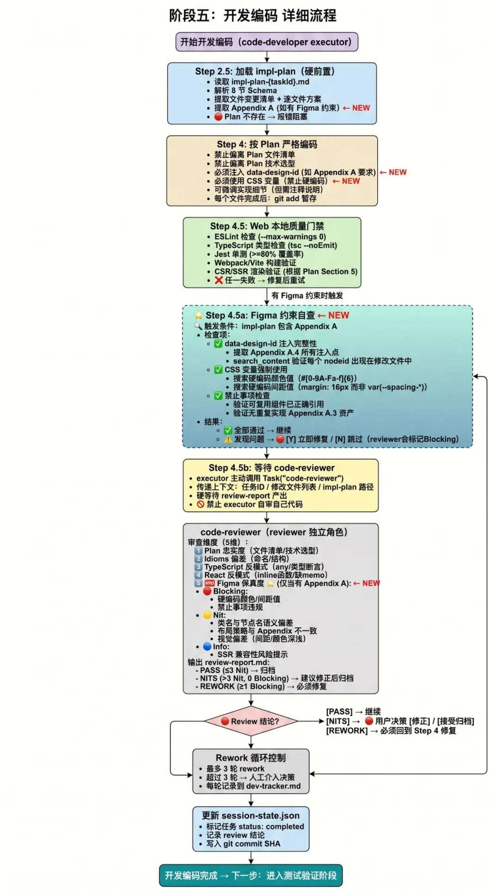

\

5.5 测试验证环节

\

3 步：本地质量门禁 → L0-L4 验证 → 效果追踪。

\

5.5.1 第一步：本地质量门禁

\

编码完成后，AI 先跑本地质量门禁（web-local-quality-gate skill），检查代码质量。

| **检查项** | **验证什么** | **不通过会咋样** |
| --- | --- | --- |
| **代码风格检查** | ESLint + Prettier | AI 自动修复格式问题 |
| **TypeScript****类型检查** | tsc --noEmit | AI 自动修复简单类型错误 |
| **单元测试** | Jest 测试套件 | 展示失败用例，询问你是否继续 |
| **CSR****构建测试** | Webpack/Vite 构建 | 分析错误日志，自动修复常见问题 |
| **SSR****构建测试** | Next.js 构建 + SSR 渲染验证 | 检查是否使用了浏览器专属 API |
| **CSR/SSR****模式验证** | 核心逻辑是否与渲染模式耦合 | 提示改用适配器模式 |

**\**

**产出格式**（质量验证报告）：

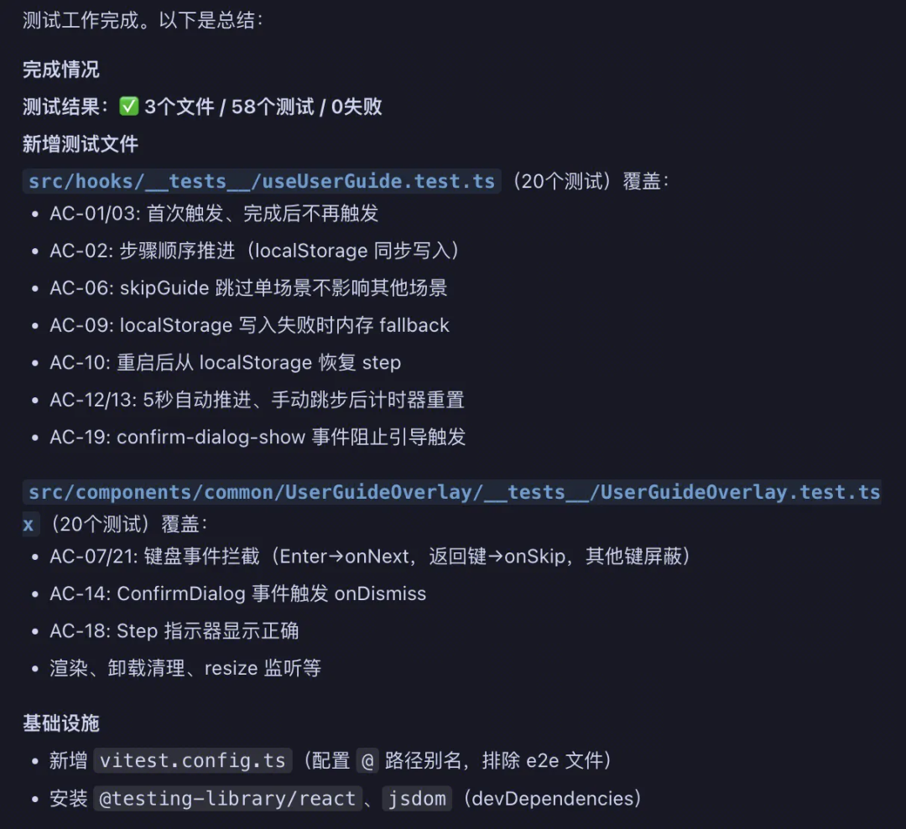

\

5.5.2 第二步：L0-L4 验证（蓝队防御）

\

本地质量门禁通过后，还要跑五层质量门禁：

| **层级** | **验证什么** | **脚本** | **不通过会咋样** |
| --- | --- | --- | --- |
| **L0** | 领域模型完整性 | validate-domain-model.sh | 检查必需文件是否存在、JSON 格式是否正确、引用是否一致 |
| **L1** | 目录与模型对齐 | validate-project-structure.sh | 检查目录结构是否符合领域模型定义 |
| **L2** | API 契约 | validate-api-contract.sh | 检查 API 接口是否与契约一致 |
| **L3** | 多端对等性 | validate-cross-platform.sh | 检查多端实现是否一致 |
| **L4** | E2E 测试 | generate-test-spec.js | 检查 E2E 测试是否通过 |

**\**

**评分规则**：

| **层级** | **权重** | **评分标准** |
| --- | --- | --- |
| L0 | 20% | 领域模型完整性 |
| L1 | 20% | 目录与模型对齐 |
| L2 | 20% | API 契约 |
| L3 | 20% | 多端对等性 |
| L4 | 20% | E2E 测试 |

**\**

**通过条件**：评分 ≥ 70 才算通过。不通过的打回重做。

\

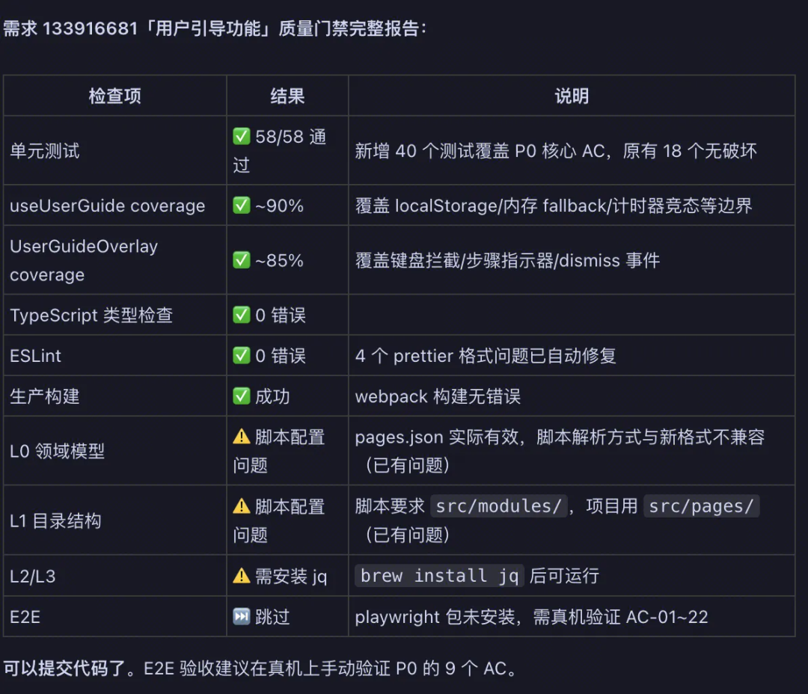

\

5.5.3 第三步：效果追踪

\

验证通过后，记录这次开发过程的数据，生成效率报表。

\

**收集哪些数据**：

| **指标** | **说明** |
| --- | --- |
| **首次通过率** | 第一版代码是否通过 L0-L4 验证 |
| **返工次数** | 因为 Review 不通过重做了几轮 |
| **任务完成数** | 拆分了多少任务，完成了多少 |
| **红队发现问题数** | 需求阶段发现多少遗漏场景 |
| **变异测试安全评分** | 代码生成阶段的安全评分 |

\

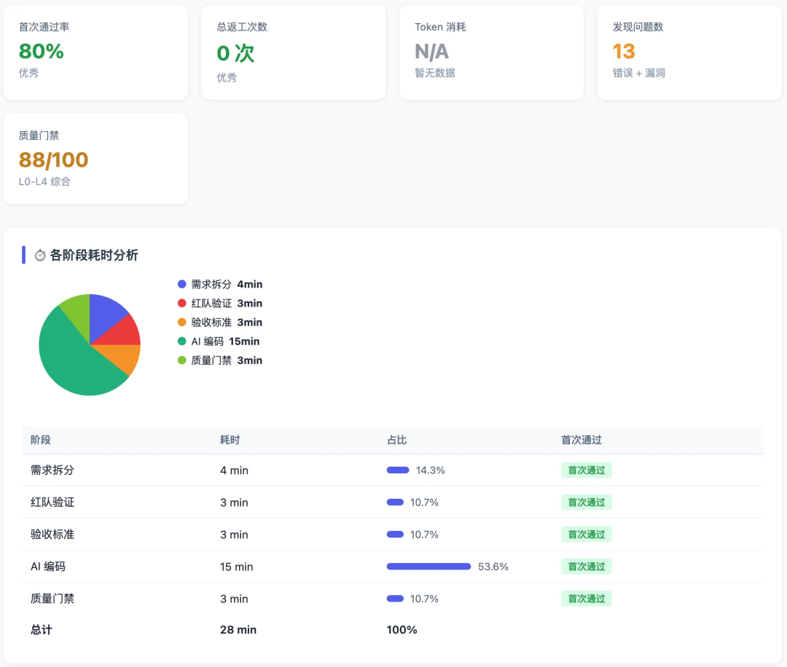

[linux-tv需求开发完后截图]

\

5.5.4 流程图

\

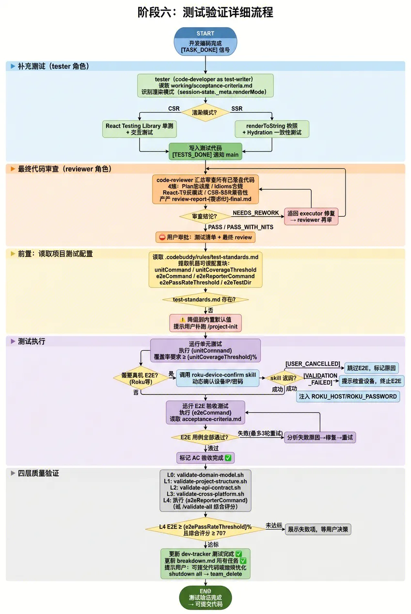

\

\

\

# 06

\

\

管理机制：怎么让团队真正用起来

\

6.1 wpc 是啥？

\

wpc 是我们自己写的一个 CLI 工具，全名 @tencent/wpc-cli，全局安装。

\

它干的事很简单：把 harness 源仓库的文件同步到目标项目。

\

为啥要自己做？因为 Harness 不是个 npm 包——它是 .codebuddy/ 目录下的一堆文件（commands、skills、agents、rules、scripts）。这些文件要"装到项目里"，还要能"升级"。

\

6.2 新项目怎么接入？

\

就两步：

**第一步：全局安装****wpc**

```
npm install -g @tencent/wpc-cli
```

只需跑一次，装完就有 wpc 命令了。

\

**第二步：进到你的项目根目录，跑****wpc harness init**

```
cd /path/to/your-projectwpc harness init
```

这条命令会干什么？**从远程仓库下载 harness，放到当前项目的 .codebuddy/ 下**。

\

默认是从远程仓库拉最新版本。当然，如果你在本地改 harness 源码，想先试试效果，也可以指定本地路径：

```
wpc harness init --local /path/to/codebuddy-harness
```

\

6.3 怎么升级？

\

Harness 源仓库改了（比如加了新 command、修了 bug），怎么同步到各项目？

\

就一条命令：

```
wpc harness update
```

它会从远程仓库拉最新，同步到当前项目。

\

**有个坑：孤儿文件**

**\**

Harness 源仓库删了某个文件（比如旧命令 bug:fix），目标项目里还留着——这就是"孤儿文件"。

\

最早我们让 update "只 add 不 delete"——源仓库删了文件，目标项目里留着，反正不影响。

\

结果是：**旧命令文件越来越多，AI 有时候会调到旧命令**（bug:fix 和 bug-fix 同时存在，AI 可能调错的那个）。

\

后来改成：update 时自动检测孤儿文件，弹三选一：

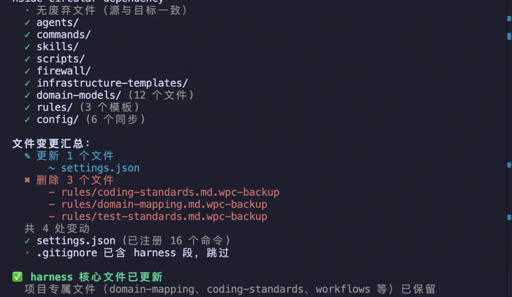

\

6.4 版本管理：源仓库是"唯一真相源"

\

Harness 的版本管理靠的是 **Git**：

- 源仓库（codebuddy-harness）是"唯一真相源"，所有修改都先提交到这里
- 目标项目的 .codebuddy/ 是"分发副本"，不直接改（AI 也被禁止直接改，除非是项目私有配置）
- 升级时，wpc harness update 本质上是个"智能复制"——只覆盖源仓库有的文件，不碰项目私有配置

**\**

**为啥不用 Git Submodule？**

**\**

试过，坑太多：

1. Submodule 要求目标项目里有个独立的 Git 仓库——.codebuddy/ 是项目的一部分，不是独立仓库
2. Submodule 的版本锁定在父仓库的 commit 里——想升级得先 cd .codebuddy && git pull，再回父仓库提交，太麻烦
3. CI/CD 里处理 Submodule 经常出问题——有的环境没配 SSH key，拉不下来

\

wpc harness update 就是个文件同步工具，不依赖 Git Submodule，简单直接。

\

6.5 AI 改文件时的"编辑边界"

\

Harness 源仓库和项目分发副本之间，有个"编辑边界"问题：AI 改 Harness 流程时，必须清楚**哪些文件能改，哪些不能改**。

\

规则很简单：

| **文件位置** | **能改？** | **谁改？** |
| --- | --- | --- |
| codebuddy-harness/.codebuddy/ | ✅ | 只有 Harness 维护者 |
| {项目}/.codebuddy/commands/ | ❌ | 禁止直接改（跑 wpc harness update 同步） |
| {项目}/.codebuddy/config/ | ✅ | 项目私有配置，AI 可以改 |
| {项目}/.codebuddy/workflows/ | ✅ | 业务数据，AI 可以改 |

\

AI 被明确告知：**改通用流程文件前，先检查路径是否以****codebuddy-harness/****开头。如果不是，立即停止**。

\

6.6 流程图

\

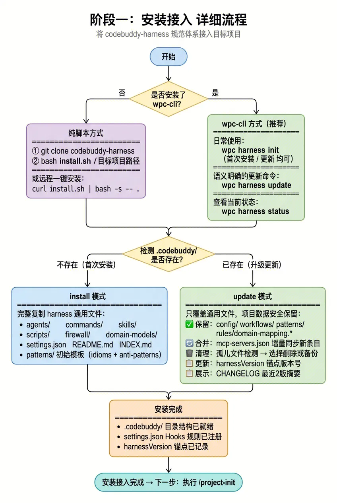

\

\

\

# 07

\

\

结尾

\

写到这里，这篇文章终于要收尾了。能看到这里的朋友，非常感谢你的耐心。

\

这篇文章是我们团队一年来在 Web 项目里用 AI 辅助编程的思考和总结。限于篇幅，其实还有很多东西没展开讲：

1. **D2C（设计稿转代码）、bug-fix 这些核心场景**

   ，这篇文章里只是提了名字，没细说
2. **像 CMS、H5 项目仓库集、创作者中心这类项目**

   ——它们不太能抽 4 层业务模型，我们是怎么接入 Harness 的——这块也没展开
3. **还有一些调优细节**

   ，比如防止 skill 虹吸、工具链的稳定性、IDE 钩子等等，也没法在文章里一一呈现

\

欢迎在评论区交流。

\

-End-

原创作者｜刘勇刚

\

感谢你读到这里，不如关注一下？👇

\ 你对本文内容有哪些看法？同意、反对、困惑的地方是？欢迎留言，我们将邀请作者针对性回复你的评论，欢迎评论留言补充。我们将选取1则优质的评论，送出腾讯云定制文件袋套装1个（见下图）。7月14日中午12点开奖。\扫码领取腾讯云开发者专属服务器代金券！  \ 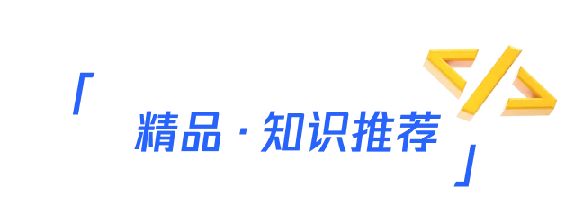 [](https://mp.weixin.qq.com/s?__biz=MzI2NDU4OTExOQ==&mid=2247695850&idx=1&sn=ecfbc2739caa6d9ebda151aadc400c8a&scene=21#wechat_redirect) [](https://mp.weixin.qq.com/s?__biz=MzI2NDU4OTExOQ==&mid=2247695865&idx=1&sn=d300189a3247bb4da82e03c2c1d9e772&scene=21#wechat_redirect) [](https://mp.weixin.qq.com/s?__biz=MzI2NDU4OTExOQ==&mid=2247695963&idx=1&sn=29f18a2db784e1ddb56796af76543688&scene=21#wechat_redirect) \ 
