# 一个鹅厂程序员，用AI给自己造了10个"外挂"

> 腾讯云开发者 · 周晓楷 · 2026-07-31 08:45

> 原文：<https://mp.weixin.qq.com/s/LC4M6J7askNQSnyl3loWtw>

---

\

\

关注腾讯云开发者，一手技术干货提前解锁👇

\

\

\

AI 已经完全重新定义软件开发的成本结构，过去那些「不值得做」的小工具，现在可以在数小时内借助 AI 完成交付。本文将结合个人实践，分享如何从日常工作中识别痛点、利用 AI 构建提效工具，并介绍几个在 AI 编程过程中积累的实用技巧。

\

\

\

# 01

\

\

AI 成为基础设施，软件行业的游戏规则已被改写

\

前阵子看到一篇来自前特斯拉 AI 总监 Andrej Karpathy 的推文：

> 作为程序员，我从未感到自己如此落后。

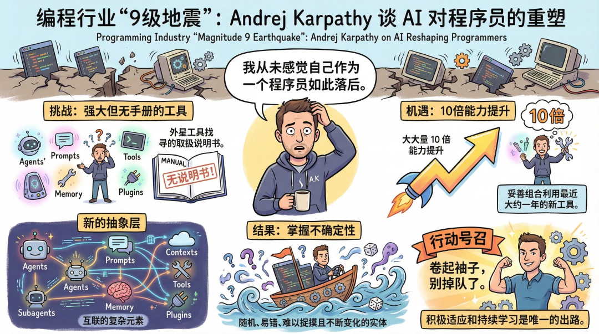

\

这句话有强烈的反差感，连这种顶尖 AI 研究人员都在感叹自己可能被时代甩在身后，可见 AI 发展速度之快。不过也从侧面说明了，软件技术范式正在发生根本性的转变。AI 不是难以企及的技术，而是已经成为像水电、互联网一样的**基础设施**。软件行业过去几十年积累的游戏规则正在被重写。

\

### 传统软件开发

### \

回想一下，传统时代（也就是一年多前），开发定制化软件的成本有多高。不同的业务技术栈都存在壁垒，需要不同分工的程序员花大量的时间去学习和投入，交付一个软件往往需要数周到数月。

- **技术栈壁垒高**：每个定制工具都需要专人、专项投入。
- **知识检索低效**：开发者 60% 时间花在读文档与调试上。
- **交付周期长**：内部工具从立项到上线往往需要数周到数月。

\

所以在以前，我们在工作中遇到一些小麻烦，脑子里可能会闪过一个念头——要是有一个提效工具该多好。但只要一想到投入的成本，想想还是算了，**没必要为了一碟醋去包一顿饺子**。

\

### AI Native 时代

### \

- LLM + Agent 重构开发流程，交付周期从数周缩短到**小时级**。
- 技术栈壁垒大幅降低——自然语言即可产出**可用软件**。
- 工具开发成本被重新定义，过去「不值得做」的工具现在**值得一试**。

\

现在 AI 彻底改变了成本核算的方式，我们通过自然语言就可以指挥 AI 构建出软件。以前那些不值得做的小痛点，现在可以花上几个小时的时间，让 AI 帮我们解决。

\

在以前脱口秀很火的时候，有一句话叫「人人可以说五分钟脱口秀」。现在是：

> 开发门槛降低，每个人都能构建自己的提效工具。

\

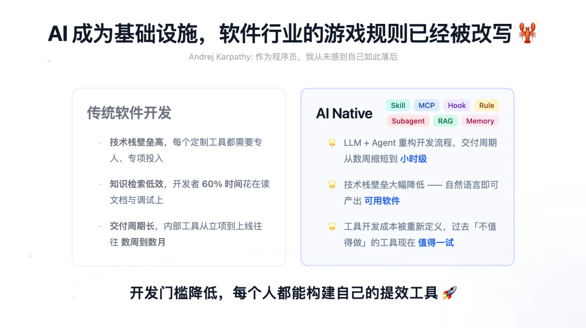

\

\

\

# 02

\

\

Kelvin's Side Projects：借助 AI，一个人也能完成全栈开发

\

过去几个月，我借助 AI 给自己开发了多个提效工具，处理的场景均来自日常工作：

### \

### 全局 AI 助手（Genie）

### \

基于 Tauri + 本地 GeminiCli 实现的全局快捷 AI 问答工具（完全免费）。可以在电脑上任意页面按下快捷键唤起，唤起 Gemini 回答问题。还有一个内置的**脚本大师**，可以帮我生成即时脚本，比如写一段代码，帮我将网页里的表格数据导出成 CSV。

\

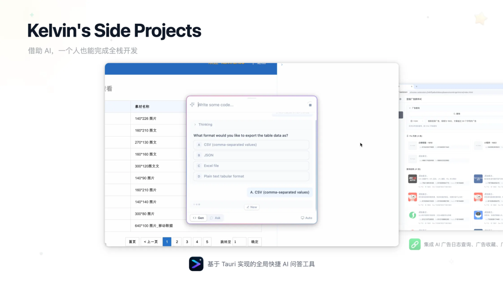

\

### 微信广告绑定助手

\

集成了 AI 广告日志查询、广告收藏、广告绑定功能，可以在一个页面快速做广告搜索和绑定。

\

\

### 学习 Agent（Muse）

### \

自动整理文章内容，生成助记图，保存到 Notion。

\

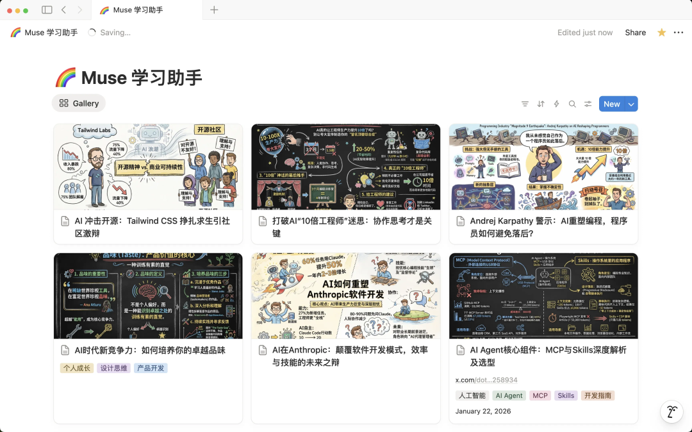

\

### AI 翻译插件（Lingo）

### \

帮我沉浸式阅读外文，理解式翻译，内容直接插回页面相同位置。

\

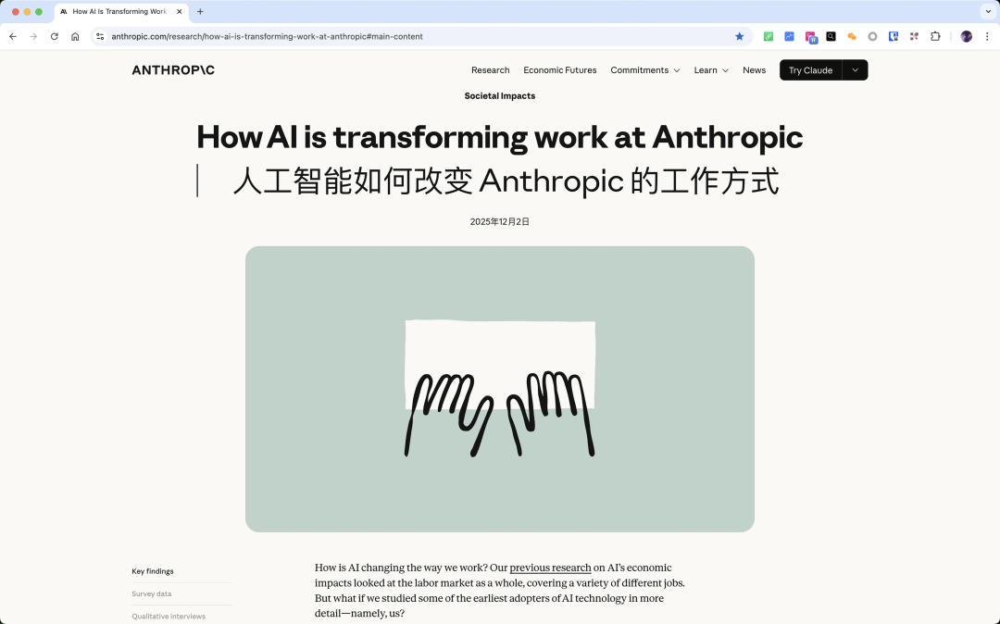

\

除了这些直接调用 AI 的提效工具，还有一些比较传统的、AI 暂时无法覆盖到的领域，也非常适合让 AI 来帮助开发工具：

\

### 公众号开发者工具

### \

可以在公众号广告上长按，弹出开发者菜单，支持原地刷新广告、广告快速诊断、远程无限调试 iframe、广告收藏等等能力。

\

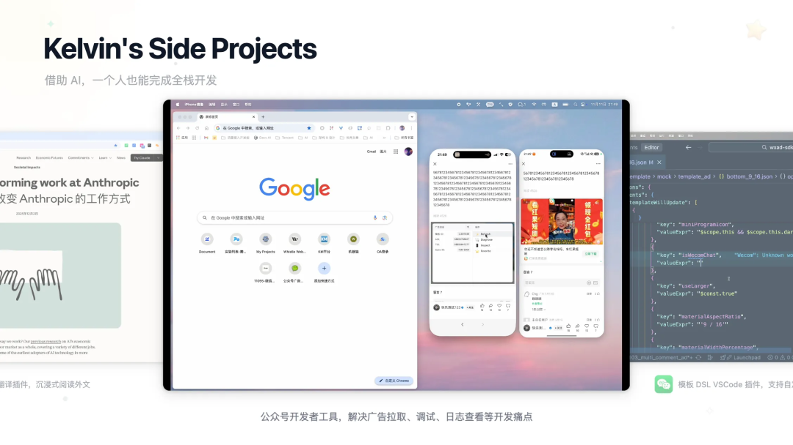

\

### 模板 DSL VSCode 插件

\

支持广告内部 DSL 的语法高亮和代码智能提示。

\

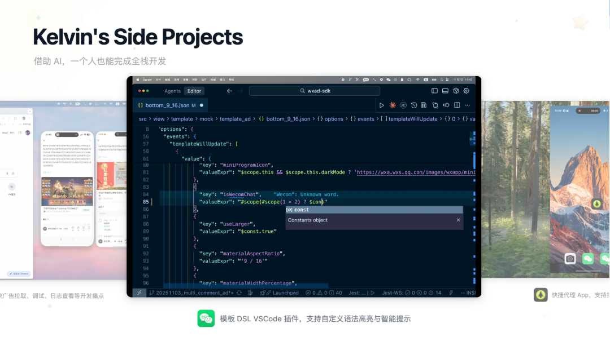

\

### 快捷代理 App（Easy Proxy）

\

支持扫码绑定代理的 App，可以快速让手机配置代理到本地电脑。

\

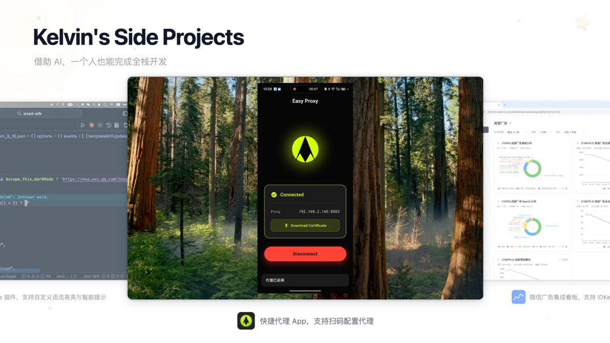

\

### 数据集成看板（Trends）

\

支持 IDKey 和 iLogs 自定义集成看板，方便在发布过程中盯盘和重点上报关注。

\

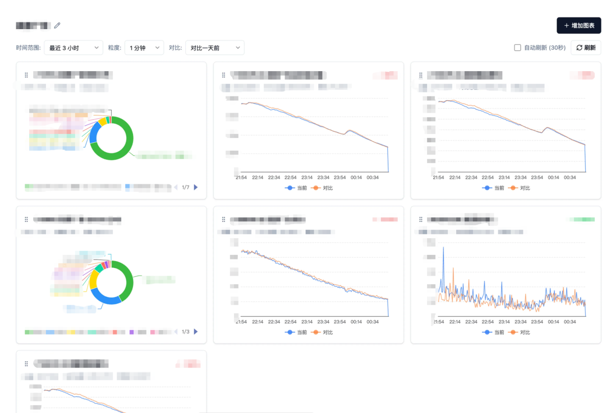

\

这些工具跨了很多技术栈，覆盖我在日常工作中的各个场景，很难想象在没有 AI 的时代，单人如何在空闲时间内开发出这么多的 SideProjects。

\

\

\

# 03

\

\

痛点识别：Yak Shaving

\

怎么判断哪些事情值得去提效？这里引入一个概念：**Yak Shaving**（薅牦牛毛）。

\

### 什么是 Yak Shaving？

### \

举个例子：

- 你想洗车 → 发现软管破了；
- 去买软管 → 要去五金店；
- 开车去五金店 → 限号不能上路；
- 借邻居的车 → 邻居说借可以，但要接他小孩放学；
- ……（经过一系列离谱的链条）
- **到最后，你发现自己居然在青藏高原薅着牛毛。**

\

> YakShaving: 在解决问题的过程中，引发的一系列任务，导致最终偏离原本的目标，通常带有负面含义。

\

就好比，我们在玩开放世界游戏时，目标是去解救塞尔达公主，但莫名其妙地你会在翻雪山、在海里捕鱼、闯神庙，或者在找呀哈哈。

\

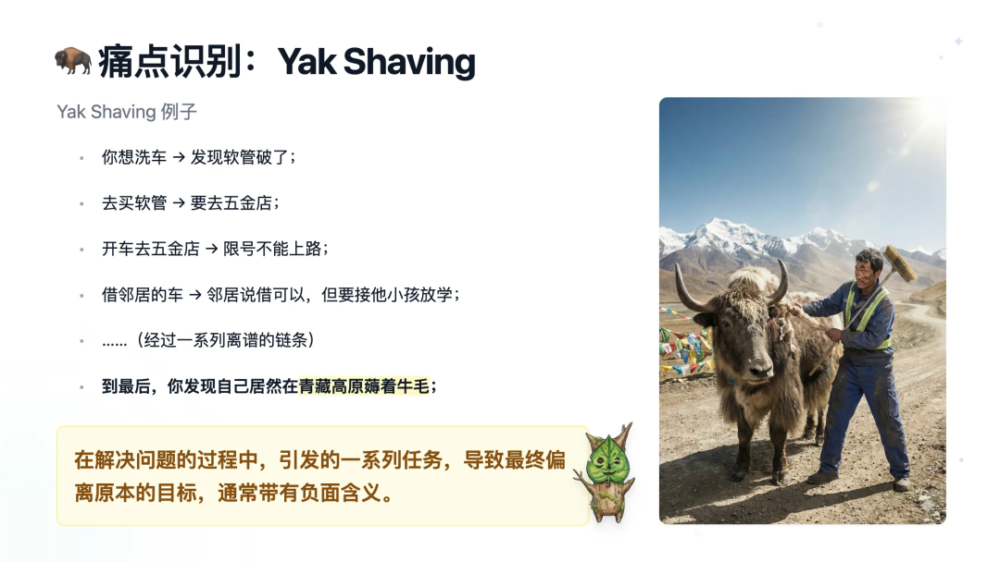

\

Yak Shaving 的故事充满荒诞的戏剧性，但由于基建差、系统老旧、流程长等等很多原因，这其实是大部分同学日常工作的常态。牛毛问题非常多，且不可避免。

\

但也有人觉得这些牛毛，**其实是可以转化为生产力的机会。**

\

### Anthony Fu 的开源之路：从「薅牛毛」到「造工具」

### \

我最早听到 **Yak Shaving** 这个词汇是在一个前端开发者大会上，开源社区开发者 Anthony Fu 分享他的开源之路是怎么走起来的。

\

> slides 直达连接：https://talks.antfu.me/2024/vueconf-shenzhen/

\

大学刚毕业的时候，跟朋友一起做了一个分账的 App，然后开源出来。

- 觉得社区的 i18n 支持不够好，就自己做了一个
- 觉得社区的 Vue 工具库不够好用，做了 VueUse
- 想在 Vue2 里使用 Vue3 的特性，又封装了 composition-api。

\

后面又参与到 Vue3 开发、加入 Vite 团队。随着越来越多的发散和扩张，最后他就变成了大家眼里非常高产的开源社区明星。

\

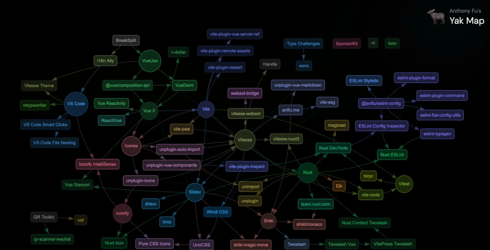

\

他的核心方法论是：

> 敏锐地发现工作中让你不舒服的点，尝试提出自己的解决方案。

\

所以，当你在工作中使用某个系统或者工具，觉得流程繁琐和低效时，不要只停留在吐槽和抱怨的层面，而是想办法，使用 AI 将这种负面的、偏离目标的阻力转化为创造工具的契机。**痛点就是非常好的需求文档。**

\

\

\

# 04

\

\

LLM 基本原理与 Prompt 技巧

\

前面讨论了 AI 的能力，接下来有必要揭开 LLM 的面纱。因为很多人把 AI 想象成全知全能的超级硅基大脑，但实际上，了解它是如何工作的才是用好它的前提。

\

### 训练三阶段

### \

大模型的训练大致可以分为三个阶段，了解这三个阶段，就可以了解它的「脾气」：

1. **Pre-training（预训练）**：海量文本编码为模型参数。这个阶段的模型就像一个知识渊博的书呆子，只学会了文字接龙，并不懂怎么跟人说话。
2. **SFT（监督微调）**：提供大量高质量的「提问-回答」范例，让模型学会对话，而非逐字续写。
3. **RLHF（人类反馈强化学习）**：对齐人类价值观与偏好，告诉模型什么是礼貌的、什么是合适的回答。

\

经过这三个阶段，模型表现得极其聪明，但**本质上并没有产生「理解」能力。**

**\**

### 本质是概率预测

### \

LLM 的本质是 **Token 概率预测**——它只是在模拟它见过的文本模式，计算在当前语境下最有可能出现的下一个 Token 的概率。在它基于概率预测的大脑里，并没有数值大小的绝对概念。比如它可能觉得 0.11 在某个语境下比 0.9 更大。

\

### 三个实用技巧

### \

基于 LLM 的工作原理，有三个实用的 Prompt 技巧：

**1. 使用大模型能理解的 Token**

不要用私有领域的黑话，使用开源界的统一语言。

- 不推荐：~~公众号~~、~~广告~~、~~模板~~、~~Expr~~
- 推荐：Vite、Flutter、Web、VSCode、Tauri

**2. 单轮对话专注单一任务**

大模型记忆窗口有限，塞入太多内容时，概率预测会受到严重干扰。

- 拆解任务粒度，直到一轮对话能完成。
- 不同的任务，拆分独立对话上下文。

**3. 大模型在「模仿」而非「理解」**

它能解奥数题，偶尔也分不清 0.11 和 0.9 哪个大。

- 拥抱 AI 不等于放弃审查，**产出务必 Review**。

\

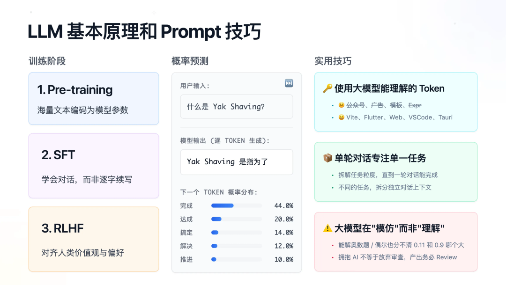

\

\

\

# 05

\

\

实用技巧分享

\

接下来再分享几个笔者近期接触到的，觉得比较实用的技巧。

\

### 技巧一：复杂任务，先规划再行动

### \

直接让 AI 去启动一个复杂任务，通常得到的效果都很差，原因是 AI 没有充分理解需求。为了解决这个问题，让 Agent **充分理解需求**再动手编码，可以有效减少返工。

\

目前有几种主流的规划方案：

\

#### 方案一：SpecKit / OpenSpec

规范驱动开发（SDD），写代码前先通过宪章、需求澄清、分析计划、任务拆解，再开始干活。包含比较多命令，每一个任务都需要经过澄清、分析、拆解，相对而言比较重。

\

#### 方案二：Plan Mode

Claude Code / Codebuddy 内置的规划模式。Agent 先通过问询理解需求，生成 Plan，确认后开始执行。

\

#### 方案三：Superpowers（推荐）

一个基于 Skill 的完整开发工作流（GitHub 57k+ Stars）。技能自动触发，心智成本低，**基本上需要记住「脑暴」就可以了，Skill 会自动决定是否需要使用方法论**。

> SuperPowers: https://github.com/obra/superpowers

\

Superpowers 的完整工作流包括 7 个步骤：

1. **脑暴需求**：追问提炼想法，探索备选方案，保存设计文档。
2. **分支隔离**：在新分支创建隔离工作空间，验证测试基线干净。
3. **编写计划**：把工作拆成小任务，每个任务包含精确的文件路径、完整代码和验证步骤。
4. **SubAgent**：每个任务派一个独立子 Agent，两阶段审查：先检查 Spec 合规，再检查代码质量。
5. **TDD 驱动**：强制 RED-GREEN-REFACTOR 循环——先写失败测试，再写最小实现，再重构。
6. **代码审查**：对照计划审查，按严重级别报告问题，Critical 问题阻断后续进度。
7. **完成开发**：验证测试通过，提供选项（Merge PR 保留 / 丢弃），清理 worktree。

\

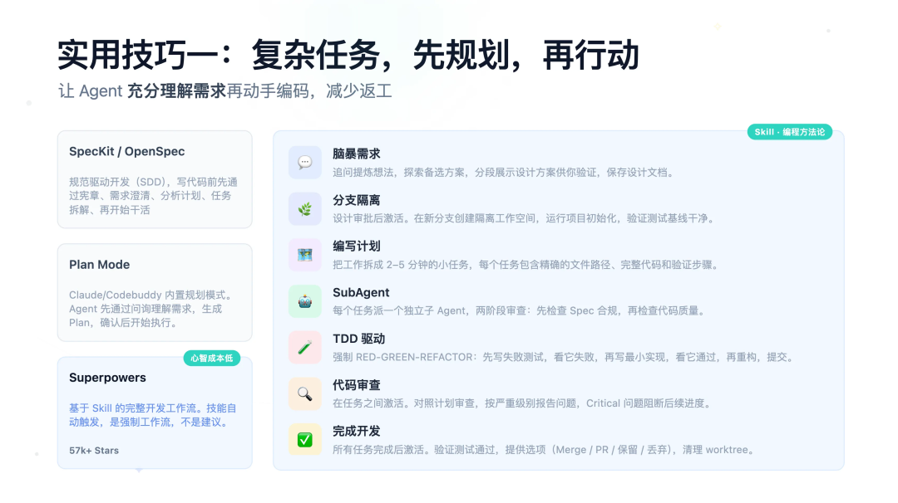

\

### 技巧二：Debug Mode 让 AI 掌握真实上下文

\

当你让大模型帮你写完第一版软件之后，大概率是不可用的。很有可能遇到这种场景：程序有 bug，但反复沟通多轮之后问题依旧没有解决。这种情况很浪费时间，也很让人受挫。

\

\

#### Debug Mode 闭环

用**真实运行结果与日志**驱动排查，而不是靠描述或猜测：

1. **列出假设并添加打点**：分析症状，生成可验证的假设列表。

   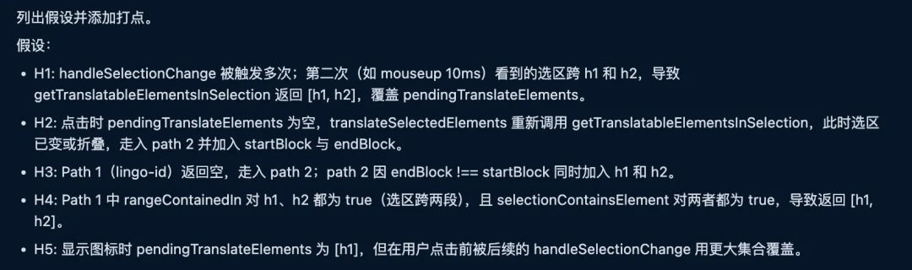

   \
2. 自动插桩，写入 Agent Log：在关键路径注入日志，捕获运行时数据。

   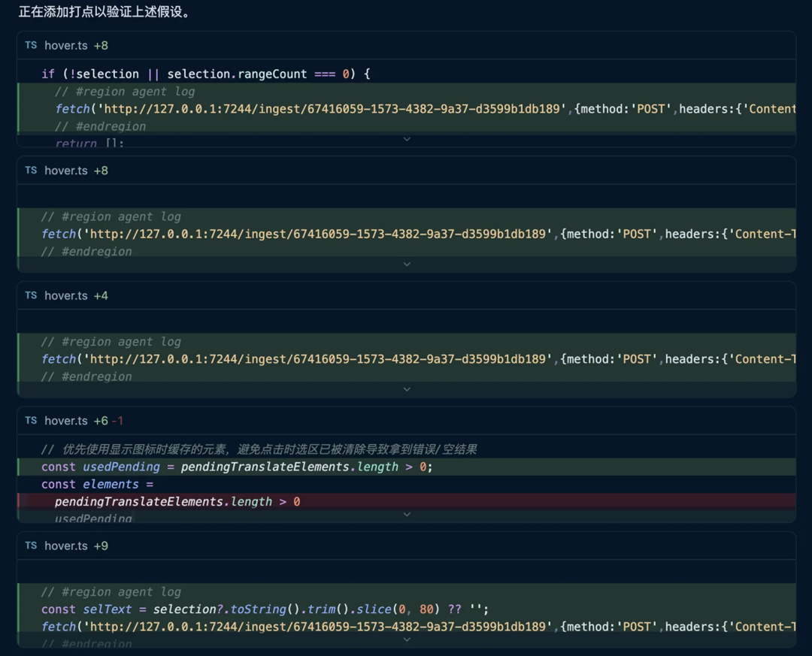

   \
3. 收集日志，复现验证：构建并执行复现步骤，用日志定位根因。

   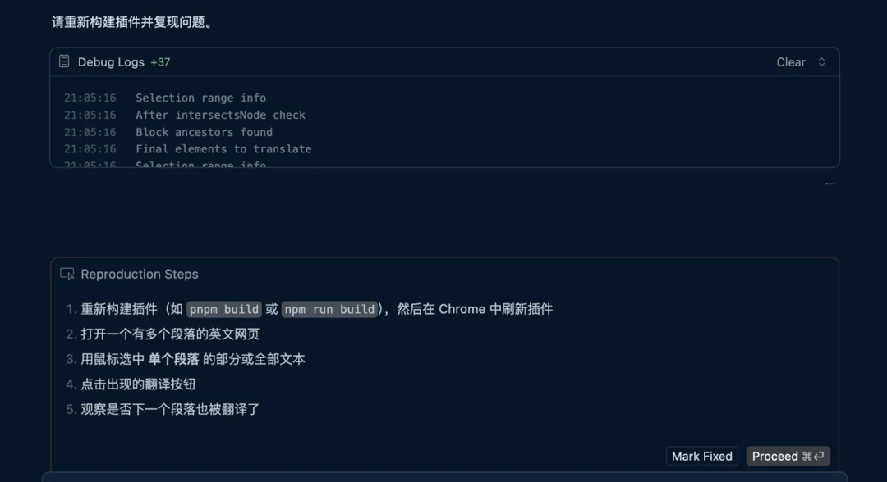

   \
4. 确认修复 / 继续循环：未修复 → 回到步骤 1；已修复 → 清理日志代码。

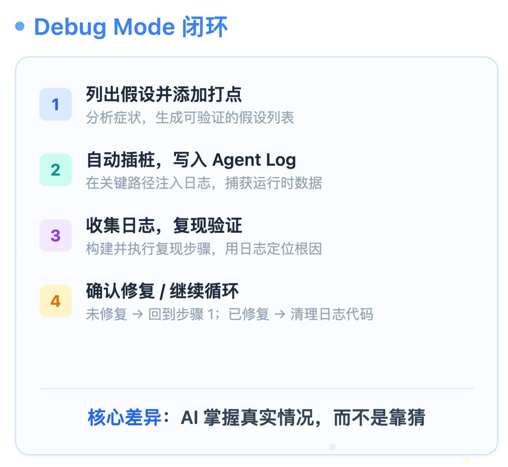

> 核心差异：AI 掌握真实情况，而不是靠猜。

\

我经历过几次多轮对话都没办法解决的问题，用 Debug Mode 一次修复通过，体验非常好。

\

### 技巧三：平行时空，多任务并行

### \

在和 AI 对话的过程中，经常需要等待，这个过程也很容易导致分心和低效。这种情况下，我们可以用 **Git Worktrees + 多窗口 + tmux** 同时推进多个任务，充分利用并行能力。

\

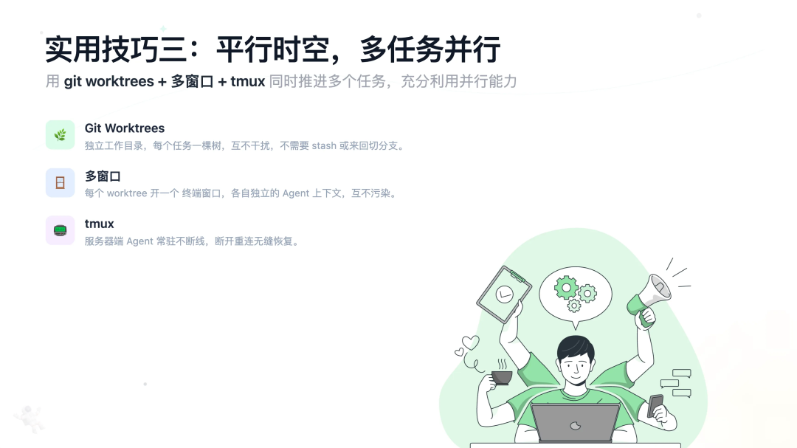

\

#### Git Worktrees

独立工作目录，每个任务一棵树，互不干扰。不需要 stash 或来回切分支，可以同时开发特性和修复 bug。

\

#### 多窗口

每个 worktree 开一个终端窗口，各自独立的 Agent 上下文，互不污染。

\

#### tmux（强烈推荐）

服务器端 Agent 常驻不断线，不小心关闭了窗口，也能通过 tmux **恢复对话上下文。**

\

\

\

# 06

\

\

未来展望

\

最后还是以 Andrej Karpathy 的推文结尾，做 PPT 的时候刷到他的一篇推文，介绍他给自己开发了一个小工具，接入了自家跑步机，方便自己看运动量和心率。

\

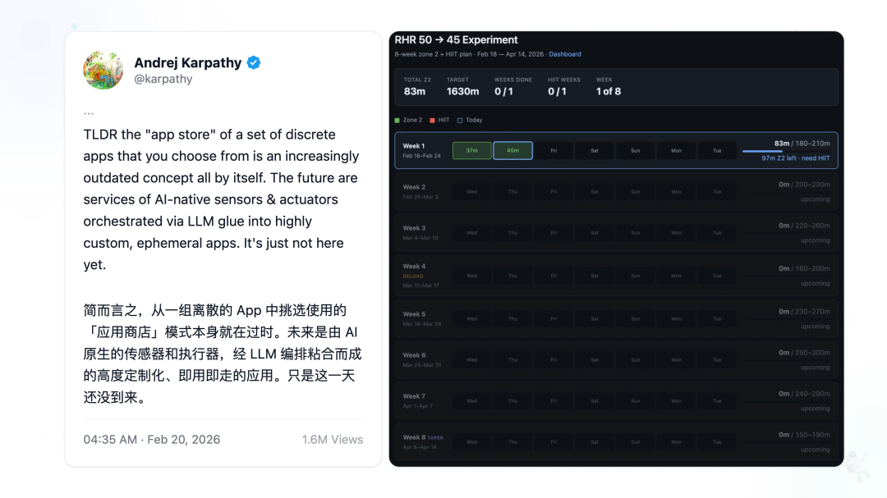

\

结尾也有一句话让我印象深刻：

> “简而言之，从一组离散的 App 中挑选使用的「应用商店」模式本身就在过时。未来是由 AI 原生的传感器和执行器，经 LLM 编排粘合而成的高度定制化、即用即走的应用。只是这一天还没到来。”

\

AI 让软件成本暴跌之后，人人可以通过数小时写一个定制化工具来解决领域内的特定问题。去 AppStore 内找通用工具软件的方式即将成为过去式。所以在未来，人机交互没有发生重大变化之前，我们可以继续指挥 AI 去帮我们做一些定制化工具，并且这些成本会越来越低，越来越智能。

\

结语\

\

感谢阅读，希望这些实践和技巧能帮助大家在日常工作中更好地利用 AI，把那些「不值得做」的小痛点变成触手可及的提效工具。

\

-End-

原创作者｜周晓楷

\

感谢你读到这里，不如关注一下？👇

\ 你对本文内容有哪些看法？同意、反对、困惑的地方是？欢迎留言，我们将邀请作者针对性回复你的评论，欢迎评论留言补充。我们将选取1则优质的评论，送出腾讯云定制文件袋套装1个（见下图）。8月7日中午12点开奖。\扫码领取腾讯云开发者专属服务器代金券！  \     \ 
