# 重磅！Graph Engineering 实操手册公开

> Datawhale · Datawhale · 2026-08-09 23:26

> 原文：<https://mp.weixin.qq.com/s/GZrKCHJaG5g7Ua-ZiEP-fQ>

---

# Datawhale干货 ******作者：Codez，X博主******

上个月我们才发过一篇 Loop Engineering 的实操手册，现在新词就已经来了。

7月初，OpenClaw 创始人，在 X 上说：我们还在聊 loop，还是已经切到 graph 了？没过多久，就有人跟帖喊出「Loop Engineering 已死，Graph Engineering 永生」。

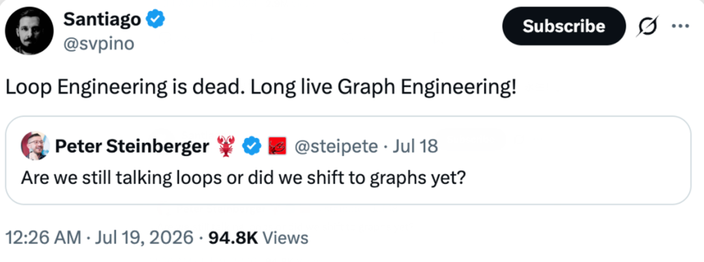

所以 Graph Engineering 到底是什么？

我们把 Codez 总结的 14 步整理了出来，全网570w人看过，讲的就是怎么从一个人的 loop，走到一张能自己路由的 graph。

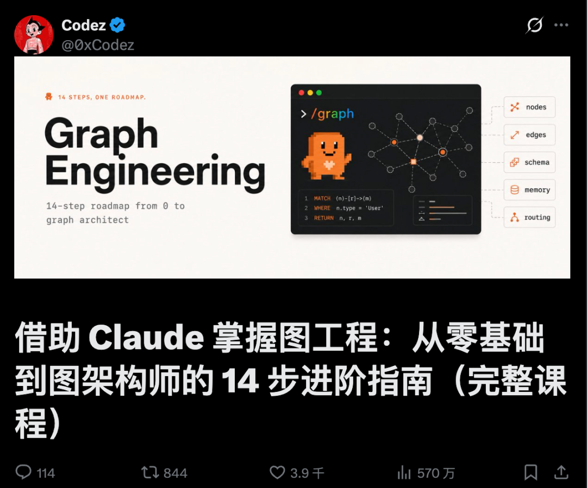

## 动手前：四个问题，决定你要不要 Graph Engineering

Graph 不是 loop 的升级版，是 loop 的组织方式。它烧的 token 比单个 loop 更多，协调开销也更高，出了问题你要 debug 的是一整张你没亲眼看着跑的路由图。所以先问自己四个问题，都想清楚之后，再动手。

一、这个任务真的能拆成不同角色吗？拆不出清晰的"谁负责什么"，那就还是一个 loop，加节点只是加成本。

二、有没有真正能并行的子任务？没有独立并行的活，图比循环贵，却不比循环快。

三、单个 agent 的上下文装得下全部背景吗？装得下，就别急着拆，拆分是为了腾出上下文，不是为了好看。

四、失败之后，你负担得起跳转分支的成本吗？没想清楚重试耗尽后去哪，图会在你看不见的地方卡死或者乱跑。

还有个附加题，比上面四个都重要：**你已经有一个跑得稳的单体 loop 了吗？**没有，先别建图。图是循环的组织方式，不是循环的替代品。

谁适合上手

已经把至少一个 loop 跑稳的团队，任务里有明确能拆开的角色（调研、撰写、复核），也接受更高的 token 成本换质量和并行度。

谁不适合上手

还没让一个 loop 稳定跑起来的个人开发者、线性依赖强拆不开的任务、瓶颈在协调开销而不在单节点能力的团队。

所以，graph engineering 真有用，但大部分人现在还用不上，因为大部分人的 loop 都还没跑稳，更别提图。

先答完四个问题，再决定要不要建图

## Graph Engineering 的四个核心构件

一张能跑的图，拆开来看，就是四个能各自单独验证的部分。

**Nodes：图的最小单位。**一个节点就是一个跑着自己 loop 的 agent 或确定性步骤，只认一件事，也只对一件事负责。节点判断不出"完了"，就不是节点，是隐藏依赖。

**Edges：决定谁接下一棒。**顺序边永远触发，条件边看检查结果，并行边一次分给多个节点，再汇到一个节点合并。边留给模型运行时判断得越多，图越灵活，但也越难预判。

**Shared State：大家都要读写的那份数据。**下游节点要用的字段，必须有上游节点写进去。这个对象会逼你承认，这活儿里到底还有多少环节没被真正想清楚。

**Failure Routing：失败之后的退路。**一个节点的重试耗尽了，控制权去哪：退回上一步、转给备用节点，还是转人工。没有失败边的图，只是一张流程图，不是一个能跑的系统。

## 第一步：先分清节点和边

01 节点是任务，边负责传数据

一张图其实只有两样东西，搞清楚这两样，大部分困惑就没了。节点是一个工作单元：一个 agent，一份边界明确的活，一个输入，一个输出。边是一种依赖关系：它表示这个节点的输出会喂给那个节点做输入，仅此而已。

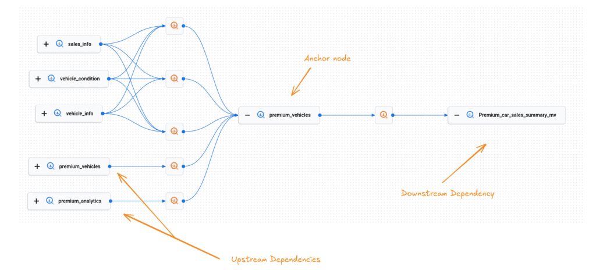

最容易犯的错，是把"然后"当成边。"总结这个文件，然后告诉我天气"，这两步之间没有边，天气根本用不到那份总结。这其实是两个互不相干的节点，被一段线性脚本硬凑成了先后顺序。没真用上数据，就没有边。

02 你的线性脚本，其实是一张退化的图

当你把一个 agent 写成"先做 A，再做 B，再做 C，再做 D"，其实你已经画出了一张图，只不过是一条不分岔的单链，每个节点都只有一条边进、一条边出。这样跑是能跑对的，但慢，也脆，因为一条链没有任何冗余：C 卡住了，D 就永远轮不到，A 的产出也被困在上游，没地方去。

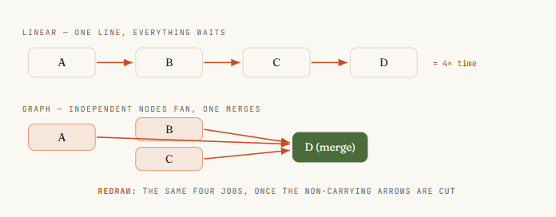

图工程的第一项真本事，是重新画这条链。拿着这个线性 agent，对每一根箭头问上一步的那个问题。大多数链里都有两三根箭头根本没有携带数据，它们只是当初写的时候顺手打的顺序。把这些箭头剪掉，链就会塌缩成更宽的东西：几个可以同时跑的独立节点，喂给一个需要它们全部到齐的节点。

## 第二步：给节点和边定契约

03 给每个节点定一份契约

一个你没法推理的节点，就没法拿去并行。解决办法是给它定一份契约：输入有边界，输出有边界，只干一件事。输入是节点要读的东西，必须显式传进去，不能指望它从共享窗口里蹭到什么。输出是一个定义好的形状，最好能校验，这样下一个节点不用猜也能直接用。

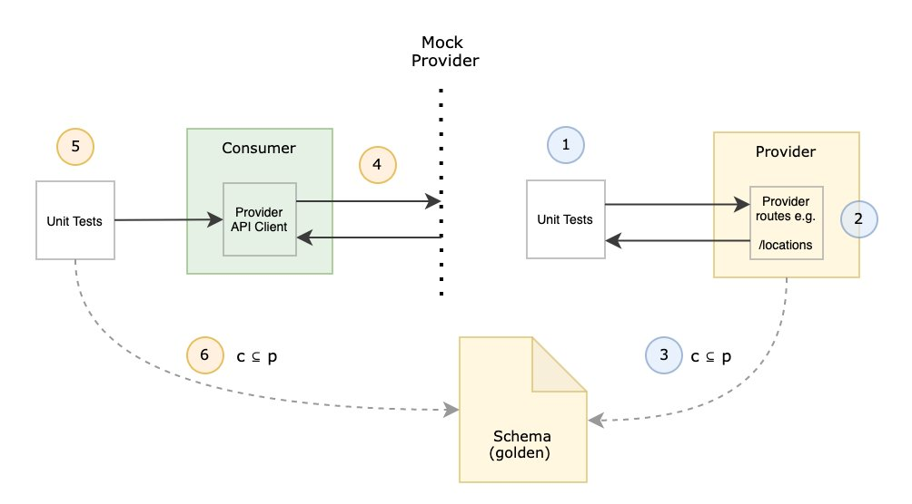

在 workflow 里，这份契约靠 schema 强制执行。给 Claude 的 agent() 调用配一份 JSON schema，Claude 派出去的 subagent 就只能返回校验过的结构化数据，校验发生在工具调用这一层，格式不对 Claude 会自己重试，不会甩给你一堆自由文本让你自己解析、自己祈祷。这就是"能接进图里的节点"和"只有人读得懂才行的节点"的区别。

```
// 一个有真契约的节点：输入有边界，输出经过校验，只干一件事const ITEM = {  type: 'object', additionalProperties: false,  properties: {    title:   { type: 'string' },    url:     { type: 'string' },    impact:  { type: 'string', enum: ['high', 'medium', 'low'] },  },  required: ['title', 'url', 'impact'],};const result = await agent(source.prompt, {  label:  `research:${source.key}`,  schema: ITEM,           // 强制返回校验过的结构化数据  agentType: 'general-purpose',});// result 现在是下一个节点能信任的形状，不用再靠人工解析
```

04 把边也当成一份数据契约

边不只是"B 排在 A 后面"，它是一个关于"传的是什么"的承诺：A 产出这个形状，B 就是照着这个形状设计来消费它的。按数据给边命名，而不是按顺序命名，两件事会立刻变简单：能一眼看出这条边是不是真的存在（有没有数据真的传过去），也能在形状不变的前提下换掉边两端的节点，不会弄坏整张图。

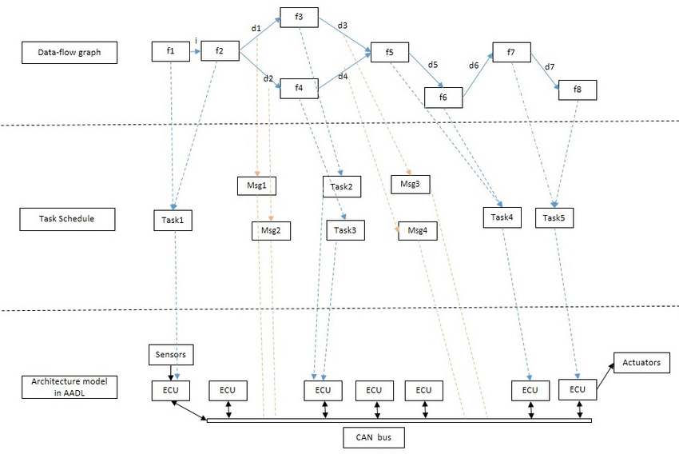

实际写的时候，边就活在普通的 JavaScript 里。派活和合成之间那一步归约，压平、去重、过滤，就是代码在处理节点返回的形状，不需要 agent。图思维一个不太起眼但很重要的收获是：很多人花模型 token 去做的事，其实就是一条边，而边是免费的。

## 第三步：构建扇出、扇入与菱形：最常用的拓扑

05 用 parallel() 扇出：把活儿一次性派出去

这一步能把前面的投入都赚回来。手上有 N 个独立节点，N 个要核实的信源、N 个要审的文件、N 条要查的路由，不要把它们串起来跑，让 Claude 把它们一次性派出去一起跑。在 workflow 里对应的是 parallel()：Claude 拿到一个函数数组，给每个函数派一个 subagent，全部并发执行，最后把结果数组一次性还给你。

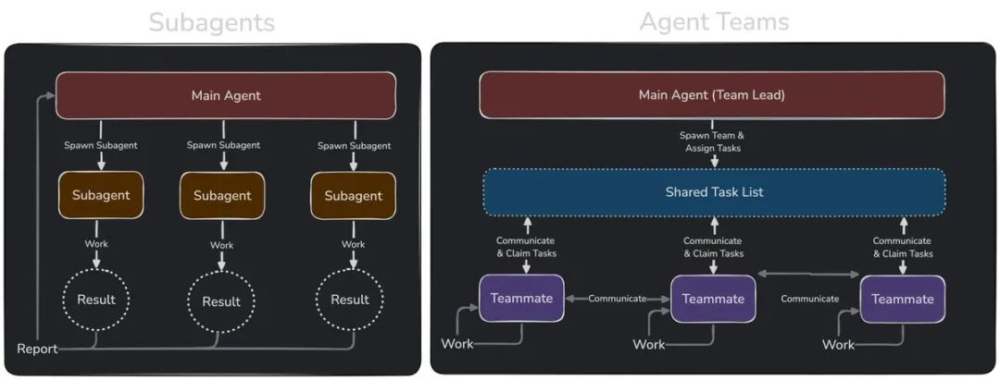

有两个细节决定它稳不稳。第一，parallel() 是一道屏障，会等所有函数都跑完才返回，下一阶段看到的是完整的结果集合。第二，一个抛错的函数会被解析成 null，而不是拖垮整个批次，一个状态不好的 agent 也拖累不了其他人，记得对结果做 .filter(Boolean)。并发数大致按核数封顶，多出来的会排队，扔进去一百个函数它们都会跑完，只是每次跑一小批。

```
phase('Research');// 九个信源，九个 agent，同时开工const raw = await parallel(  SOURCES.map((s) => () =>    agent(s.prompt, {      label: `research:${s.key}`,      phase: 'Research',      schema: ITEM_SCHEMA,     // 每个节点都返回校验过的 JSON      agentType: 'general-purpose',    }),  ),);const collected = raw.filter(Boolean);  // 把失败 agent 留下的 null 过滤掉
```

派活这一步是活在 Claude 写的代码里，不是活在一轮模型对话里。Claude 自己的上下文从来不会同时装着九个信源，每个 subagent 带着自己的一份，只有最终答案会传回来。这就是 Claude 能把一次 workflow 扩展到几十上百个 subagent、却不会把这次会话淹没的原因，编排这一层不花 token，因为它不是 Claude 又想了一轮。

06 在屏障处做汇入

活儿派出去，得有东西能收拢它才有意义。拢回来的这个节点，就是边汇聚的地方：一个 agent（或一段代码）一次性看到全部上游结果，去做一件必须看到全集才能做的事，比如跨信源去重、按影响力排序、总数为零就提前退出。这是整张图里唯一值得让屏障付出等待成本的地方。

```
// 这条边就是普通 JS，没有 agent，零 tokenconst flat = collected.flatMap((c) => c.items);log(`Collected ${flat.length} items`);phase('Curate');// 这个屏障节点需要全部结果凑齐才能去重排序const curated = await agent(  `Dedupe and rank these by impact:\n${JSON.stringify(flat)}`,  { phase: 'Curate', schema: CURATED_SCHEMA },);
```

只是把一个列表压平？那是一条边，直接写在行内就好。判断方法很简单粗暴：如果写成了 parallel → transform → parallel，中间那个 transform 又没有跨条目的依赖，那本该用流水线，完全不需要屏障。

07 菱形：拆分 → 工作 → 合并

把"派出去"和"拢回来"拼在一起，就得到了几乎每张正经 agent 图里都会出现的主力拓扑：菱形。一个节点拆任务，多个节点并行干活，一个节点合并。市场扫描、依赖审计、代码评审、研究报告，背后都是这个形状，换个信源和提示词，同一副骨架照样能用。

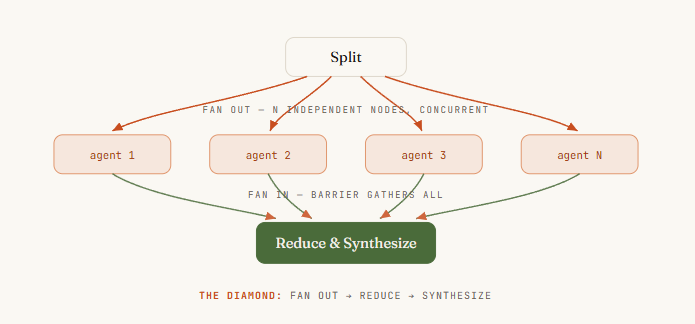

它的标准写法有个值得记住的名字：派发 → 归约 → 合成。先派出去收集广度，用普通代码归约压缩，再用最后一个 agent 合成写出答案。看懂这颗菱形之后，就不会再问"怎么让 agent 多做几步"，而是会问"拆分点在哪，合并点在哪"，这才是真正能扩展的问题。

## 第四步：路由、验证与隔离

08 用条件语句在运行时给边选路

不是每张图都是固定的。有时候走哪条边，取决于某个节点发现了什么。路由节点检查结果，决定走哪条下游路径：给工单分类后分流到对应处理节点，或者看 diff 大小，决定走快速评审还是完整审计。在 workflow 里这就是一个普通的 if 或 switch，判断依据是某个节点校验过的输出，因为控制流本来就活在代码里。

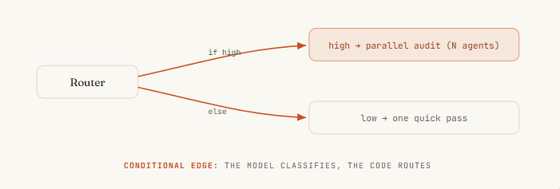

这正好是确定性变成优点而不是限制的地方。路由的判断可以由 Claude 完成（一个 subagent 负责分类），但路由本身是 Claude 写的代码，同样的分类结果每次都走同一条路。节点上拿到 Claude 的判断力，边上拿到脚本的可靠性，不会出现"Claude 自己决定跳过审计"这种意外，因为跳过这件事必须写进图里才会发生，而它没有被写进去。

```
// 路由节点：agent 负责分类，代码负责选边const { severity } = await agent(  `Classify this diff's risk:\n${diff}`,  { schema: { type: 'object',      properties: { severity: { enum: ['low', 'high'] } },      required: ['severity'] } },);let review;if (severity === 'high') {  // 高风险路径：完整并行审计  review = await parallel(FILES.map((f) => () => agent(`Audit ${f}`)));} else {  // 低风险路径：一次快速评审  review = await agent(`Quick review of ${diff}`);}
```

09 在边上放一个验证器

一张图真正的杠杆不是塞了更多 agent，而是能围绕结果搭起多少确定性。验证器节点蹲在一个结果被放行到下游之前，它唯一的工作就是试图推翻这个发现。扛住了就放行，扛不住就到不了最终答案。

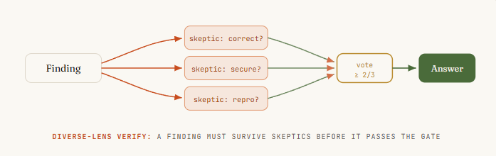

三种模式值得掌握：

- **对抗式验证：**给每个发现派 N 个独立的怀疑者，专门去反驳它，多数没被驳倒才算站得住。
- **多视角验证：**让每个验证者盯不同的方面，正确性、安全性、能不能复现，角度越分散，越能揪出 N 个一样的检查都发现不了的问题。
- **评委制：**从不同角度生成 N 个方案，用并行的评委打分，挑最好的一版作为主线，再把其他几版里的亮点揉进去。

真实团队在移植 Bun 运行时的时候，就是靠这套对抗式代码评审焊进循环，才做成的。

10 把节点隔离开，别让一个失败污染整张图

在一条链里，失败会级联：C 死了，D 就跑不起来，整条链停摆。在一张图里，失败本该被限制在它自己的节点里。这一点已经部分成立：parallel() 里一个抛错的函数会被解析成 null，八个正常的 agent 照样能返回结果，一个坏的自己掉队，.filter(Boolean) 就是那道防线。把每一次汇入都设计成能容忍缺失的输入，而不是假设总能凑齐全集。

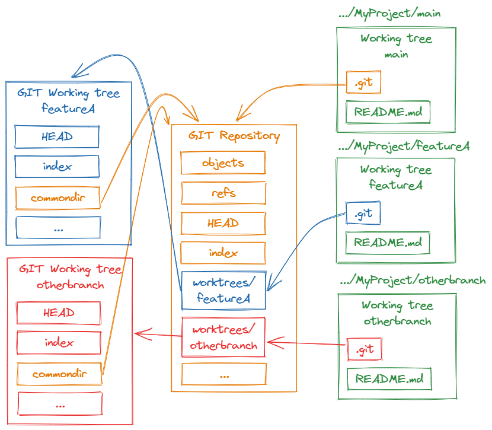

更隐蔽的失败，是节点之间互相踩到对方。多个 agent 并行写文件时可能会撞车，解法是隔离：用 git worktree，让每个 agent 在自己的一份工作区里干活，在沙盒里完成，再干净地合并回去。只在节点真的会并行写入的时候才用它，它是那种拓扑真正需要的安全带，不是每次运行都要交的税。

## 第五步：循环、模型分层与拓扑

11 可以加一个循环，但一定要让它收敛

要是压根不知道这活儿有多大呢？只有真的做下去才知道：规模未知的探索，一次漏洞排查发现一个 bug 又带出三个新的。这时候需要一个循环，一条指回更早节点的、受控的边。危险也很明显：一个不收敛的循环，就是一台不停派 agent 出去、直到预算耗尽才停的死循环机。

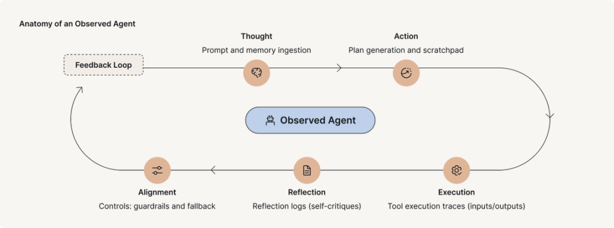

能收敛的写法叫"跑到干为止"：持续派出发现者，直到连续 K 轮都没发现新东西，才停下来。真正决定成败的细节，也是几乎每个人第一次都会踩的坑，是拿什么去做去重比对。要对着"见过的一切"去重，而不是只对着"已确认的结果"去重。不然被否掉的发现每一轮都会重新冒出来，循环永远跑不干，最后搭出的是一台专门花钱去反复发现同一批死胡同的机器。

```
const seen = new Set(); const confirmed = []; let dry = 0;while (dry < 2) {                       // 连续两轮空手而归就停下  const found = (await parallel(    FINDERS.map((f) => () => agent(f.prompt, { schema: BUGS }))  )).filter(Boolean).flatMap((r) => r.bugs);  const fresh = found.filter((b) => !seen.has(key(b)));  if (!fresh.length) { dry++; continue; }  dry = 0;  fresh.forEach((b) => seen.add(key(b))); // 对"见过的一切"去重，不是只对已确认的  // 每个新发现都要过一轮多视角验证才算数  const judged = await parallel(fresh.map((b) => () =>    parallel(['correctness', 'security', 'repro'].map((lens) => () =>      agent(`Judge "${b.desc}" via ${lens} — real?`, { schema: VERDICT })))    .then((v) => ({ b, real: v.filter(Boolean).filter((x) => x.real).length >= 2 }))));  confirmed.push(...judged.filter((v) => v.real).map((v) => v.b));}
```

12 给不同节点分配不同档位的模型

不是每个节点都需要最好的模型。一张图会用单个 agent 永远做不到的方式，把这件事摆明白：有些节点干的是有边界、会重复的活，比如抽取一个字段、给工单分类；有些节点承载真正的判断力，比如合成报告、裁定一个发现是否成立。干重复活的节点放到便宜模型上跑，token 留着花在真正需要判断力的地方。

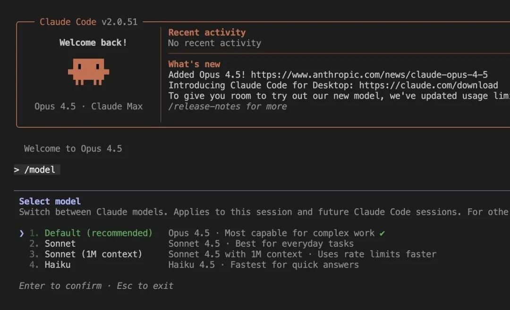

在 workflow 里，Claude 派出去的每个 subagent 默认继承这次会话的模型，除非脚本里显式覆盖，所以默认情况下一次大规模运行的账单会全按会话档位算。单次 agent() 调用上的 model 选项，能让 Claude 单独把这一个节点换到别的模型上跑。大规模运行前先看一眼 /model，让 Claude 把派出去的那些重复性节点降到便宜模型，合并节点留在高档位，这个办法能把一张烧 token 的图从贵变便宜，还完全不用动它的形状。

13 拓扑结构，就是你的成本和延迟

图的形状不是装饰，它是决定运行时间的最大杠杆。最容易踩坑的选择是 parallel() 还是 pipeline()。parallel() 这道屏障会让所有东西都等最慢的那个节点，才进入下一阶段。pipeline() 让每条数据各自独立地依次经过所有阶段，没有屏障，条目 A 可能已经在第三阶段了，条目 B 还在第一阶段，跑得快的提前结束，不用在慢的后面干等。

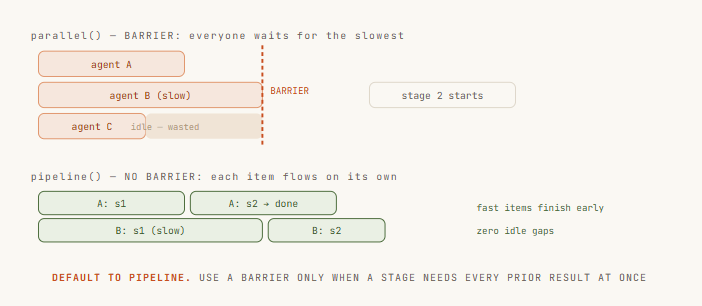

默认用 pipeline()。只有一个阶段真的需要全部前置结果同时到齐时才用屏障，比如跨集合去重、按总数提前退出、需要对照"其他发现"来写的 prompt。"代码更干净"和"这些阶段感觉是分开的"都不是理由，屏障带来的延迟是真实的、可测量的、被浪费掉的时间，分开不代表必须同步。

## 最后一步：让 Claude 自己画图

14 让 Claude 自己画图，自我路由

最后一步，是对那些没法提前规划的活儿，不再自己动手画图。用 dynamic workflows，只要描述目标，Claude 会自己写编排脚本：拆解任务、决定怎么把活儿派出去、派出一队 subagent、再合成结果。拿到的是一张为这次运行量身定做的图，而不是一张你希望它恰好合适的固定图。

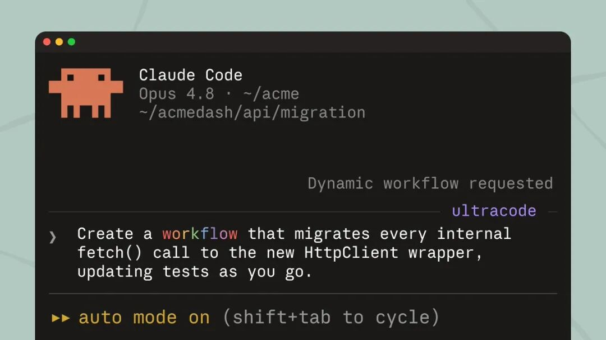

有三种用法。在 prompt 里说出"workflow"这个词，Claude 就会为这个任务写一份。跑一个已经存好或内置的，比如 /deep-research，就是一张已经在生产里跑着的真实图：定范围 → 并行搜索 → 抓取 → 对抗式验证 → 合成，正是这门课从头到尾讲的那副骨架。或者打开 ultracode，Claude 会给这次会话里每个像样的任务都规划一次 workflow。跑得好的时候按 s 把脚本存进 .claude/workflows/，从此可以版本控制、按名字重新运行，谁 clone 了这个仓库都能直接跑起来。

```
› Run a workflow to audit every route under src/routes/ for missingauth. Spawn one agent per route file, then verify each finding beforereporting.● Claude wrote an orchestration script · launching in background…/workflows — auth-audit · running ✓  Scope       1/1   2.1k tok  Fan-out    18/18  one agent per route file  Verify     11/18  3-vote skeptics per finding…  Synthesize  0/1   waiting on verify// 会话保持响应，队伍在后台继续跑
```

两年来，多 agent 协作的杠杆一直在单个 loop 上：更好的 verifier，更稳的退出条件，更干净的状态文件。

而现在，把这些 loop 怎么连起来，成了新的护城河。


**一起“**点****赞”****三连**↓**
