# AI工程范式的跃迁，一文讲透Context Engineering！

> 腾讯云开发者 · 梁凌郁 · 2026-08-28 10:39

> 原文：<https://mp.weixin.qq.com/s/tExSOifZrzCUW8GLMF5IrQ>

---

\

\

关注腾讯云开发者，一手技术干货提前解锁👇

\

\

   开发者公众号专属群聊 扫码加入获取更多一手教程、科技前沿报告 \

上一篇[《Agent全面爆发！一文搞懂背后的核心范式ReAct！》](https://mp.weixin.qq.com/s?__biz=MzI2NDU4OTExOQ==&mid=2247693710&idx=1&sn=27fed3a8274bcc16764b1323d6c6981b&scene=21#wechat_redirect)介绍了 ReAct 如何通过“思考→行动→观察”的 TAO 循环，让 LLM 从静态答题机变成能主动使用工具的智能体。 本文接续那篇的话题，分析 ReAct 在长任务中的上下文盲点，并由此引出 Context Engineering——一个专门为解决这一问题而生的全新范式。

\

\

\

# 01

\

\

引言：从 Prompt Engineering → ReAct → Context Engineering 的演进

\

这三个范式的演进，是 AI 应用复杂度提升的必然结果。理解这条演进路线，才能真正理解 Context Engineering 为什么不可缺少。

\

**1.1 第一阶段：Prompt Engineering**

\

2020 年，GPT-3 的发布让大众第一次意识到：只需要在输入里描述任务，模型就能输出相当好的结果。但结果的好坏，对措辞极其敏感。“请写一篇关于 AI 的文章”和“请用面向初学者的通俗语言，写一篇 800 字的关于大语言模型工作原理的科普文章”，产出质量天差地别。

\

于是工程师们开始研究：如何写出让模型“最听话”的提示词？这就是 Prompt Engineering 的核心问题。它催生了 Zero-shot、Few-shot、Chain-of-Thought 等大量技术，这些方法有一个共同点：它们都在优化“单次 LLM 调用”——写好一条输入，获得一条更好的输出。这在单轮任务里非常有效，但“单轮”是它的硬边界。

\

**1.2 第二阶段：ReAct 范式**

\

2022 年，普林斯顿和 Google 的研究团队提出了 ReAct 范式。它解决了一个 Prompt Engineering 解决不了的问题：如何让 LLM 主动使用外部工具、动态获取信息、分多步完成复杂任务。ReAct 定义了“思考 → 行动 → 观察”（Thought → Action → Observation）的闭环循环：

> 示例：用户请求“查询明天从深圳到海南最便宜的晚班机票并预订”
>
> \
>
> Thought：“我需要先查明天深圳到海南的晚班航班，再找最便宜的。”
>
> \
>
> Action：flight_search(from=“深圳”, to=“海南”, date=“明天”, time=“晚上”)
>
> \
>
> Observation：“查到 3 班：HU7089（20:15，480元）/ CZ6753（21:30，620元）……”
>
> \
>
> Thought：“HU7089 最便宜，480元。接下来预订这班。”
>
> \
>
> Action：flight_book(flight=“HU7089”, passenger=“张三”)
>
> \
>
> Observation：“预订成功。订单号：ORD20260817001”
>
> \
>
> Final Answer：“已为您预订 HU7089（20:15，480元），订单号 ORD20260817001。”

\

ReAct 是一个巨大的进步——它让 LLM 从“静态答题机”变成了“能动手的助理”。但 ReAct 的设计核心是行动逻辑（如何决策和调用工具），对“做的过程中上下文如何管理”几乎没有显式规定。

\

> ⚠ ReAct 的隐患
>
> \
>
> 每一轮的 Thought / Action / Observation 都会追加到上下文里，在一个 20 步、30 步、50 步的复杂任务里，上下文会越积越大。
>
> \
>
> ReAct 解决了“做什么”，但没有解决“管什么信息”。

\

**1.3 第三阶段：Context Engineering**

\

2025 年，当 AI 工程从“Demo Agent”走向“生产级 Agent”，工程师们集体撞上了同一堵墙：任务轮次增加后 Agent 开始“忘记”最初设定的规则；工具返回值越来越多，有用信息被淹没；系统提示写得再好，也扛不住上下文被“稀释”的侵蚀。

\

这时候，三位业界顶尖人物几乎同时给出了诊断：

> “我越来越喜欢用 context engineering（上下文工程）这个词，而不是 prompt engineering。它更准确地描述了这项技能：在上下文窗口中精心填充恰当的信息——指令、少样本示例、工具、状态、历史，以及其他一切——来完成任务。”
>
> —— Andrej Karpathy，X Platform，2025 年 7 月

> “在 AI 时代，使用人工智能的核心技能在于上下文工程——理解 LLM 的能力边界，知道如何构建相关背景、信息和工具，让任务得以完成。”
>
> —— Tobi Lütke，Shopify CEO，内部备忘录，2025 年 4 月

> “现在大多数 Agent 的失败已经不再是模型的失败，而是上下文的失败（Most agent failures are not model failures anymore, they are context failures）。”
>
> —— Philipp Schmid, The New Skill in AI is Not Prompting, It's Context Engineering, 2025 年 6 月

\

Philipp Schmid 给出的定义，与 Anthropic“策展 · 最优 · 演化”的定义相互补充，从另一个角度强调了“动态”和“时机”：

> “Context Engineering 是设计和构建动态系统的学科，其目标是在正确的时机、以正确的格式，向 LLM 提供正确的信息和工具，使其能够完成任务。”
>
> —— Philipp Schmid, The New Skill in AI is Not Prompting, It's Context Engineering, 2025 年 6 月

\

同年 6 月，Philipp Schmid 发表了广为传播的《The New Skill in AI is Not Prompting, It's Context Engineering》；9 月，Anthropic 工程团队正式发表《Effective Context Engineering for AI Agents》，系统阐述了这一范式。本文以 Anthropic 的文章为主要参考，结合认知科学理论（CoALA 框架）、NLP 实证研究（Lost in the Middle）以及 Anthropic 更早期的《Building Effective Agents》一文，构建一份完整、可实践的 Context Engineering 知识体系。

\

**1.4 三个阶段的完整演进图**

\

表 1　Prompt Engineering、ReAct、Context Engineering 三个范式的演进对比

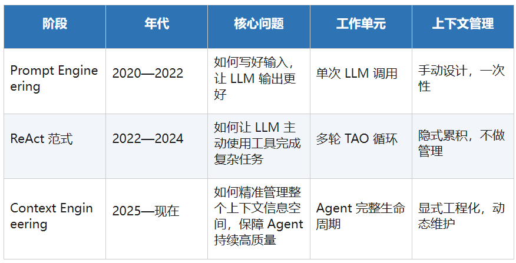

\

> 💡 重要理解
>
> \
>
> 这三个范式不是替代关系，而是叠加关系：Context Engineering ⊇ ReAct ⊇ Prompt Engineering。
>
> \
>
> Context Engineering 包含了 Prompt Engineering 的技巧（如何写好系统指令），也包含了 ReAct 的工具调用模式，并在此基础上增加了整个信息生命周期的管理维度。

\

\

\

# 02

\

\

什么是 Context Engineering

\

**2.1 Anthropic 的核心定义**

\

> “Context engineering is the art and science of curating what will go into the limited context window from that constantly evolving universe of possible information.”
>
> —— Anthropic, Effective Context Engineering for AI Agents, Sep 2025

\

这个定义字字有深意，拆开来看有三个关键词：

\

### ▸ 关键词一：策展（Curating）

“策展”意味着主动选择和剪裁，而不是被动堆砌。就像一位博物馆策展人，不会把仓库里所有的文物都摆出来——他会精选那些能讲好故事的展品。Context Engineering 要求工程师像策展人一样，主动决定哪些信息进入上下文、以何种形式进入、放在什么位置。

\

### ▸ 关键词二：最优（Optimal）

“最优”不是“最多”，而是“信噪比最高”。最优的 Token 集合是：以最少的 Token 数量，传递最关键的信息，使模型能做出最准确的下一步决策。加入一个无关的 1000 Token 文档，可能反而会降低模型的表现——因为它稀释了真正有用信息的信号。

\

### ▸ 关键词三：演化（Ever-evolving）

“演化”揭示了 Context Engineering 与 Prompt Engineering 最本质的区别：上下文不是一次性写好的静态文本，而是随着每一轮工具调用、每一次新的用户输入、每一步环境变化而动态更新的。Context Engineering 是一个持续进行的过程，在 Agent 运行的整个生命周期内持续发生。

\

表 2　Prompt Engineering 与 Context Engineering 的对比

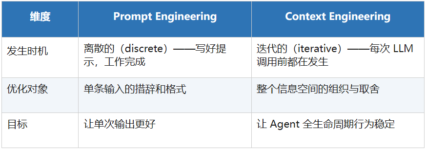

\

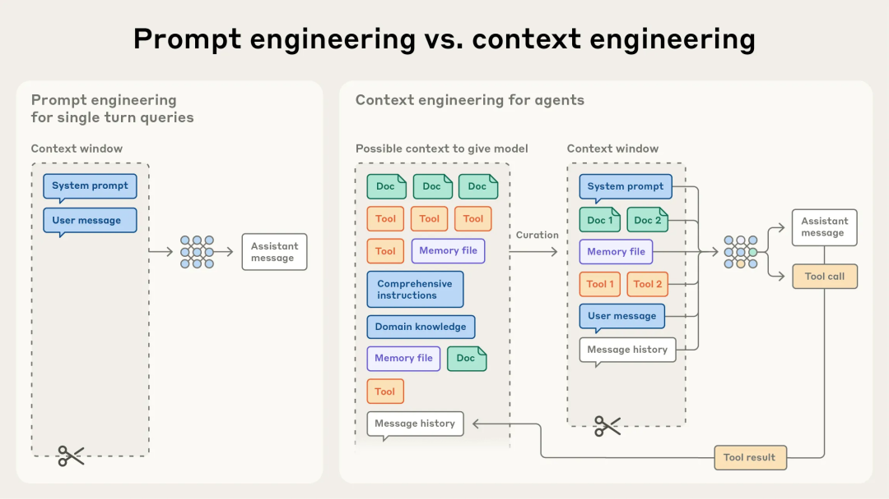

图 1　Prompt Engineering 与 Context Engineering 的信息处理流程对比

\

这张图非常直观地呈现了上表的三行对比：左侧 Prompt Engineering 的上下文窗口只有“System prompt + User message”两块内容，一次性写好、一次性用完；右侧 Context Engineering 则要从一个庞大的“可能的上下文候选池”（文档、工具、记忆文件、知识库、消息历史……）中，经过Curation，精选出真正需要的一小部分放入上下文窗口。

\

**2.2 LLM 的信息架构：上下文窗口就是工作内存**

\

理解 Context Engineering，首先要理解 LLM 的信息处理方式。Andrej Karpathy 提出了一个被广泛引用的类比：可以把现代 LLM 理解为一种全新的“操作系统”（LLM OS），它重新定义了计算机各组件的对应关系：

表 3　LLM 操作系统（LLM OS）与传统计算机的类比

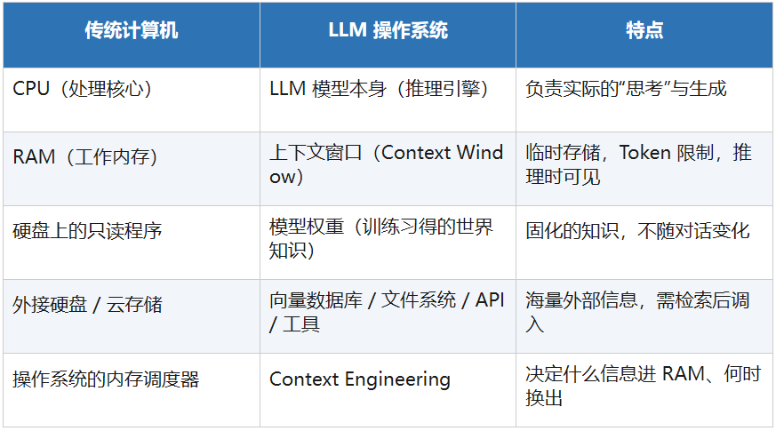

\

> ⚠ 关键认知
>
> \
>
> LLM 在每次推理时，只能“看到”当前上下文窗口里的内容。无论模型权重里储存了多少知识，只要相关信息没有出现在上下文窗口里，对当次推理而言，那个信息就“不存在”。
>
> \
>
> 这也意味着：Context Engineering 就是 LLM OS 的“内存管理”。优秀的内存管理不是把所有数据都塞进 RAM，而是在正确的时机把正确的数据调入 RAM，不用的数据及时换出。

\

**2.3 Token：Context Engineering 的计量单位**

\

LLM 不是按字或字符处理文本的，而是先将文本切分成 Token，再进行计算。英文文本大约 1 Token ≈ 4 个字符；中文文本大约 1 Token ≈ 1.5～2 个汉字。

\

表 4　常见文本长度对应的 Token 数量估算

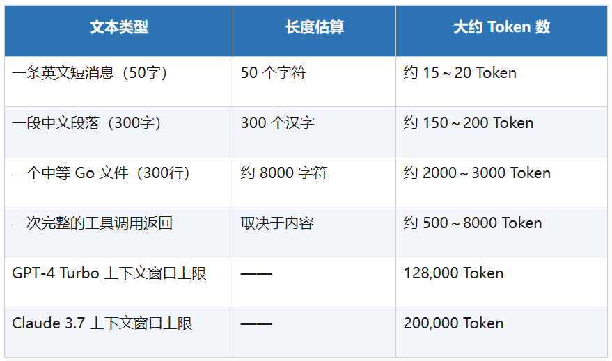

\

这些数字意味着什么？一个“大型代码库审查”任务，仅 10 轮对话 + 5 次文件读取，就可能消耗 30,000～50,000 Token。更关键的是：上下文窗口大 ≠ 性能好，Token 越多不等于越好。

\

**2.4 CoALA 框架：认知科学视角的记忆架构**

\

普林斯顿大学 Sumers、Yao 等人（2024）在 TMLR 发表的 CoALA 论文（Cognitive Architectures for Language Agents），借鉴认知科学的记忆理论，为语言智能体的信息架构提供了一个系统性框架。CoALA 将语言智能体的记忆分为“工作记忆”和三类“长期记忆”：

\

表 5　CoALA 框架中的记忆类型与工程实现对照

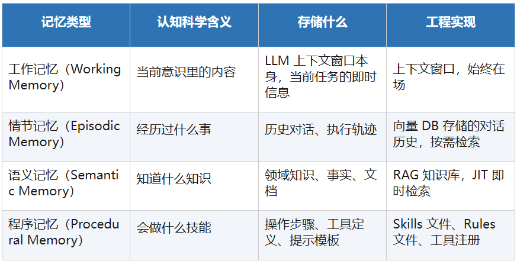

\

CoALA 对 Context Engineering 的核心启示是：不同类型的信息应该用不同的存储和检索方式管理。上下文窗口（工作记忆）只应该存放当前任务所必须的内容；其他信息应该存在外部的长期记忆中，在需要时精准检索。

\

\

\

# 03

\

\

核心思想：信息的精准供给 vs 信息的堆砌

\

很多工程师的直觉是：“既然上下文窗口很大，那就把所有相关的东西都放进去，信息越多越好。”这个直觉是错误的。以下三个经过实验验证的物理约束，解释了为什么，三者的汇总对比见本章末尾的表格。

\

**3.1 Lost in the Middle：信息的位置决定它被“看见”的概率**

\

斯坦福大学 Nelson F. Liu 等人于 2023 年发表论文《Lost in the Middle: How Language Models Use Long Contexts》（arXiv:2307.03172，TACL 2024），成为 Context Engineering 领域最重要的实证研究之一。

\

实验设计：给 LLM 提供 10～20 个文档，其中只有一个文档包含正确答案，系统地改变这个答案文档在上下文中的位置，测量 LLM 的正确率。结果呈现一条清晰的 U 型曲线：当答案文档位于开头或结尾时，正确率约 75%；当被夹在中间时，正确率可能下降到 35% 左右。

\

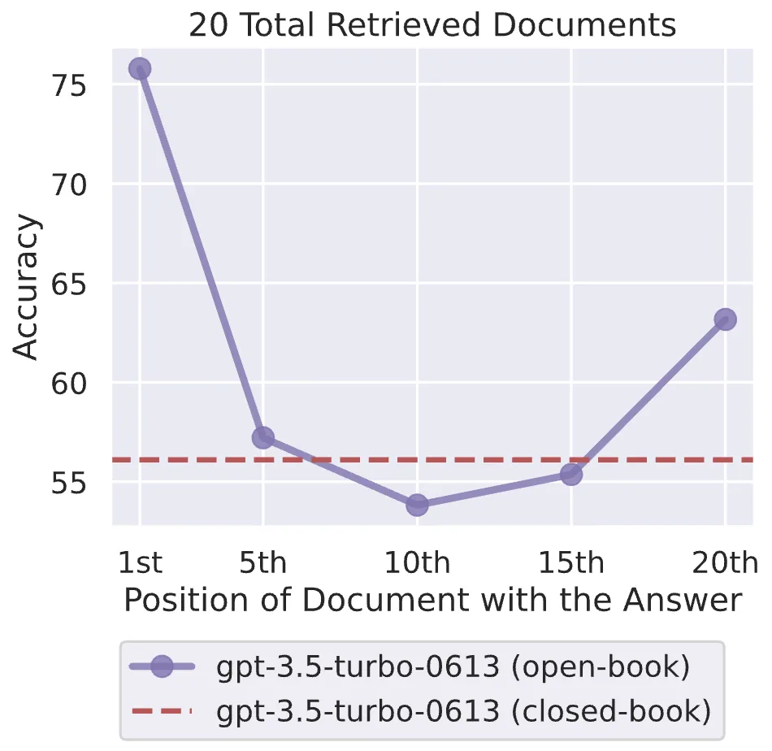

图 2　改变答案文档在输入上下文中的位置，导致模型正确率呈 U 型曲线

\

原论文给出的这条曲线极具说服力：图中红色虚线是“闭卷”（closed-book，即完全不提供任何文档，纯靠模型自身知识回答）时的正确率基线（56.1%）。当正确答案文档被放在上下文“中间”位置时，模型的开卷（open-book）正确率甚至低于什么都不给它看的闭卷基线。也就是说，此时“塞给模型更多信息”反而变成了负贡献，这是对“信息越多越好”这一错误直觉最有力的反证。

\

表 6　Lost in the Middle：答案文档位置与模型正确率

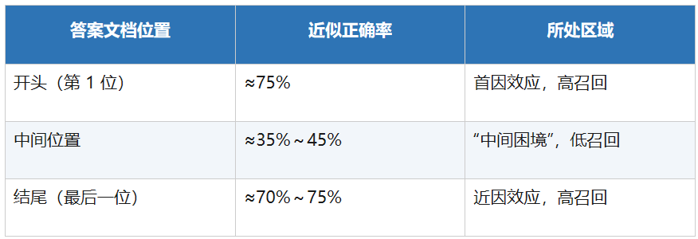

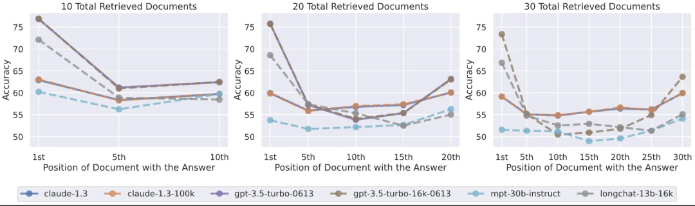

图 3　多文档问答任务中，答案位置对不同模型正确率的影响

\

实验结果表明，U 型曲线不是某个模型的个例，而是在 claude-1.3、gpt-3.5-turbo（含 16k 长窗口版本）、mpt-30b-instruct、longchat-13b-16k 等多种不同架构、不同厂商的模型上都稳定复现的普遍规律，且文档总数从 10 篇增加到 30 篇后，中间区域的性能坍陷会更加明显。

\

为什么会这样？这与 Transformer 的注意力机制密切相关。模型在训练时接触的长序列数据远少于短序列数据，导致模型在处理长上下文时，对中间位置内容的注意力权重相对较弱；人类写作中重要内容常在开头或结尾的序列性特征，也被模型“学会”了。

\

> ✓ 实践规则
>
> \
>
> 规则 1：最重要的系统级指令放在 System Prompt 的开头（利用首因效应）
>
> 规则 2：当前任务最关键的约束条件放在用户消息的结尾（利用近因效应）
>
> 规则 3：检索到的文档放在上下文中时，最相关的一个放第一位或最后一位
>
> 规则 4：避免把关键规则夹在大量工具调用记录的中间

\

**3.2 Context Rot：上下文腐化——越长越糟糕的真相**

\

> “研究表明，随着上下文 Token 数量增加，模型准确召回上下文信息的能力线性下降。虽然不同模型降级程度不同，但这一现象在所有模型中普遍存在。”
>
> —— Anthropic, Effective Context Engineering for AI Agents, 2025

\

一个具体例子：假设你在开发一个 Go 代码重构 Agent，第 1 轮设定了规范——变量名用 camelCase、错误变量统一命名为 err、函数不超过 50 行。第 1～10 轮 Agent 严格遵守。但到了第 40 轮，上下文里已经累积了 39 轮对话历史、20 次文件读取的完整内容、15 次编译错误日志、10 次测试运行结果，合计数万 Token。你最初设定的规范早已被淹没到“中间地带”。Agent 开始生成 snake_case 变量名——不是因为它“忘了”指令，而是因为规范的信号被大量无关内容稀释了，注意力权重下降到难以起作用的程度。

\

这就是 Context Rot：它不是崩溃，而是慢性退化。在长任务中，不主动管理上下文，Agent 质量会持续下滑。

\

**3.3 Attention Budget：O(n²) 的注意力代价**

\

LLM 基于 Transformer 架构，其核心是“自注意力”（Self-Attention）机制：让上下文中的每一个 Token 都与其他所有 Token 进行“交互计算”。这导致了 O(n²) 的计算复杂度——n 个 Token 需要计算 n×n 个注意力分数。

\

表 7　上下文长度与注意力计算量的关系

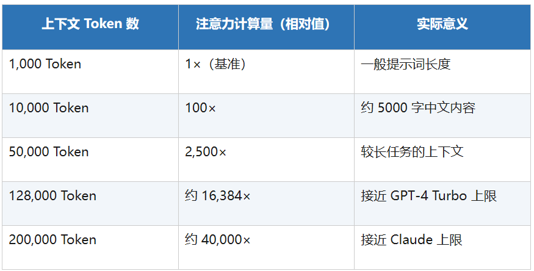

\

增加上下文长度不只是“计算量”的问题，它带来三重代价：计算代价（推理速度下降）、延迟代价（用户等待时间增加）、金钱代价（大多数 LLM API 按 Token 计费）。更重要的是，更长的上下文并不一定带来更好的推理质量——训练数据中短序列远多于长序列，当上下文超过一定长度后，有效信息被大量无关 Token 稀释，模型的注意力被分散，整体质量可能反而下降。

\

> ⚠ 重要原则
>
> \
>
> 注意力是稀缺资源。每一个进入上下文的 Token 都在消耗注意力预算，增加无关内容不是中性操作，而是主动损害有效信息的信号强度。

\

**3.4 三大约束总结与两种策略对比**

\

上述三个约束——Lost in the Middle、Context Rot、Attention Budget——彼此独立却相互加强，汇总对比如下表所示。

\

表 8　三大物理约束的现象、成因与工程对策汇总

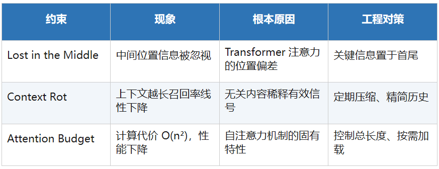

\

表 9　信息堆砌策略 vs 信息精准供给策略（Context Engineering）

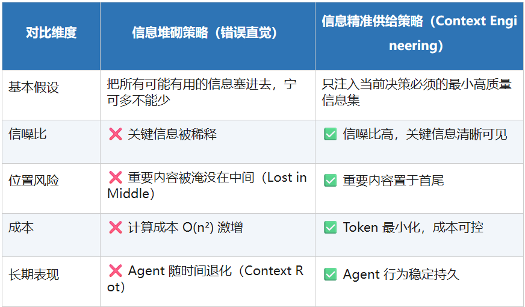

\

> 💡 核心公式
>
> \
>
> 最优上下文 = 最小 Token 数量 × 最高信噪比

\

\

\

# 04

\

\

Context 的七类构成要素

\

> “要理解 Context Engineering，我们必须先扩展对“上下文”的定义。它不仅仅是你发给 LLM 的单一提示词，而应被视为模型在生成回复之前所看到的一切内容。”
>
> —— Philipp Schmid, The New Skill in AI is Not Prompting, It's Context Engineering, 2025 年 6 月

\

进入 LLM 上下文窗口的所有信息，本文采用 Philipp Schmid 提出的七类要素划分法进行系统化拆解：Instructions / System Prompt（系统指令）、User Prompt（用户提示词）、State / History（状态与历史，短期记忆）、Long-Term Memory（长期记忆）、Retrieved Information（检索信息，RAG）、Available Tools（可用工具）、Structured Output（结构化输出）。清晰认识每个要素的特性，是做好 Context Engineering 的前提。

\

表 10　Context 七类构成要素总览

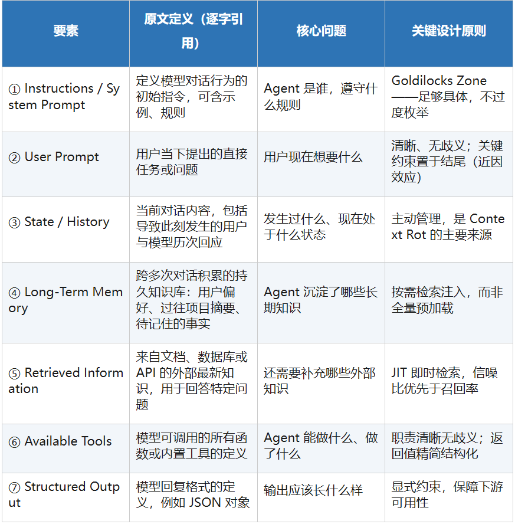

\

### ▸ 一个例子：为什么“简陋 Demo”和“神奇产品”的差距不在代码，而在上下文

\

Philipp Schmid 在原文中给出了一个非常直观的对比：假设一个 AI 助理收到一封邮件——“Hey, just checking if you're around for a quick sync tomorrow.”，要求它帮忙安排会议。

\

> ❌ 简陋 Demo Agent——上下文极度匮乏
>
> \
>
> 它能看到的上下文只有用户的这句请求，没有其他任何信息。
>
> \
>
> 代码完全能跑通（调用 LLM 并拿到回复），但输出生硬机械：“Thank you for your message. Tomorrow works for me. May I ask what time you had in mind?”
>
> \
>
> 问题：没有解决任何实际问题，还需要用户再回复一轮告知具体时间。

> ✅ 神奇产品 Agent——调用前主动“收集”四类上下文
>
> \
>
> a. Long-Term Memory：日历信息（显示“明天排满了”）
>
> b. Retrieved Information：与这位联系人的过往邮件往来（据此判断该用非正式语气）
>
> c. Long-Term Memory：联系人列表（识别出对方是重要合作伙伴）
>
> d. Available Tools：send_invite / send_email 工具
>
> \
>
> 输出：“Hey Jim! Tomorrow&#39;s packed on my end, back-to-back all day. Thursday AM free if that works for you? Sent an invite, lmk if it works.”——不仅语气得体，还直接给出可行方案并发出了邀请。

\

这个例子里，代码的职责发生了根本转变：不再是“想办法回复”，而是“收集 LLM 完成目标所需的信息”。下面逐一展开这七类要素的设计原则。

\

**4.1 Instructions / System Prompt（系统指令）：定义 Agent 的基本盘**

\

系统指令是上下文中最稳定、最持久的部分，定义了 Agent 的角色、原则和行为边界，相当于整个 Context Window 的“宪法”。

\

### ▸ Goldilocks Zone：最优的描述粒度

Anthropic 的文章提出了“Goldilocks Zone”（适中区间）概念——系统指令的描述粒度既不能过于精细，也不能过于宽泛。下面用一个金融客服 Agent 的例子说明三种情况的差别：

> ❌ 太精细——脆性指令（枚举式规则，维护成本极高）
>
> \
>
> 如果支付方式=信用卡 AND 错误码=E001 → 回复：您的信用卡被银行拒绝……
>
> \
>
> 如果支付方式=信用卡 AND 错误码=E002 → 回复：您的信用卡余额不足……
>
> \
>
> 如果支付方式=微信 AND 用户状态=正常 → 先查订单再……
>
> \
>
> ……（此类规则列了 180 条）
>
> \
>
> 问题：①维护成本极高，每新增场景都要改指令 ②遇到未覆盖场景 Agent 不知如何处理 ③大量规则消耗 Token 且多数永远用不到

> ❌ 太宽泛——空洞指令（零实质约束）
>
> \
>
> 你是一个有帮助的客服助手。请专业地处理用户问题。
>
> \
>
> 问题：①没有实质性指导，LLM 自由发挥 ②无法保证行为一致性 ③敏感场景（退款、投诉）可能做出不恰当决策

> ✅ Goldilocks Zone——原则性指令（适中、高效）
>
> \
>
> ## 角色：你是 XYZ 金融的客服助手，专注处理支付和账户问题。
>
> \
>
> ## 核心原则：先确认用户情绪，再给解决方案；涉及资金安全（如疑似盗刷）立即升级人工，不自行决策；不承诺具体赔偿金额，只说明流程；需要查订单才回答，不凭猜测回答。
>
> \
>
> ## 工具使用原则：query_order 查订单状态，query_account 查账户状态，两者不可混用，不确定时先问用户。
>
> \
>
> 优点：①提供明确原则但不枚举所有场景 ②对高风险行为设置明确边界 ③Token 消耗合理，维护成本低 ④遇到未知场景能根据原则推理出合理行为

\

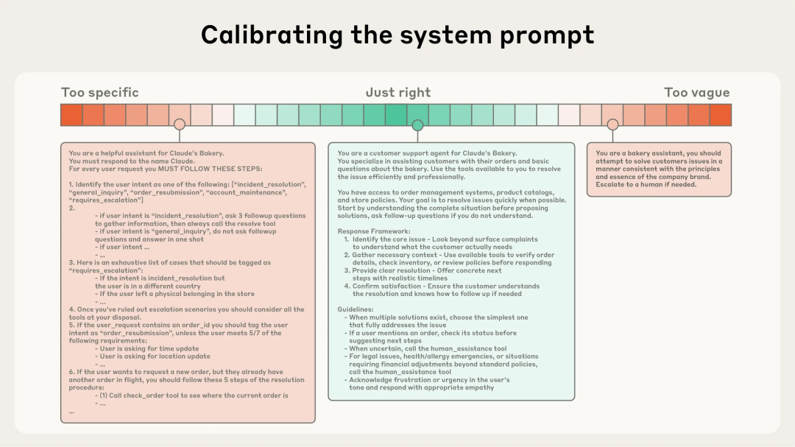

图 4　System Prompt 校准光谱：从“太具体”到“太模糊”

\

Anthropic 原文用的是“面包店客服 Agent”的例子，把上面三种情况画成了一条从“Too specific”到“Too vague”的连续光谱，“Just right”落在中间的绿色区间——与我们上面用“金融客服 Agent”举的三个例子（太精细 / 太宽泛 / Goldilocks Zone）说明的是完全同一个原理。这条光谱图的价值在于：它提示我们 Goldilocks Zone 不是一个固定的“标准答案”，而是需要工程师在“规则的确定性”和“场景的泛化性”之间，针对每个具体业务场景反复校准（Calibrating）出来的一个动态平衡点。

\

结构化技巧：Anthropic 建议使用 XML 标签或 Markdown 标题对系统指令分区（如 ## 角色、## 核心原则、## 工具使用），让 LLM 能快速定位不同类型的指令，也让维护者能精准修改某一模块。位置原则：最重要的约束（如安全限制）放在系统指令开头的第一段，利用首因效应。

\

**4.2 User Prompt（用户提示词）：当下这一刻真正想要什么**

\

philschmid 把 User Prompt 单独列为一类要素，定义是“用户当下提出的直接任务或问题”。它跟Instructions 有本质区别：Instructions 是“稳定的、跨会话复用的规则”，而 User Prompt 是“当次交互特有的、动态变化的具体请求”——前者回答“Agent 是谁”，后者回答“这一刻要做什么”。

\

User Prompt 的设计要点看似简单，实际上有三条容易被忽视的原则：

- 清晰、无歧义——好的 User Prompt 应该像 4.2 节开头的邮件示例那样直接明确；如果用户输入天然模糊（如“帮我看看这个”），Agent 的首要动作应该是澄清，而不是猜测后直接执行。
- 结构化拆分复杂请求——当一次输入包含多个子任务时，用 XML 标签或编号把不同子任务分开呈现，能显著降低模型“漏做一项”的概率。
- 关键约束放在结尾 —— Lost in the Middle 的近因效应：如果 User Prompt 很长（比如粘贴了一大段背景资料），最关键的那句要求应该放在最后，而不是埋在开头或中间。

\

值得注意的是：User Prompt 和 Instructions 共同构成了本文第 2.1 节图 1 中“Prompt Engineering”阶段唯一关心的两块内容（System prompt + User message）。Context Engineering 的进步之处，正是在这两块之外，还系统化地管理了下面五类要素。

\

**4.3 State / History（状态 / 历史）：短期记忆，增长最快也最难管理**

\

philschmid 对这一要素的原文定义是“当前对话内容，包括导致此刻发生的用户与模型历次回应”——也就是通常所说的“短期记忆”（short-term memory）。它让 Agent 具备“上下文连贯性”，知道之前说了什么、做了什么。但它也是上下文增长最快的部分，是 Context Rot 的主要来源。

\

### ▸ 对话历史增长有多快？

以一个代码重构 Agent 为例，估算上下文增长速度（这一增长模式与第 7 章讨论 ReAct 循环时的累积规律高度相似）：

表 11　代码重构任务中对话历史的 Token 增长速度估算

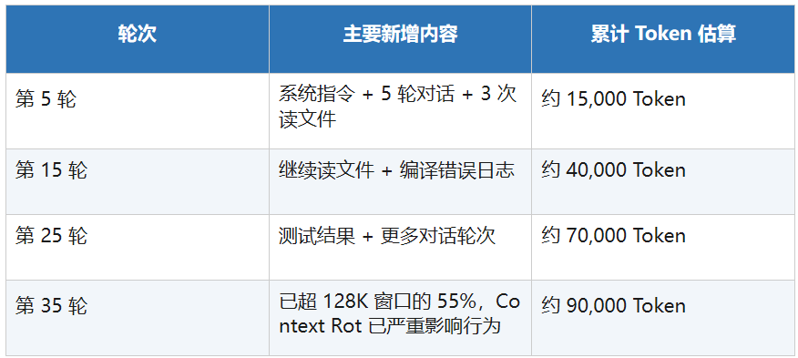

\

### ▸ 三种历史管理策略（递进选择）

1. 滑动窗口（Sliding Window）——只保留最近 N 轮原始对话，实现简单直接，但会彻底丢弃更早的信息，适合短中期、对早期细节依赖弱的任务。
2. Context Compaction（上下文压缩）——定期用 LLM 将历史对话摘要为结构化摘要，保留关键信息、丢弃冗余细节，适合中长期任务（详见第 5 章 5.1）。
3. Structured Note-Taking（结构化外部化）——将关键信息主动“卸载”到上下文窗口之外的持久化存储，理论上支持无限长的任务（详见第 5 章 5.2）。

\

这三种策略是递进关系：滑动窗口最简单但信息损失最大；Compaction 用摘要保留关键信息；Structured Note-Taking 则把信息管理完全移出上下文窗口本身。生产级 Agent 通常会组合使用后两者。

\

### ▸ 同一个要素的另一半：任务状态（Task State）

State / History 这个要素名里的“State”，除了指对话历史本身，工程实践中还常常包含另一类内容——描述 Agent 当前所处环境的“任务状态”，例如当前工作目录、任务阶段、用户账户等级、正在处理的文件名。这类信息同样具有“短期、随会话变化”的特征，因此归入同一要素统一管理。常见错误是把整个项目目录树（可能有几百行）、完整的用户配置（几十个字段）都“以防万一”地全量注入，这是对 Token 预算的严重浪费，也会加重 Context Rot。正确做法遵循三个原则：

1. 只注入决策必需的最小字段集合，不做“全量快照”式注入——每次只放当前这一步真正会用到的字段。
2. 用引用代替内容——传递文件路径、任务ID等轻量标识，而非完整数据本身，需要时再按需拉取。
3. 及时更新与失效清理——任务阶段变化后主动更新或移除过时的状态字段，避免陈旧状态误导模型的判断。

\

**4.4 Long-Term Memory（长期记忆）：跨会话积累的知识库**

\

philschmid 对长期记忆的原文定义是“通过多次先前对话积累而来的持久化知识库，包含已学习到的用户偏好、过往项目摘要，或被告知需要记住以供未来使用的事实信息”。Long-Term Memory 是跨会话持久存在的，对应 CoALA 框架的三类长期记忆（情节 / 语义 / 程序），它们都不应全量注入上下文——应该“按需检索，精准注入”。少样本示例（Few-Shot Examples）作为程序记忆的重要载体，也归入这个要素。

\

少样本示例特别有价值的场景：期望的输出格式比较特殊（如特定的 JSON 结构、报告模板）；任务需要特定的推理风格；存在容易混淆的场景，规则难以清晰描述。

\

▸ 示例的选取原则

1. 数量精简——2～5 个高质量示例通常已经足够，每新增一个示例都在消耗 Token 预算，示例并非越多越好。
2. 覆盖边界与易混淆场景——优先挑选容易出错、容易混淆的情形，而不是最简单直白的情形，这样示例才能真正起到“消歧”作用。
3. 与真实任务分布一致——示例的复杂度、风格应贴近实际场景，避免“教科书式”的理想化示例误导模型对真实输入难度的预期。

\

**4.5 Retrieved Information（检索信息）：按需拉取的外部最新知识**

\

philschmid 对这一要素的原文定义是“来自文档、数据库或 API 的外部、最新知识，用于回答特定问题”（即 RAG，Retrieval-Augmented Generation）。Long-Term Memory 的区别在于：Long-Term Memory 通常是“关于这个用户/这个 Agent 自身”的持久化知识（偏好、历史项目摘要），规模相对小、更新频率低；而 Retrieved Information 面向的是“外部、大规模、可能实时变化”的知识源（产品文档、代码库、知识库、实时 API 数据），需要针对每次具体问题动态检索。

\

**4.6 Available Tools（可用工具）：工具设计即上下文设计**

\

philschmid 对这一要素的原文定义是“模型可以调用的所有函数或内置工具的定义”（例如 check_inventory、send_email）。这是一个被很多工程师忽视的点：工具定义本身是上下文窗口的一部分，每个工具的定义（名称、描述、参数说明）都会占据 Token 空间，并直接影响 LLM 决策“使用哪个工具”的准确率。

> “如果人类工程师都无法明确判断某个场景应该用哪个工具，AI Agent 也无法做到更好。”
>
> —— Anthropic, Effective Context Engineering for AI Agents, 2025

\

> ❌ 工具定义反模式：功能重叠导致混乱
>
> \
>
> search_all_documents(query) —— 在所有文档中搜索相关内容
>
> \
>
> search_recent_documents(query, days=7) —— 搜索最近几天的文档
>
> \
>
> search_documents_by_category(query, category) —— 在指定分类下搜索
>
> \
>
> find_relevant_info(query, type=“any”) —— 查找相关信息（类型可选）
>
> \
>
> 问题：五个工具功能高度重叠，LLM 面对“找最近一个月某类文档”时无法判断该用哪个，工具选择错误率显著上升。

\

### ▸ 工具定义的四个关键原则

1. 名称自描述——工具名称本身就应该清楚表达其功能（如 read_file 比 get_content 更清晰）。
2. 描述说明“适用场景”和“不适用场景”——明确边界能显著减少模型在相近工具间的选择歧义。
3. 工具之间功能无重叠，或重叠边界非常清晰——每个工具应有明确、唯一的职责定位。
4. 参数描述具体，避免“any”或“optional”类的模糊参数——给出示例值，减少模型的猜测成本。

### \

### ▸ ACI：像做人机交互设计一样做“Agent-工具”交互设计

这四条原则背后有一个更早、更根本的概念支撑——Anthropic 在 2024 年底发表的《Building Effective Agents》中提出了 ACI（Agent-Computer Interface，Agent-计算机接口）的类比：工具文档和参数描述对 LLM 来说，就相当于人机交互设计中的 UI/UX 对人类用户的作用。人类工程师在设计 API 或命令行工具时会反复打磨参数命名、错误提示、返回格式，让人类使用者少犯错；ACI 要求我们用同样的严谨程度去打磨工具给 LLM 看的那部分文字——工具名字要不要有歧义、要不要举例、参数格式要不要贴近模型“见过”的训练数据分布，都值得像做产品设计一样进行“可用性测试”（比如让模型对着候选工具描述反复试跑，观察它多久才能选对工具）。

### \

### ▸ 工具返回值也是上下文

工具定义之外，工具的返回值同样是上下文的重要组成部分。一个工具调用失败或返回冗长的结果，可能会在上下文里占据数千 Token，而其中大部分内容是噪声。工程建议：设计工具时不只要设计输入接口，也要设计输出格式——返回精简、结构化的结果，而不是把原始 API 响应直接透传给 LLM。工具调用完成并被 Agent 消化后，其原始结果可以从历史中移除或折叠为摘要，释放 Token 预算——Anthropic 将此视为最轻量的 Compaction 策略。

\

**4.7 Structured Output（结构化输出）：给 LLM 明确的“交卷规范”**

\

philschmid 对这一要素的原文定义是“模型回复格式的定义，例如 JSON 对象”。这个要素常被忽视，但它直接影响输出的可用性。在 Agent 系统中，LLM 的输出往往不是给用户直接看的，而是被下游系统消费的（如 JSON 解析器、工具调用路由器）。如果输出格式不符合预期，整个流程就会断链。

- JSON 输出：明确声明 schema 并给出示例，比只说“输出 JSON”的格式稳定性高 3～5 倍。
- 思考链格式：如果需要 CoT，明确要求“先分析，再结论”的结构，避免混合输出。
- Few-shot 定格：在少样本示例里展示期望的输出格式，比文字描述更有效（示例胜过规则）。

\

\

\

# 05

\

\

长任务的三大核心技术

\

对于短任务（10 轮以内），精心设计的系统提示和工具定义通常足够。但对于长任务——大型代码库迁移、综合研究报告撰写、长期自动化任务——上下文窗口会逐渐被填满，Context Rot 会严重影响任务质量。Anthropic 在 2025 年总结了三大工程技术来解决这个问题：

表 12　长任务三大核心技术的适用场景与机制对比

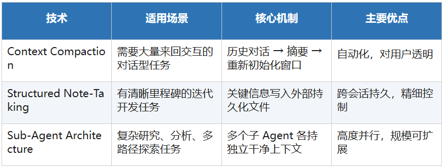

\

**5.1 Context Compaction（上下文压缩）——让 Agent “自动记忆”**

\

核心机制：当对话的 Token 数量接近上下文窗口上限（通常设为 70%～80% 时触发），自动调用 LLM 对当前完整对话历史进行摘要，生成一个包含关键信息的压缩摘要，然后以“系统提示 + 压缩摘要 + 最近几轮原始对话”重新初始化上下文窗口，继续任务。

表 13　Context Compaction 应保留与应丢弃的内容

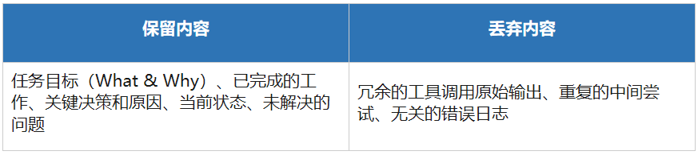

\

### ▸ 关键：如何写好压缩 Prompt

压缩的质量取决于压缩 Prompt 的设计。Anthropic 建议：先优化召回率（确保关键信息不丢失），再优化精确率（消除冗余）。一个经过实践验证的压缩指令模板如下：

```
You are compacting a conversation history for an AI coding agent.Preserve the following information:1. The original task goal and any clarifications made2. All completed steps and their outcomes3. Key decisions made and the reasoning behind them4. Current state: what file is being worked on, what problem remains5. Any unresolved errors or known constraints6. Any important user preferences mentionedCompress the following into a structured summary under 600 tokens.Do NOT include: raw tool outputs, duplicate attempts, verbose error logs.Output format:## Task Overview## Progress## Current State## Key Decisions## Open Issues
```

Claude Code 的实现细节：Claude Code 在触发 Context Compaction 时，会在摘要基础上额外保留“最近访问的 5 个文件”的内容。这是因为正在处理的文件是最重要的环境状态，而它们在摘要中可能没有完整保留——摘要负责“知道发生了什么”，最近文件负责“知道正在看什么”。

\

**5.2 Structured Note-Taking（结构化笔记）——Agent 的“工作日志”**

\

与 Compaction 的区别：Context Compaction 是被动的——当上下文满了才触发。Structured Note-Taking 是主动的——Agent 在执行任务的过程中，主动将关键信息“卸载”到上下文窗口之外的外部持久化存储，随时可以重新加载。用一个比喻：Compaction 像是“笔记本写满了，翻回去写摘要”；Note-Taking 像是“边做任务边记录，随时把重要内容抄到外部笔记本上”。

> 结构化笔记的四种类型（以代码重构任务为例）
>
> \
>
> # 进度笔记（Progress Notes）——已经做了什么：[✓] auth_service.go 已重构认证逻辑；[ ] order_service.go 待处理
>
> # 决策笔记（Decision Notes）——为什么这样做：选择 JWT 而非 Session，理由是服务无状态、水平扩展需要
>
> # 发现笔记（Finding Notes）——过程中发现的重要信息：发现 payment_service 调用 auth_service 三次/每请求（冗余！）
>
> # 策略笔记（Strategy Notes）——下一步怎么做：1. 先修复 auth 冗余调用 2. 然后处理 panic 3. 最后统一 error handling 风格

\

### ▸ Claude Plays Pokémon：一个极端的案例

Anthropic 记录了一个极具说明性的案例：Claude 玩《宝可梦》游戏。这个任务要求 Agent 在数千个游戏步骤中保持连续的长期记忆，是对结构化笔记机制的极限测试。在没有结构化笔记的情况下，Agent 会在每次上下文重置后“忘记”之前的进度；但通过结构化笔记，Agent 在上下文重置后能读取自己之前写的笔记，并无缝继续任务——即使上下文窗口被重置了多次，Agent 通过读取笔记也能立刻知道当前的游戏进度、队伍状态和下一步计划，在数小时的连续游戏中实现了“跨会话的连续记忆”。

\

**5.3 Sub-Agent Architecture（子 Agent 架构）——上下文隔离的艺术**

\

核心设计思想：不要让一个 Agent 处理一切，而是让一个“主 Agent”（Orchestrator）负责高层规划和协调，将具体的探索性子任务分发给多个专门的“子 Agent”（Worker）。每个子 Agent 拥有一个独立、干净的上下文窗口，执行完毕后只向主 Agent 返回精炼的摘要。

\

这个架构并不是 Context Engineering 时代的全新发明——它的原型是 Anthropic 在更早的《Building Effective Agents》一文中提出的 “Orchestrator-workers”（编排者-工作者）设计模式：一个中心 LLM 动态地拆解任务、把子任务分派给多个工作者 LLM，再汇总它们的结果。当时这个模式被归纳为一种通用的“工作流编排”手段，主要用于解决“任务需要动态拆解，且拆解方式无法预先写死”的场景（如代码改动会涉及不确定数量、不确定类型的文件）。放到 Context Engineering 的视角下看，这个模式还额外解决了一个当年没有被强调的问题——上下文隔离：每个 worker 独立的上下文窗口天然阻止了 Context Rot 在子任务之间扩散。

\

> 💡 关键优势
>
> \
>
> 用上下文隔离（Context Isolation）换取规模扩展（Scale）。子任务的探索过程可能消耗数万 Token，但这些 Token 被隔离在子 Agent 的上下文中，不会污染主 Agent 的上下文。主 Agent 始终保持一个干净、专注的上下文。

\

### ▸ 一个具体的例子：竞品分析报告

假设任务是“撰写一份大语言模型市场竞品分析报告”。主 Agent 将任务分解为四条研究路线，每个子 Agent 独立研究一家厂商：

表 14　竞品分析报告任务中四个子 Agent 的分工与消耗

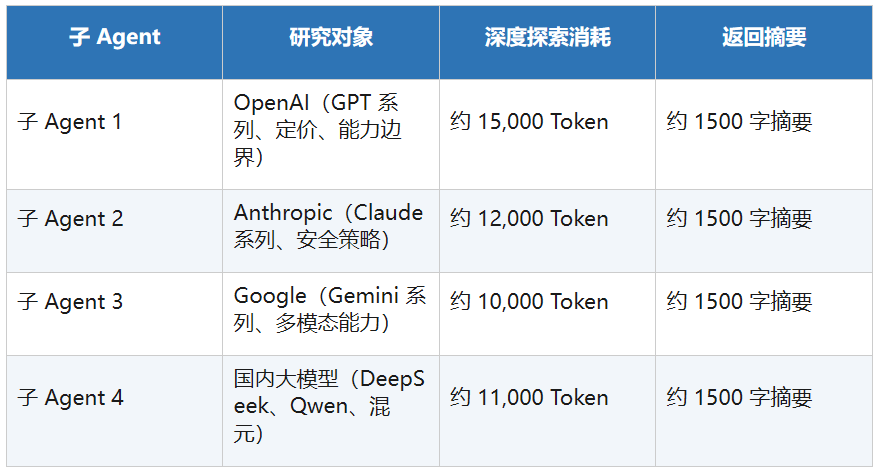

\

主 Agent 接收到四份摘要（共约 6,000 Token），以这份精炼的信息为基础撰写综合报告，其上下文始终保持干净，不会被任何一条研究路线的原始探索细节污染。如果用单个 Agent 顺序完成同样的任务，探索完四条路线后上下文会增长到 50,000+ Token，早期研究结果会因为 Context Rot 而被“遗忘”，最终报告质量大幅下降。

\

### ▸ 何时选择 Sub-Agent

1. 任务可以拆解为多个相对独立、可并行探索的子方向（如竞品分析的多条研究路线），彼此之间耦合度低。
2. 单条探索路径预计消耗大量 Token（数千至数万），如果放在主 Agent 的上下文里会严重污染后续判断。
3. 任务对“深度”的要求高于对“实时性”的要求，能够容忍多子 Agent 并行带来的额外延迟和成本。

\

\

\

# 06

\

\

检索策略：从“预加载”到“即时按需”

\

检索策略决定了“外部知识”如何进入上下文窗口，这是 Context Engineering 中另一个关键的设计决策点。

\

**6.1 两种检索哲学的对比**

\

表 15　传统预检索策略与 Just-in-Time 即时检索的对比

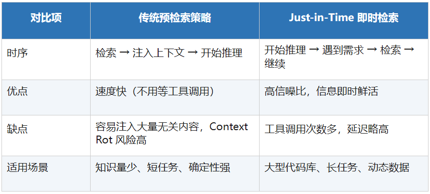

\

关键问题：检索内容的相关性。检索到不相关的内容比没有检索更糟糕。举例：用户问“最新版本的 API 如何认证？”，你检索了 5 个文档，其中只有 1 个真正相关。如果把全部 5 个文档塞进上下文，正确答案就被夹在了大量无关内容之间——Lost in the Middle 效应开始起作用。更好的做法：只检索最相关的 1～2 个文档，而不是“宁可多要，不要少要”。

\

**6.2 渐进式披露（Progressive Disclosure）**

\

即时检索的一个重要子策略是“渐进式披露”。Agent 不是一次性获取完整信息，而是通过轻量级的“探索”逐步判断哪些信息值得深度加载。就像一个经验丰富的工程师在陌生的大型代码库里排查 Bug：不会一开始就读所有文件，而是先看目录结构判断哪个模块最相关，再看关键文件的函数签名确认方向，最后才精读最关键的函数实现。

\

类似地，Claude Code 使用 head 命令只读取文件前几行判断文件类型，用 grep 快速定位相关代码片段，而不是把整个文件读入上下文。这种“探索 → 精准加载”的策略，比“预加载所有可能相关文件”节省了大量无效 Token。

\

**6.3 混合策略：Claude Code 的实践**

\

表 16　Claude Code 针对不同信息类型的混合检索策略

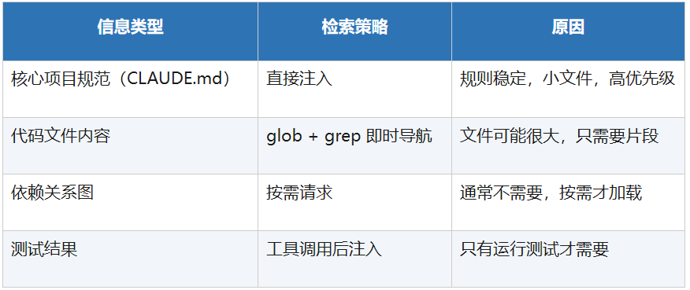

\

\

\

# 07

\

\

Context Engineering 与 ReAct 的关系

\

ReAct 范式解决了 AI 工程中一个关键问题：“如何让 LLM 通过工具调用完成复杂任务”，赋予了 Agent 主动行动的能力。但 ReAct 有一个设计上的盲点：它专注于“如何做”的逻辑，对“做的过程中上下文如何管理”几乎没有显式规定。TAO 循环每执行一轮，就有内容被追加到上下文历史里。在短任务（5～10 轮）时问题不明显；但在长任务（20～50 轮）中，上下文失控会导致 Agent 的行为质量持续退化。

\

**7.1 ReAct 循环中的上下文积累机制**

\

在每一轮 TAO 循环中，有三类内容会被追加到上下文历史：

表 17　TAO 循环三类内容的 Token 特征

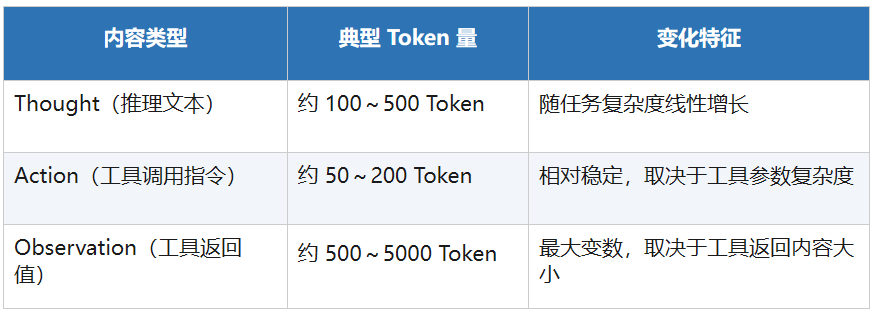

\

表 18　无上下文管理时，ReAct 循环轮次与累计 Token 的关系

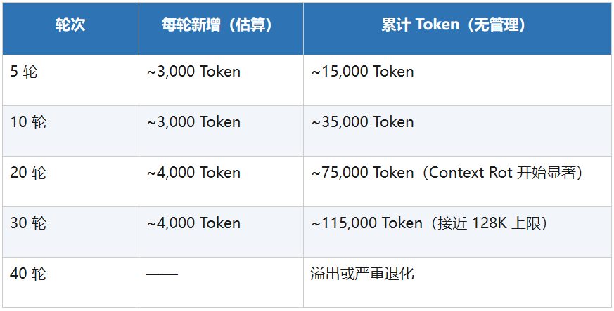

\

**7.2 ReAct 的四大上下文陷阱**

\

随着 TAO 循环不断累积，ReAct Agent 会落入四个典型的上下文陷阱，这是导致“Agent 用久了越来越差”的根本原因。

\

### ▸ 陷阱一：Observation 无限膨胀

每次 Action 调用工具后，Observation 被永久追加到历史里。即使 Agent 早已“消化”了信息并做出决策，原始的工具返回值仍然占据上下文空间。一个 50 轮任务，仅 Observation 累计可超过 80,000 Token，其中大部分对当前决策毫无价值。

\

### ▸ 陷阱二：规则漂移（Rule Drift）

这是最隐蔽也最危险的陷阱。系统指令在任务开始时位于上下文开头，模型能清晰看见；但随着 TAO 循环推进，对话历史快速增长，系统指令被从“开头”推入了“中间”——正好落入 Lost in the Middle 研究发现的“性能洼地”。这个现象在实践中表现为：Agent 在前 10 轮严格遵守命名规范，从第 20 轮开始偶尔出错，到第 30 轮已经完全混用不同风格。工程师往往把这归因为“模型不稳定”，实际上是规则漂移导致的。

\

### ▸ 陷阱三：错误轨迹污染（Error Contamination）

工具调用失败、API 超时、格式解析错误是常态。ReAct 的容错机制会让 Agent 在 Thought 里记录失败然后重试，但这些失败的 Thought 和错误的 Observation 都被永久保留在上下文历史里。一旦一条错误信息进入上下文，它就会影响后续所有轮次的推理，就像一个“谣言”在系统里流传，越传越影响模型的判断——这是 Context Rot 的一种具体表现形式。

\

### ▸ 陷阱四：Thought 冗余积累

ReAct 的每一轮 Thought 都被完整保留在历史里。这些中间推理在当时很有意义，但随着任务推进变成了纯粹的历史记录，不再提供信息价值，却持续消耗 Token 预算。以一个 40 轮任务为例，仅 Thought 部分累计约 8,000 Token，其中真正对当前决策有价值的可能不超过最近 3～5 轮。

> ⚠ 根本问题
>
> \
>
> 四大陷阱的共同本质：ReAct 循环只进不出。每一轮 TAO 循环都在向上下文里添加内容，却没有任何机制决定“什么时候应该移除或压缩什么内容”。Context Engineering 就是专门解决这个“只进不出”问题的。

\

**7.3 Context Engineering 如何精准破解四大陷阱**

\

表 19　Context Engineering 对 ReAct 四大陷阱的针对性破解机制

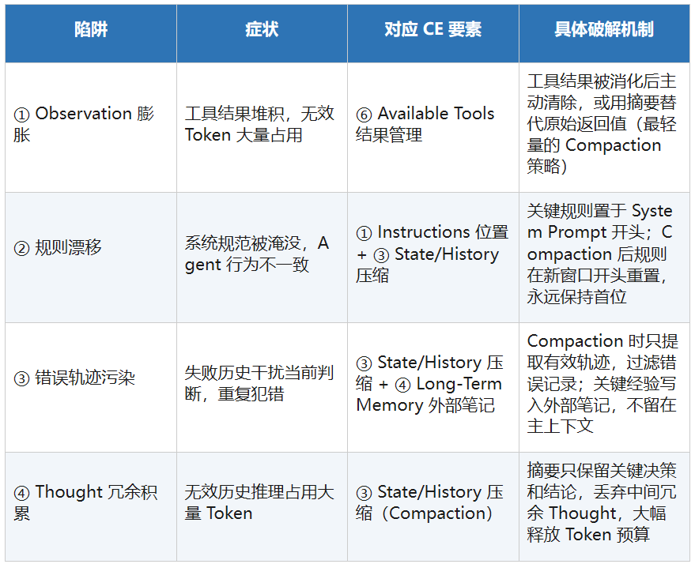

\

这张表揭示了一个规律：CE 对 ReAct 的修补不是全局的，而是针对性的。每个陷阱有其对应的 CE 机制，而且大多数陷阱的解法都指向同一个核心操作——主动管理和压缩上下文历史。

\

**7.4 数字化对比：同一个 50 轮任务的两种命运**

\

表 20　50 轮任务在“无 CE”与“有 CE”下的 Token 走势对比

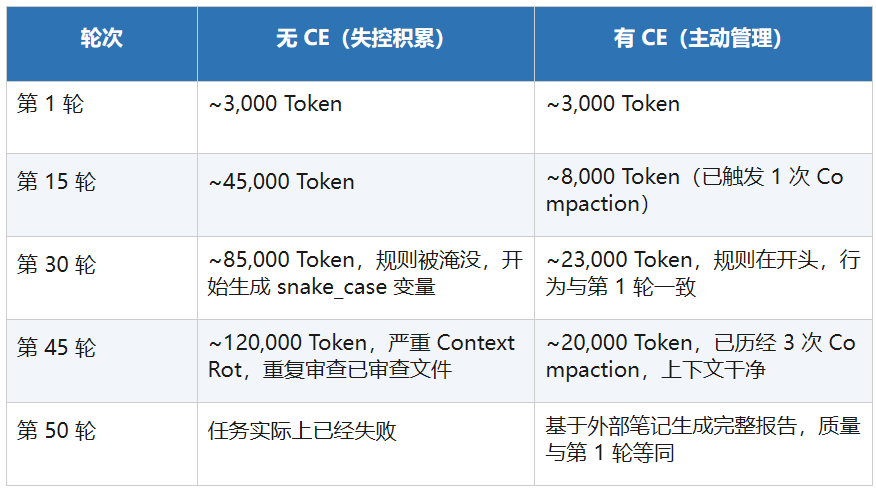

\

两条曲线揭示了关键差异：不是 CE 减少了任务的信息量，而是 CE 用更少的 Token 承载了同样的有效信息。Compaction 每次发生时，丢弃的是已经没有信息价值的冗余内容，保留的是真正影响后续决策的关键信息。

\

**7.5 关系定论：分工明确，缺一不可**

\

表 21　ReAct 与 Context Engineering 的职责分工

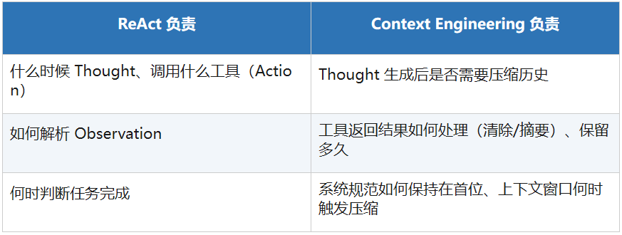

> 💡 结论
>
> \
>
> ReAct 是行动框架，CE 是信息保障，两者缺一不可。
>
> \
>
> 有 ReAct 无 CE → Agent 短期能用，长期退化。
>
> \
>
> 有 CE 无 ReAct → 有信息管理但没有行动逻辑。
>
> \
>
> ReAct + CE → 可以在生产环境长期稳定运行的 Agent。

\

\

\

# 08

\

\

代码实战：构建 Context-Aware Agent

\

代码示例：

```
"""Context Engineering 实战：Context-Aware Code Review Agent"""from dataclasses import dataclass, fieldimport json@dataclassclass TokenBudget:    """应对 Attention Budget 约束的预算管理器"""    max_tokens: int = 100_000    compact_at: float = 0.75  # 超过 75% 触发压缩    warn_at: float = 0.60     # 超过 60% 发出警告    def usage_ratio(self, used: int) -> float:        return used / self.max_tokens@dataclassclass StructuredNotes:    """上下文窗口之外的外部持久化笔记（对应 CoALA 情节/语义记忆）"""    progress: list = field(default_factory=list)    decisions: list = field(default_factory=list)    findings: list = field(default_factory=list)    strategy: list = field(default_factory=list)        def add_finding(self, text: str):        self.findings.append(f"[发现] {text}")        def to_context_string(self) -> str:        # 放置在系统提示末尾，利用近因效应        parts = []        if self.progress:            parts += ["## 已完成工作", *self.progress]        if self.findings:            parts += ["## 重要发现", *self.findings]        return "\n".join(parts)@dataclassclass ContextWindow:    """七类要素的落地映射：本类持有 ①③④⑥⑦ 五个字段；    ②User Prompt 由 add_turn() 动态传入；    ⑤Retrieved Information 由外部 JITRetriever 检索后写入 state"""    instructions: str = "## 角色\n你是 Go 代码审查助手..."  # ① Instructions    tools: list = field(default_factory=list)              # ⑥ Available Tools，职责清晰无歧义    history: list = field(default_factory=list)            # ③ State/History，需主动管理    state: dict = field(default_factory=dict)              # ③ State/History，只放最小字段    output_format: str = "[文件名:行号] 问题 -> 建议"       # ⑦ Structured Output    notes: StructuredNotes = field(default_factory=StructuredNotes)  # ④ Long-Term Memory    budget: TokenBudget = field(default_factory=TokenBudget)        def estimate_tokens(self) -> int:        text = self.instructions + json.dumps(self.history) + \            json.dumps(self.state) + self.notes.to_context_string()        return len(text) // 4  # 近似：1 Token ≈ 4 字符        def add_turn(self, role: str, content: str):        self.history.append({"role": role, "content": content})        used = self.estimate_tokens()        ratio = self.budget.usage_ratio(used)        if ratio >= self.budget.compact_at:            self._compact()  # 触发 Context Compaction        elif ratio >= self.budget.warn_at:            print(f"[警告] Token 使用率 {ratio:.0%}")        def _compact(self):        """生产环境应调用 LLM 生成摘要，而非简单截取"""        if len(self.history) <= 3:            return        early, recent = self.history[:-3], self.history[-3:]        for turn in early:            if turn["role"] == "assistant":                self.notes.add_finding(turn["content"][:150])  # 卸载到外部笔记        self.history = [{"role": "system",                         "content": f"[历史已压缩：{len(early)} 轮已摘要]"}] + recentclass JITRetriever:    """即时检索：只拉取与当前问题最相关的 1~2 条，信噪比优先于召回率"""        def __init__(self, kb: dict):        self.kb = kb    def retrieve(self, query: str, top_k: int = 2) -> list:        hits = []        for doc_id, content in self.kb.items():            if any(k in content.lower() for k in query.lower().split()):                hits.append(f"[{doc_id}] {content[:300]}")            if len(hits) >= top_k:                break        return hits
```

\

### ▸ 完整闭环：把四个零件组装成一次真实的 Agent 运行

上面的四个类分别负责多类要素管理、Token 预算、外部笔记和即时检索，但它们只是“零件”。下面这段代码把它们组装成一个可以直接运行的闭环：每一轮对话先经过 JITRetriever 做即时检索，再写入 ContextWindow；一旦 Token 使用率触及阈值，add_turn 会自动调用 _compact()，把早期历史卸载进 StructuredNotes，确保 history 不会无限增长。

\

```
def run_code_review_loop():    """闭环运行：JIT检索 -> 组装ContextWindow -> 模拟LLM决策 -> 写入笔记 -> 自动压缩"""    kb = {        "style_guide": "变量命名使用 camelCase，错误变量统一命名为 err",        "error_handling": "所有错误必须包裹上下文后再返回，禁止裸露 err",    }    retriever = JITRetriever(kb)    ctx = ContextWindow()    ctx.tools = ["read_file", "run_tests", "apply_patch"]        user_turns = [        "审查 auth_service.go 的错误处理是否规范",        "审查 order_service.go 的命名规范",        "运行单元测试并总结失败原因",    ]    for turn_idx, user_query in enumerate(user_turns, start=1):        hits = retriever.retrieve(user_query)  # ⑤ JIT 检索，而非预加载全部知识        ctx.state = {"current_query": user_query, "retrieved": hits}        ctx.add_turn("user", user_query)        # 模拟 LLM 推理后产出的结论（生产环境这里替换为真实的 LLM API 调用）        assistant_reply = f"[第{turn_idx}轮结论] 已依据 {hits} 完成审查"        ctx.add_turn("assistant", assistant_reply)        print(f"第{turn_idx}轮 | Token使用率={ctx.budget.usage_ratio(ctx.estimate_tokens()):.0%} "              f"| 历史轮数={len(ctx.history)} | 笔记条数={len(ctx.notes.findings)}")        print("\n最终上下文（七类要素快照）：")    print(f"- Instructions: {ctx.instructions[:20]}...")    print(f"- Tools: {ctx.tools}")    print(f"- History 轮数: {len(ctx.history)}（已自动压缩，未无限增长）")    print(f"- 外部笔记: {ctx.notes.to_context_string()[:60]}...")if __name__ == "__main__":    run_code_review_loop()
```

\

运行这段代码会看到：随着轮次增加，Token 使用率被持续监控，一旦触及阈值，历史轮数不会像 ReAct 裸循环那样无限膨胀，而是被自动压缩、关键内容转存到外部笔记。

\

\

\

# 09

\

\

常见误区与反模式

\

掌握了 Context Engineering 的正确做法，同样重要的是了解常见的错误做法。以下是工程实践中最频繁出现的五大反模式。

\

### ▸ 反模式 1：“更多上下文更安全”的幻觉

表现：把所有可能相关的文档、所有历史对话、所有工具调用记录都保留在上下文里，“万一用到了呢？”问题：这是 Context Rot 和 Attention Budget 约束最常见的触发方式，无关内容稀释关键信息，上下文越长，模型对早期关键指令的遵从度越低。

> ⚠ 原则
>
> \
>
> 最优的上下文不是最长的上下文，而是信噪比最高的上下文。

\

### ▸ 反模式 2：工具越多越好

表现：注册了十几个工具，覆盖所有可能的操作场景。问题：工具定义本身消耗 Token；更重要的是，功能重叠的工具会让 LLM 产生决策困惑，工具选择错误率上升，Agent 行为变得不可预测。

> ⚠ 原则
>
> \
>
> 工具集应该“够用”而不是“全面”。每个工具有清晰的职责边界，功能不重叠。

\

### ▸ 反模式 3：System Prompt 越详细越可靠

表现：在系统提示里列出所有可能的边缘情况和对应处理规则，几千字的系统提示覆盖每一种可能场景。问题：过度细化（违反 Goldilocks Zone 原则）会导致 Token 浪费（大多数规则用不到）和脆性（遇到未枚举场景时不知如何处理）。

> ⚠ 原则
>
> \
>
> 系统提示应该提供“原则”而非“枚举”。让 LLM 根据原则推理，而不是查表匹配规则。

\

### ▸ 反模式 4：不清理工具调用结果

表现：工具调用的完整原始结果永久保留在对话历史中，不做清理。问题：工具调用结果可能非常长（一次文件读取可能 3000+ Token），当任务继续推进，这些早期结果已经不再需要，但仍占据大量上下文空间，加速 Context Rot。

> ⚠ 原则
>
> \
>
> 工具调用结果是临时性的。一旦 Agent 消化了结果，就应该将其从对话历史中移除或压缩。

\

### ▸ 反模式 5：用大上下文窗口作为“解决方案”

表现：“我用 Claude 的 200K Token 窗口，肯定够了，不需要管理上下文。”问题：更大的上下文窗口只是推迟了问题，不是解决问题。Context Rot 的“信号稀释”效应在任何大小的窗口里都存在，况且更大的上下文意味着更高的计算成本（O(n²)）和更长的延迟。

> ⚠ 原则
>
> \
>
> Context Engineering 不是解决“窗口不够大”的问题，而是在任何大小的窗口里，让信噪比最大化。

\

\

\

# 10

\

\

Context Engineering 与 Harness Engineering 的映射

\

Harness Engineering 与 Context Engineering 是什么关系？答案是：Harness Engineering 是 Context Engineering 在 AI Coding 场景的工程化落地体系——它把 CE 的抽象原则，变成了可以版本化管理、团队共享、持续积累的具体工程资产。

\

**10.1 Harness 四组件与七类要素的映射**

\

表 22　Harness 四组件与七类要素、CoALA 记忆类型的映射

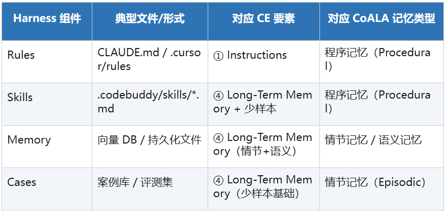

\

**10.2 为什么说 Harness Engineering 是“工程化的 Context Engineering”**

\

Context Engineering 是“做什么”的理论框架：管理好七类要素，保持高信噪比，主动处理 Context Rot。Harness Engineering 是“怎么做”的工程实践体系，它解决了 CE 面临的三个工程问题：

### \

### ▸ 工程问题 1：规则怎么沉淀和复用

Harness 的 Rules 文件（如 CLAUDE.md、.cursor/rules）将系统指令从“对话里临时写”变成了“版本化管理的文件”。一旦某条规则被验证有效，提交到 Git，团队所有人的 Agent 都能使用。

### \

### ▸ 工程问题 2：过往经验怎么积累

Harness 的 Memory 和 Cases 系统，把 CoALA 中的“情节记忆”和“语义记忆”工程化了：过去做过的任务、踩过的坑、找到的好方案，都可以持久化存储，下次 Agent 运行时自动检索注入。

### \

### ▸ 工程问题 3：好的做法怎么标准化

Harness 的 Skills 文件，把经过验证的“做某件事的方法”封装成可调用的技能模块。Agent 遇到对应任务时，自动加载 Skill，按经过验证的步骤执行。

\

> 💡 一句话总结
>
> \
>
> Context Engineering 告诉你“为什么要管理上下文、管理什么”；Harness Engineering 告诉你“怎么把这些管理沉淀成团队资产，持续积累”。理解了 CE，就理解了 Harness 的设计原理；实践了 Harness，就是在落地 CE。

\

**10.3 Claude Code：两者结合的最佳参考实现**

\

表 23　Claude Code 的具体机制与 CE 原则对照

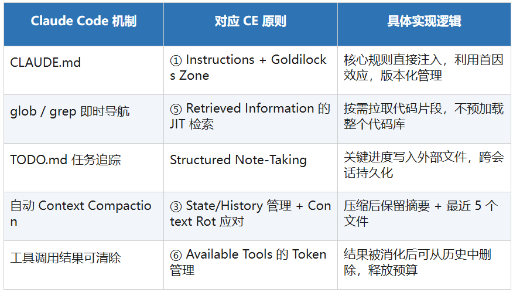

\

\

\

# 11

\

\

背景：服务重构为什么难

\

**11.1 判断标准：什么场景需要 Context Engineering**

\

并非所有 AI 应用都需要完整的 Context Engineering 体系。判断标准很简单：

表 24　不同场景是否需要完整 Context Engineering 体系的判断表

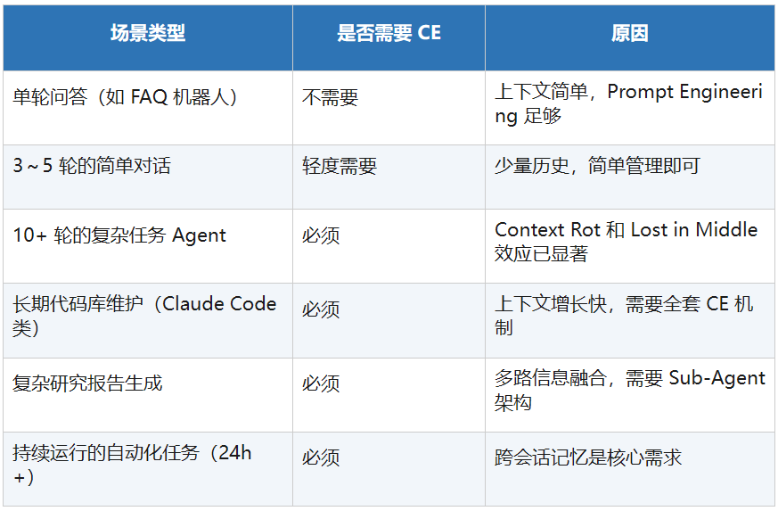

\

**11.2 三大典型场景的 CE 应用方式**

\

### ▸ 场景一：智能客服 Agent（多轮对话）

核心挑战：客服对话轮次多，用户可能在同一会话内问多个不同问题，上下文混乱会导致 Agent “记混”不同问题。

1. Instructions：明确角色边界，高风险操作（退款、注销）列明需要升级人工的原则
2. State/History 管理：采用滑动窗口（保留最近 8 轮）+ 关键信息外部笔记（用户诉求、情绪状态）；环境状态只注入用户等级、订单 ID 等关键字段，不注入完整档案
3. Tools：明确区分“查询类工具”和“操作类工具”，操作类工具调用必须有确认步骤

### \

### ▸ 场景二：AI Coding Agent（长期开发任务）

核心挑战：代码审查/重构任务轮次极多，工具调用返回结果量大，Context Rot 是最主要的质量杀手。

1. Instructions：Goldilocks Zone 原则，提供编码规范和工具使用原则，不枚举所有场景
2. Long-Term Memory（Skills）：把经过验证的重构步骤、审查 Checklist 封装成 Skill，按需调用
3. State/History：激进的 Compaction 策略（60% 阈值触发），工具调用结果读完即清除；只维护“当前审查的文件清单”和“已完成清单”，不注入完整目录树
4. 外部笔记：严格执行 Structured Note-Taking，所有重要发现实时写入

### \

### ▸ 场景三：复杂研究报告 Agent（多路信息融合）

核心挑战：需要同时从多条信息路径获取信息并综合出有深度的报告，单个 Agent 无法维持所有路径的深度探索。

1. 架构：采用 Sub-Agent Architecture，主 Agent 负责规划和综合，子 Agent 负责各路径深度探索
2. 主 Agent 的上下文：只包含任务目标 + 子 Agent 返回的精炼摘要（每路 1000～2000 Token）
3. 检索策略：JIT 检索，每个子 Agent 只检索自己负责的那条路线的相关文档

\

**11.3 一个值得思考的问题：大窗口会淘汰 Context Engineering 吗**

\

随着 Gemini 1.5 Pro 的 100 万 Token 窗口和各家模型不断扩展的上下文能力，一个自然的问题是：窗口越来越大，Context Engineering 还有必要吗？

> “上下文窗口变大，并不会使 Context Engineering 变得不重要，而是将挑战从“如何装下足够信息”转向“如何在百万 Token 中组织最优的信息结构”。”
>
> —— Anthropic Engineering Team, 2025

\

- Context Rot 在大窗口里同样存在：100 万 Token 的窗口里，1 万 Token 的关键指令同样会被 90 万 Token 的无关内容稀释，Lost in the Middle 效应不会因窗口变大而消失。
- Attention Budget 代价更高：O(n²) 的注意力计算，在百万 Token 窗口里意味着更长的延迟和更高的成本。
- 信噪比问题永远存在：无论窗口多大，加入无关内容都是在消耗注意力预算，精准供给始终优于堆砌。

\

\

\

# 12

\

\

背景：服务重构为什么难

\

**核心要点：三句话总结**

\

> 💡 Context Engineering 三句话核心要点
>
> \
>
> 1. 上下文窗口是稀缺资源——每一个进入窗口的 Token 都在消耗注意力预算；无关信息不是中性的，它主动损害有效信息的信号强度。
>
> \
>
> 2. 最优上下文 = 最小 Token 数 × 最高信噪比——目标不是“装下更多信息”，而是“每个 Token 都对当前决策有价值”。
>
> \
>
> 3. 上下文管理是持续进行的工程工作，不是一次性任务——Agent 在运行的每一步都在发生 Context Engineering 决策；好的工程化让这些决策自动化、可积累、可复用。

\

**参考文献**

\

1. Effective Context Engineering for AI Agents. https://www.anthropic.com/engineering/effective-context-engineering-for-ai-agents
2. Building Effective Agents. https://www.anthropic.com/engineering/building-effective-agents
3. Lost in the Middle: How Language Models Use Long Contexts. https://arxiv.org/html/2307.03172v1\
4. Cognitive Architectures for Language Agents. https://arxiv.org/pdf/2309.02427

\

-End-

原创作者｜梁凌郁

\

感谢你读到这里，不如关注一下？👇

\  📢📢来抢开发者限席名额！点击下方图片直达👇  \  \ 扫码领取腾讯云开发者专属服务器代金券！\


[](https://mp.weixin.qq.com/s?__biz=MzI2NDU4OTExOQ==&mid=2247695850&idx=1&sn=ecfbc2739caa6d9ebda151aadc400c8a&scene=21#wechat_redirect)

[](https://mp.weixin.qq.com/s?__biz=MzI2NDU4OTExOQ==&mid=2247695865&idx=1&sn=d300189a3247bb4da82e03c2c1d9e772&scene=21#wechat_redirect)

[](https://mp.weixin.qq.com/s?__biz=MzI2NDU4OTExOQ==&mid=2247695963&idx=1&sn=29f18a2db784e1ddb56796af76543688&scene=21#wechat_redirect)

\


