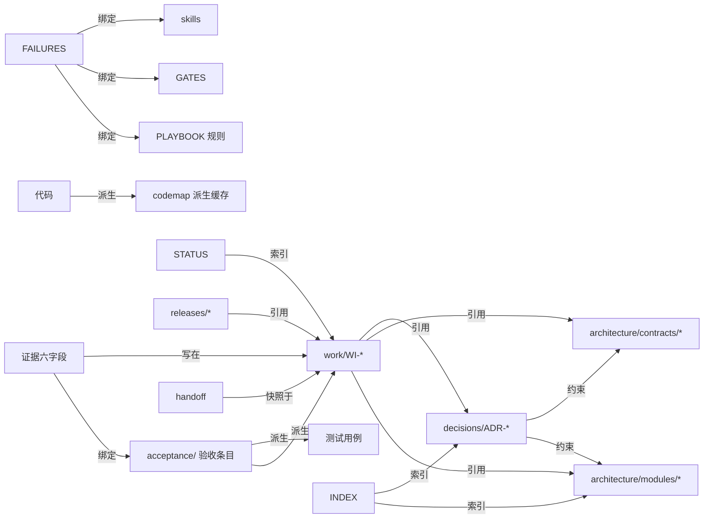

# 01 项目管理标准

版本 1.0 · 适用：由人与 AI 编程工具共同长期开发和维护的大型软件项目（多模块、多会话、可能多人、可能多工具）

---

## 0. 这份标准管什么

管"AI 参与的软件开发过程"，不管代码怎么写。任何时刻、任何工具、任何接手者，都应能只靠仓库答出五个问题：

1. 项目要做什么、本期不做什么——**意图**
2. 现在做到哪了、什么卡着——**状态**
3. 系统为什么这样设计、哪些契约不能动——**架构**（详见 [02](02-项目架构描述规范.md)）
4. 下一个接手的人或工具怎么继续——**接续**
5. 凭什么说做完了、可交付了——**证据**

答不出任何一个，先补工件，再动手。

**"必须"是采用本标准后的最低要求；"建议"按项目选；"参数"是本标准给默认值、项目可改的量。**

---

## 1. 十条原则

每条附检查方式——检查不出的原则等于没有。

| # | 原则 | 要求 | 怎么检查 |
|---|---|---|---|
| G1 | 知识随仓库 | 影响后续维护的目标、约束、决策、进度、坑，不得只存在于聊天记录或某人脑子里 | 每次会话结束时问：本次得出的结论里，哪些会影响未来？落到哪个文件了？ |
| G2 | 单一权威 | 同一事实只有一个维护位置；别处引用写链接，不抄值 | 检索同一数值/状态/清单出现两处即缺陷 |
| G3 | 意图、现状、验证分开 | "已批准""已改代码""已验证"分别记录，不混称"完成" | 工作项里三者是三个字段 |
| G4 | 完成需要证据 | 每个完成声明绑定版本、环境、方法、结果、时间 | 证据六字段（§4.2）缺一即声明无效 |
| G5 | 约束可检查 | 高价值规则对应脚本、测试、CI 或明确的人工步骤 | 规则表的"检查方式"列非空 |
| G6 | 变更可追踪 | 契约与架构变更记录原因、影响、替代方案、实施状态 | 高影响变更必有 ADR + 迁移工作项 |
| G7 | 工作可接续 | 中断与交接时保存剩余步骤、阻塞、验证状态、工作区身份 | 接手演练：新会话只读仓库能否继续 |
| G8 | 流程按风险增减 | 小改动轻量；涉及数据、契约、发布时加验证 | 变更分级表（§4.3） |
| G9 | 规则受控演进 | 每条规则绑定它防的失败与删除条件；只增不减是缺陷 | 规则登记表两列非空；季度减法有记录 |
| G10 | 入口简短 | 工具入口只放"晚一秒就来不及"的规则与阅读路径 | 入口行数预算（§3.7）；超了先移出 |

---

## 2. 三条地基纪律

这三条对一切运行成立，不随项目规模裁剪。它们不成立时，后面全部形同虚设。

### N1 · 三态：通过 / 失败 / 未定

**每个结论都是"结论 + 它的成立条件"。写不出成立条件，记 `UNDETERMINED`（未定）。**

一律记未定、**不得折算为通过**：检查没跑、失败、超时；**输出为空**（空输出最常见的原因是采集根本没跑起来）；生成者与验证者是同一方且判断涉及解释；外部写入结果未知；需要人应答而没答；交接缺字段。**"全部 X 通过"在 X 为空集时判未定。**

报告写 `PASS n / FAIL n / UNDETERMINED n`，三个数分列，未定不进通过率分母。

### N2 · 单一权威：副本即缺陷

**每类事实只有一处权威位置。** 版本号、提交号、条数、状态摘要、清单——任何"某处已有权威"的值，在别处写一份便于阅读的投影，它必然漂移。写下任何名单或数字之前，先问：它的权威在哪一处？为什么那一处不够读？

### N3 · 每条规则绑定它防的失败与删除条件

**新增规则必须同时写清：它防哪个已经发生过的具体失败、什么条件下删掉它。两样写不出，不许加。** 每条规则都编码了一个会过期的假设（"模型此刻做不到什么"）；说不清防什么的规则删不掉，只会堆积，而规则越多，每条被遵守的概率越低。修订作用于判据，不把样例编码进规则。

---

## 3. 文档架构

### 3.1 文档树

下面是大型项目的完整形态。**文件存在的理由是"它承载哪条职责"，不是"树里有这一行"**；单人小项目从三个无条件文件起步（标 ★），其余在对象出现时建。

```text
project/
├─ AGENTS.md                      ★ 工具入口：常驻规则 + 默认加载合同（≤150 行）
├─ CLAUDE.md                        一行 import（Claude Code 读这个名字）
├─ governance/
│  ├─ project.yaml                ★ 项目配置：技术栈、检查命令、路径、兼容策略、预算
│  ├─ GATES.md                      闸门合同：每道门的检查器、通过条件、失败去向、豁免
│  ├─ exceptions.md                 例外登记：规则编号、理由、范围、批准人、到期
│  └─ STANDARD_VERSION              采用的标准版本
├─ docs/
│  ├─ INDEX.md                    ★ 文档地图：每份文档的职责、权威域、加载时机（只做地图）
│  ├─ product/
│  │  ├─ vision.md                  目标、用户、非目标、成功判据
│  │  └─ acceptance/              ★ 验收条目，按领域分文件，稳定 ID，可观察结果
│  ├─ architecture/                 见 02：overview / invariants / dependency-rules / modules/ / contracts/
│  ├─ decisions/                    ADR，编号，状态，取代关系；README 是索引
│  ├─ state/
│  │  ├─ STATUS.md                ★ 项目现状：基线、当前重点、阻塞、接手入口（里程碑级）
│  │  ├─ work/                      工作项，一件一文件（实时状态源）
│  │  ├─ handoff/                   会话交接（带身份的临时快照）
│  │  └─ artifacts/                 工具返回原文落点，按引用回读，不进版本控制或只保留索引
│  ├─ knowledge/
│  │  ├─ PLAYBOOK.md                项目特有做法与坑（规则索引，正文可进 skills）
│  │  ├─ FAILURES.md                失败清单：不分区，一条一行
│  │  └─ glossary.md                术语，只放本项目特有的
│  ├─ runbooks/                     故障排查与运维操作，一事一文件
│  └─ releases/                     每个版本：包含的工作项、证据、已知限制、回滚
├─ .agents/skills/<name>/SKILL.md   方法库：按需加载的细则（description 常驻，正文命中才读）
├─ tools/check_*.py                 检查器：每引入一个新失效面配一个
└─ （代码、测试、构建照项目原样）
```

### 3.2 每份文档的职责卡

| 文档 | 权威域（它对什么说了算） | 写入方 | 更新触发 | 加载时机 | 它过期了怎么被发现 |
|---|---|---|---|---|---|
| `AGENTS.md` | 常驻规则；默认加载合同；权威位置表；不可逆动作清单；停机条件 | 项目所有者 | 增删必读项；规则被违反且判定为"需要约束不是提醒" | **每次**，整份 | 行数超预算；有一条规则从没被援引过 |
| `governance/project.yaml` | 怎么跑、怎么测、怎么构建；栈与版本；兼容策略 | 项目所有者 | 命令或栈变化 | 每次（agent 读命令只从这里） | 命令跑不通（CI 每天跑一遍） |
| `GATES.md` | 每道闸门的合同 | 闸门维护者 | 新增/修改闸门 | 按需 | 闸门放行时无日志（回执对账） |
| `docs/INDEX.md` | **只做地图**：每份文档去哪找 + 一句摘要 + 加载时机 | 项目所有者 | 增删文档 | 每次任务开始 | 指向不存在的路径（linkcheck） |
| `product/vision.md` | 目标、非目标 | 产品负责人 | 阶段变化 | 按需 | 半年未更新且验收条目在增 |
| `product/acceptance/*` | **什么算做完**：每条带稳定 ID 与可观察结果 | 产品负责人（确认即冻结） | 意图变化，留痕不覆盖 | 只加载当前工作项引用的条目 | 工作项引用了不存在的 ID |
| `architecture/*` | 当前有效的设计、模块、依赖、契约、不变量（见 02） | 架构负责人 | ADR 生效；模块增删；契约变更 | 按当前任务涉及的模块 | `source_rev` 落后；依赖检查失败 |
| `decisions/ADR-*` | 为什么这样选、代价、重评条件 | 决策人 | 高影响变更前 | 按需 | 状态 active 但引用的模块已废弃 |
| `state/STATUS.md` | 项目级：基线、当前重点、阻塞、下一优先级 | 项目所有者 | 重点或阶段变化；每次发布 | 每次 | `updated_at` 超过两周 |
| `state/work/WI-*` | **单个任务的实时状态**：范围、验收映射、阶段、阻塞、证据、下一原子动作 | 执行方写，负责人核 | 每次状态转换；每次会话结束 | 当前工作项 | 状态 `in_progress` 超 N 天无转换记录（活性巡检） |
| `state/handoff/*` | 某一时刻的恢复凭据 | 上一次运行的执行方 | 会话结束、压缩前 | 新会话第一读 | 缺工作区身份；HEAD 与当前不符 |
| `knowledge/PLAYBOOK.md` | 项目特有的做法与坑，每条绑失败与删除条件 | **只有人** | 新增规则；规则被判不可执行 | 按触发条件 | 条目只增不减；某条长期无消费 |
| `knowledge/FAILURES.md` | 出过的错 | 只有人 | 每次观察到失败 | 做删减、审计、补绑定时 | 长期不增（不是没失败，是没登记） |
| `runbooks/*` | 故障怎么排、操作怎么做 | 事故处理人 | 事故复盘后 | 出故障时 | 引用的命令跑不通 |
| `releases/*` | 某版本包含什么、证据、已知限制、回滚 | 发布人 | 每次发布 | 回溯时 | — |
| `.agents/skills/*` | 某类任务的细则 | 只有人 | 规则细化；坑沉淀 | description 常驻，命中才读正文 | 长期无消费 |
| `tools/check_*` | 机械判定 | 维护者 | 新失效面出现 | CI / 提交前 | 四步验收（§5.6）；反例测试失败 |

### 3.3 三层结构与阅读路径

```
入口层   AGENTS.md ─── INDEX.md ─── STATUS.md          每次都看，合计 ≤ 300 行
主题层   acceptance/  architecture/overview  decisions/README  PLAYBOOK  当前任务涉及的才看
对象层   modules/<m>  contracts/<c>  work/WI-*  runbooks/RB-*  ADR-*  精确到文件与片段
```

**标准阅读路径**：`AGENTS.md` → `STATUS.md`（当前重点）→ 当前 `WI-*`（它的上下文清单说本次读什么）→ 清单里列的模块文档、契约、ADR、验收条目 → 代码。**不从 INDEX 往下全展开；INDEX 是地图，不是目录树遍历的起点。** 详细规则在 [03](03-Agent信息获取与上下文管理.md)。

### 3.4 文档之间的关系

只有四种关系，每种有各自的核对方式：

| 关系 | 含义 | 例 | 怎么核对 |
|---|---|---|---|
| **派生** | B 由 A 机械生成，B 记录 A 的版本 | 代码地图 ← 代码；测试 ← 验收条目 | B 头部 `source_rev`；CI 重建 + diff |
| **引用** | B 链接 A，不复制 A 的内容 | 工作项 → 模块文档、契约、ADR | linkcheck；引用处不出现被引内容的数值 |
| **绑定** | B 用稳定 ID 回指 A 的一条 | 证据 → 验收 ID；规则 → 失败 ID；工作项 → 验收 ID | ID 存在性检查 |
| **索引** | B 只列 A 的位置与一句摘要 | INDEX → 全部文档；STATUS → 当前工作项；ADR README → ADR | 索引与细节冲突时**以细节为准**，索引失配可检测 |



**禁止的关系**：文档 A 复制文档 B 的一段（应引用）；两份文档对同一事实各自维护（应指定主从）；模型专用摘要与人读版本分离（人看不懂的副本没人维护）。

### 3.5 文档元信息与状态

重要文档（验收、架构、模块、契约、ADR、runbook）头部带：

```yaml
id: MOD-inventory          # 稳定 ID
status: active             # draft | active | superseded | retired
owner: 具名到人或角色
updated_at: 2026-08-25
supersedes: []             # 取代了谁
source_rev: a3f9c21        # 仅派生文档：它对账的源版本
review_at: 2026-11-25      # 可选：到期复核日
```

- `draft` 不产生约束；`active` 是当前有效；`superseded` 保留并指向替代者；`retired` 只留追溯。
- **日期较新或标题写着"终稿"，不自动意味着已取代其他文档**；取代关系只由 `supersedes` 字段表达。
- 涉及实施的文档另行关联工作项与证据；**不用文档状态代替实施状态**（G3）。

### 3.6 冲突处理

文档之间、文档与代码之间冲突时，按序：① 检查各自的适用范围与状态；② 检查明确的 `supersedes`；③ 都没有则**登记冲突**（写进 FAILURES 或工作项的阻塞项），列出互相冲突的主张与各自的范围、版本、环境，**不静默挑一个**；④ 需要负责人裁的部分等待，其他独立工作继续。**代码与文档不符时不自动以代码为准**——代码可能是错的实现，文档可能是过期的意图，谁对由主张的归属人裁。

### 3.7 篇幅预算（参数，给默认值）

| 文档 | 默认上限 | 超了怎么办 |
|---|---|---|
| `AGENTS.md` | 150 行 | 细则移进 skills；权威位置表之外的一切表格移出 |
| `INDEX.md` | 每份文档一行 | 不写摘要以外的内容 |
| `STATUS.md` | 80 行 | 完成的移出"当前重点"；历史进 releases |
| 工作项 | 150 行 | 过程记录移进 artifacts，只留结论与指针 |
| 交接 | 60 行 | 只留当前判断所需 |
| 模块文档 | 200 行 | 拆出契约与 runbook；"已知坑"移进 PLAYBOOK |

超预算不是格式问题，是**加载成本**问题：入口层三份合计超过 300 行时，每次推理动手前就已被占去可观的一块窗口。

---

## 4. 日常管理

### 4.1 工作项生命周期

一套状态机，一个完成定义。每个状态写清进入依据与**必需工件**——工件缺失即不得进入。

| 状态 | 进入依据 | 必需工件 |
|---|---|---|
| `planned` | 目标与范围足以开工 | 工作项文件：目标、范围内/外、引用的验收 ID、变更级别、上下文清单 |
| `in_progress` | 已开始修改或调查 | 工作区身份（仓库/分支/提交）；影响清单（常规及以上） |
| `blocked` | 依赖条件不足 | 缺失条件、影响、解除方式、责任人、复查时间。**阻塞是显式标记，不是乐观的完成态** |
| `in_validation` | 已有可检查结果 | 验证计划（从改动集派生的可观察终点）；闸门记录 |
| `done` | 验收条件满足 | 证据六字段逐条绑验收 ID；相关文档已同步；已知限制已写 |
| `cancelled` | 明确不再做 | 原因；已有工作的处理 |

规则：`blocked` 解除回到适当状态；验证失败回 `in_progress`；`done` 后发现验收不成立可重开并记原因。**`done` 不代表已合并、已部署、已发布**——这三个另记在发布记录里。每次转换在工作项里留一行：`from → to | 时间 | 执行者 | 工作区身份 | 依据（闸门/证据）| 三态`。

活性：`in_progress` 超过 N 天（参数，默认 5）无转换记录，巡检转 `blocked` 并通知，不许长期停在进行中。

### 4.2 一次会话的协议

**开工前**（答不出就停，先补工件；详细加载规则见 [03 §3](03-Agent信息获取与上下文管理.md)）：

1. 声明本次运行类型：**交付型**（出口是验收）还是**事实型**（出口是一份带成立条件的事实 + 待裁项，不是变更）；**从头**还是**接手**。
2. 八问：① 当前工作项与其状态版本 ② 仓库/分支/提交/未提交改动 ③ 交付型还是事实型 ④ 从头还是接手 ⑤ 本次可触范围 ⑥ 本次禁止的动作 ⑦ 完成判据是哪几个验收 ID ⑧ 上次遗留项。
3. 核对实际代码与工作项描述；有差异先登记。**不得未经判断覆盖别人留下的修改。**
4. 接手时多做一步：对交接里每个"必读"项问"它上次被写是什么时候、上次被读是什么时候"，答不出的记未定。

**执行中**：

- 简单修改直接做，在工作项里留一句。
- 跨模块、接口、数据变更先写影响清单、实施顺序、验证方式，再动手。
- 遇到阻塞记缺少的条件，不把"等待某个条件"写成"已完成"。
- 新发现但不属于本次目标的问题登记为新工作项，不就地扩大范围。
- **不可逆动作先问人，同意只对本次有效**（清单见 §5.5）。
- **停机条件**，命中任一即停下报告：同一故障连续两次修复无效且无新证据（重试前必须改变一个输入变量并写下改了什么）；超出第 ⑤ 项范围；需要不可逆动作而未获同意；未定挡在完成判据上；连续三次工具调用失败；**发现自己在改测试而不是改代码**。停机不是失败——带着"知道什么、不知道什么、下一步要什么"停下，比猜着做便宜。

**收工前**：

1. **证据六字段**，每个完成声明后面跟一段，缺一项声明无效：① 断言（具体说了什么）② 原始证据（命令 + 完整输出，或 CI 链接；不许只写结论）③ 版本与工作区身份 ④ 适用范围 ⑤ 观察时间 ⑥ 确认方法。**当时没记，事后补不出来。**
2. 更新工作项：状态、转换记录、下一原子动作、最后验证时间。
3. 写交接（会话结束与上下文压缩同等对待）：短交接进窗口，完整产物按引用回源。字段见示例项目的交接文件。
4. 沉淀候选：本次发现的"只有本项目知道的事"写进工作项的候选区，由人在周维护时决定进不进 PLAYBOOK。**模型自己的推断不作候选，只有人的输入和可定位的观察才算。**
5. 影响项目整体认知的，同步 STATUS、架构或决策记录。

### 4.3 变更分级

| 级别 | 例子 | 必需工件与验证 | 谁可以放行 |
|---|---|---|---|
| **轻量** | 文案、样式、日志措辞、注释、行为明确的一行修复 | 工作项可省，提交信息写明；跑相关测试 | 执行者本人 |
| **常规** | 新功能、模块内重构、一般缺陷修复、新增测试 | 工作项 + 影响清单 + 相关测试 + 文档同步 + 证据六字段；闸门 G1–G8 | 验证者（≠生产者） |
| **高影响** | 数据迁移、契约变更、跨模块依赖变化、核心架构调整、权限模型、生产发布、依赖大版本升级 | 以上全部 + ADR + 分阶段计划（见 02 §5.4）+ 兼容与恢复策略 + 针对关键风险的专项验证 + 人的确认 | 负责人具名批准 |

**不以修改行数判断风险。** 一行改动碰到契约就是高影响；三百行的新页面可能只是常规。

### 4.4 评审与合并

- 每个 PR/合并请求必含：工作项 ID、涉及的验收 ID、证据六字段（或指向工作项里的证据）、变更级别。
- **生产者 ≠ 验证者是结构要求**：多人项目至少一名他人评审、不自合；单人项目在独立会话里只挂产出物与验收标准做审查，不读生产会话的推理。
- 契约、架构、治理、闸门文件由 CODEOWNERS 指定的人评审（团队档）。
- 评审看什么：验收映射是否完整、影响清单是否覆盖、测试是否描述行为、有没有改测试让它变绿、文档是否同步、不可逆动作是否有授权记录。
- 评审否决率长期为零，说明这道检查点已不再产生判断——合并或移除。

### 4.5 发布

- 每个版本一份 `releases/vX.Y.Z.md`：包含的工作项、每项的证据指针、已知限制、回滚方式、发布后观察窗与观察结果。
- 发布前清单：全部包含的工作项 `done`；高影响变更的 ADR 为 `active`；迁移脚本在 staging 跑过并有回读证据；回滚脚本存在且试过；SLO 与告警就位（有生产环境时）。
- 发布后观察窗（参数，默认 24h）内不发下一版；观察结果写回发布记录。
- 语义化版本：契约破坏性变更进 MAJOR。

### 4.6 事故

1. 处置期间只记录，不改规则。
2. 复盘（无追责）：时间线、根因层（意图 / 权威源 / 检索与上下文 / 状态与记忆 / 工具与环境 / 工作流与权限 / 验证与证据 / 环境 / 模型）、为什么没被拦住。
3. 产出：runbook（新建或更新）；回归测试（原失败路径 + 至少一条正常路径）；FAILURES 一行；如需新规则，按 N3 登记。
4. 同一形状第三次出现，把规则下沉为检查器或闸门（提醒 → 约束）。

### 4.7 周期性维护

这是长期维护的心脏。**没有周期性减法的项目，规则、文档、上下文只会单向增长，直到没人读得动。**

| 触发 | 动作 | 产出 | 怎么知道做了 |
|---|---|---|---|
| **每次任务结束** | 更新工作项、证据、交接；候选沉淀 | 工作项转换记录 | 巡检：`done` 的工作项必有证据段 |
| **每周** | 过一遍候选区：进 PLAYBOOK、进 skills、进 FAILURES、或丢弃；STATUS 更新；活性巡检超龄工作项 | PLAYBOOK/FAILURES 增量；STATUS `updated_at` | STATUS 日期在 7 天内 |
| **每迭代**（参数，默认 2 周） | 未闭环缺陷、技术债、过时文档、未处理例外过一遍；模块文档 `source_rev` 对账 | 文档新鲜度报告 | `check_docs_fresh` 输出 |
| **每季度** | **减法**：PLAYBOOK、skills、AGENTS.md、GATES 逐条问"最近一季被消费过吗？防的失败还会发生吗？"——零消费且绑定的失败不再复现即删，保留历史；契约登记表核对消费者；依赖审计 | 减法记录（删了什么、为什么） | 季度减法在 FAILURES 或 decisions 有一行 |
| **每次模型换代** | 在隔离环境按规则逐条做"不带这条重跑它绑定的失败"对照；通过即删 | 到期审计记录 | 规则登记表的删除条件被触发过 |
| **每次发布** | 发布记录；已知限制；回滚验证 | releases/* | 发布记录存在 |
| **标准升级** | 读差异；评估；更新 `STANDARD_VERSION`、project.yaml、入口 | 升级记录 | `STANDARD_VERSION` 与差异记录一致 |

---

## 5. 开发约束

### 5.1 分支与提交

- 主干可发布；功能分支短命（参数，默认 ≤ 2 天合回）；长期分支本身是缺陷，登记为技术债。
- 提交信息：`type(scope): subject`，正文写**为什么**，尾部带 `WI: WI-0142` 与涉及的验收 ID。一个提交一件事，重构与功能不混。
- 破坏性变更的提交体写 `BREAKING CHANGE:` 并引用 ADR。
- 有未提交改动时不 `reset --hard`；不 `push --force` 到共享分支。

### 5.2 测试

- 测试从验收条目派生，测试名是一句行为陈述，不是函数名。
- 修 bug 先写能复现它的失败测试，看它红，再改代码。
- **证明修复的测试不得由修复者修改**；改测试让它变绿是停机条件。
- 覆盖率不作闸门（可被无断言刷满），只作提醒；配变异测试或断言密度作独立信号时才可参考。
- 阻断结论只对**新增失败**成立：变更前记录基线失败集合，判定对象是变更后集合减基线；存量失败显式登记，不得掩盖新增。
- 端到端只覆盖关键路径；flaky 测试隔离并登记，不许静默重试。

### 5.3 兼容与迁移

- `project.yaml` 的 `compatibility.policy` 必填：数据、接口、配置、旧版本客户端各支持到什么程度。**已有用户和数据的项目必须明确；未上线项目可选破坏性重构但要记录前提**——不能把"零兼容"推广为默认。
- 契约与 schema 变更走 expand → migrate → contract（[02 §5.4](02-项目架构描述规范.md)），每一步单独可发布、可回滚。
- 迁移脚本幂等、可重跑、有回读校验（迁移后数出来的数与预期一致才算完成）；大表分批。
- 每个不可逆迁移前有备份或快照的证据。

### 5.4 依赖

- 锁文件必须提交；新增依赖说明为什么不用现有的；大版本升级按高影响处理。
- 定期依赖审计（季度）；high/critical 漏洞升级或明确接受风险并写 ADR。
- 供应链：只从声明的源安装；CI 里不跑未 pin 的脚本。

### 5.5 不可逆动作

先问人，同意只对本次有效，不延伸到下一次：

- 删文件/分支/表/桶/存储；`push --force`；有未提交改动时 `reset --hard`
- 写生产：迁移、部署、回滚、改配置/DNS/IAM/密钥
- schema 变更；无精确 WHERE 或影响多行的批量写
- 发布：publish、推镜像、打 tag、发 release
- 对外：发邮件/消息、向外部仓库提 issue/PR、调用产生费用的 API
- 装新依赖、改锁文件、改 CI 配置、改权限文件
- 改已冻结的验收条目；覆盖或删除入口、状态、失败清单
- 项目特有的（写在 `AGENTS.md` §0）

**不在清单但可能不可逆的，按不可逆处理**：撤销要不要人工介入？要不要恢复备份？会不会被别人看见？任一为是就问。审批不沉淀为永久授权；免审批集合可枚举、有复审周期；模型不能自己写授权标记。

### 5.6 闸门与三态

闸门是**合同**不是清单：每道门声明身份、生效范围、检查器、输入、通过条件、失败去向、证据输出、谁能限时豁免、怎么发现误阻断与静默失效。默认八道（可增删，写在 `GATES.md`）：

| 门 | 通过条件 | 失败去向 |
|---|---|---|
| G1 格式化 | formatter 无 diff | 自动修 |
| G2 静态检查 | linter + 类型 0 error | 修；绕过须在 PR 说明 |
| G3 单元测试 | 全绿（对新增失败） | 修代码，不改测试 |
| G4 集成测试 | 全绿 | 同上 |
| G5 构建 | 成功且无新告警 | 修 |
| G6 依赖审计 | 无 high/critical | 升级或 ADR 接受 |
| G7 密钥扫描 | 0 命中 | 停止，撤销凭据 |
| G8 验收对账 | 声明的验收 ID 全部有证据 | 补证据或降低声明 |

**没配置的门记未定，不记跳过、不记通过。** 豁免与跳过留同样的记录（门、理由、范围、批准人、到期、补偿控制），超期自动失效。

**新增一个检查器的验收不是"跑一遍 PASS"**，是四步：① 验字节（控制字符会隐身）② 注入前断言待替换串存在 ③ 反例测试确认它真报 ④ 跑全仓看误伤。任一步空输出记未定。检查器自身的结构假设过期时判检查器故障并阻断，不降级为警告。

### 5.7 安全基线

- 最小权限：agent、CI、服务各自只拿本次需要的；默认只读。
- 凭据不进仓库、配置、提交信息、日志；用环境变量或密钥管理。
- 所有外部输入（含**模型输出**）先校验再用；参数化查询。
- 危险动作清单与工具实现分离、按环境配置、版本化慢变，模型在会话内不可修改。
- 对外服务按 OWASP Top 10 做评审清单。

### 5.8 错误处理与可观测性

- 不得未经声明地掩盖失败或改变用户意图；重试、缓存、降级是否可用由项目策略规定，并留可识别的执行记录。
- 结构化日志带 trace id；对外调用、错误、关键状态转换三类埋点起步。
- 有生产环境时：先定 SLO（多少算坏），再谈优化；没有 SLO 时性能改动没有判据。
- 无生产环境时本节记未定（不适用），不记通过。

### 5.9 配置与环境

- 环境（本地/staging/prod）差异只在配置，不在代码分支。
- 每个环境的身份可被回读（版本号、构建号、迁移版本）；证据必须带环境。
- 特性开关有到期日，过期未清理登记为技术债。

### 5.10 代码内文档与项目文档的边界

- 代码结构、依赖、配置**不写进项目文档**，它们会先于代码过期；写进模块文档的是"代码里读不到的"：为什么、边界、不变量、坑。
- 公开接口的 docstring/注释是契约的一部分，改接口同时改它；模块文档只引用不复制。

---

## 6. 角色与写入权

**每类工件只有一个可写角色**；单人项目一人兼全部角色，但"不在同一次动作里既改被验对象又改证明它的用例"这条自我约束不消失。

| 工件 | 唯一可写角色 | 团队档补充 |
|---|---|---|
| 验收条目 | 产品负责人 | 确认即冻结；实施期修改回原批准人 |
| 架构、契约、不变量 | 架构负责人 | CODEOWNERS |
| ADR | 决策人 | 批准人具名 |
| 工作项 | 当前执行方（人或 agent） | 负责人核 |
| 证明修复的测试 | 非修复者 | — |
| PLAYBOOK、skills、AGENTS.md、GATES | 只有人 | 变更受评审 |
| FAILURES | 只有人 | — |
| 记忆候选 | 提取器（绑定状态转换） | 归属人批准才成权威 |
| 授权标记 | 只有人侧通道 | 模型不能代写 |

---

## 7. 长期维护的衰减对抗

项目"无法继续维护"很少是一次事故，是几种衰减各自积累到某个阈值。本标准对每种衰减配一个机制和一个探测：

| 衰减 | 症状 | 机制 | 探测 |
|---|---|---|---|
| **文档过期** | 按过期文档行事；文档与代码对不上 | 元信息头 `updated_at`/`source_rev`；派生文档只作缓存并机械对账；模块文档更新触发绑定 ADR 与契约变更 | `check_docs_fresh`：`source_rev` 落后 N 次提交即报；迭代对账 |
| **规则膨胀** | 规则越写越多越不被遵守；入口几百行 | N3 绑失败与删除条件；入口预算；季度减法；三次同形才下沉为检查 | 规则登记表零消费计数；入口行数 |
| **上下文膨胀** | 新会话一开始就臃肿；动手前窗口已满 | 唯一加载清单；三层加载；工具返回外部化；篇幅预算 | 默认加载集大小；每任务按来源分解的消耗 |
| **状态丢失** | 换会话就失忆；中断后重做；重复已失败的尝试 | 工作项是实时状态源；交接两半；每条记录带工作区身份；压缩前外部化 | 接手演练；缺身份的交接被检查器拒 |
| **知识流失** | 没人知道为什么这样设计；同一个坑反复踩 | ADR；模块文档的"为什么"与"坑"；PLAYBOOK–FAILURES 成对 | 新人/新会话只靠仓库能否答出"为什么" |
| **架构漂移** | 依赖方向被违反；契约被静默改；模块边界模糊 | 依赖规则机械检查；契约登记表与消费者；不变量检查；expand/contract | `check_deps`、契约测试、周对账 |
| **验证失真** | 测试全绿仍出事；"做完了"查无实据 | 三态；证据六字段；生产者≠验证者；只对新增失败阻断；证明修复的测试不由修复者改 | 未定计数长期为零本身是信号；事故复盘"为什么没拦住" |
| **检查失效** | 规则只写在文档里从没拦住任何事；检查器恒 PASS | 四级约束力（提醒/工具/警告/约束）；检查器四步验收；拦截层回执对账 | 每个受管动作有对应日志；"应被拦截"回归集 |
| **责任稀释** | 谁都能改任何东西；审批被绕过；否决率为零 | 单一可写角色；不可逆动作授权；豁免带到期 | 否决率；豁免清单到期扫描 |
| **工具锁定** | 换工具就得重写一切 | 语义写在 AGENTS.md/文档，工具差异只在薄适配；跨工具可依赖的只有四类机制（[03 §12](03-Agent信息获取与上下文管理.md)） | 第二个工具接手同一任务的演练 |

---

## 8. 采用、例外与升级

- 项目记录采用的标准版本（`governance/STANDARD_VERSION`）。标准升级后由项目显式评估并升级，不在任务中自动跟随。
- 例外记录至少含：规则编号、偏离原因、影响范围、决定人、替代检查、复查条件、到期。**例外不能只是一份让检查永久跳过的无说明名单。**
- 本标准自身受 N3 约束：每条要求应能说出它防什么；采用方发现某条从未产生过判断，可按 §4.7 的减法处置并记录。
- 存量项目接入不要求搬迁文件：把现有路径映射到 §3.2 的职责卡即可；先整理当前有效约束，不补写全部历史。接入顺序与"怎么知道真的生效了"见示例项目的[维护时间线](示例项目-连锁零售中台/维护时间线.md)首月。
